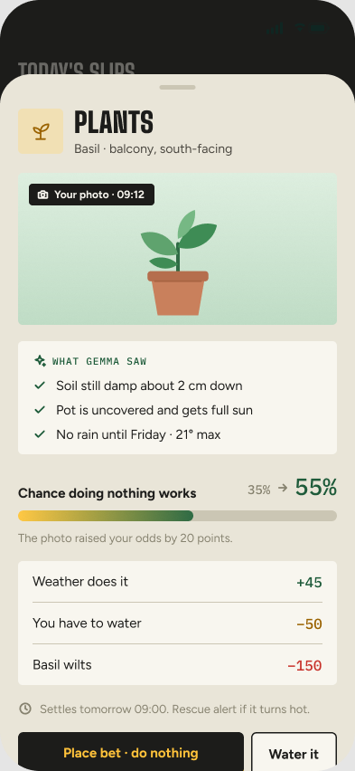
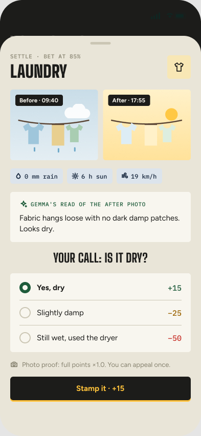

# Should I Bother?

**A local Gemma 4 bookmaker that bets on doing nothing.**

[](https://github.com/adricasi/ShouldIBother/actions/workflows/ci-node.yml)


"The Lazy Bookie" turns weather chores (watering balcony plants and line-drying in the core loop;
laundry overnight, the AC and the heater behind feature flags) into bets on doing nothing. **Gemma 4
E4B, running on your own laptop through Ollama, is the bookmaker and the judge:** it reads what you
type or say, looks at your photo, fetches the forecast itself with a function call, and quotes odds
as one of five bands (very likely to very unlikely). You bet that the weather will do the job, or you
do it yourself. When the bet comes due, the app fetches the recorded weather and asks for an after
photo or one tap, Gemma gives the verdict, and the points, the time, the water and the electricity you
saved are counted with their assumptions shown. Code only executes: Gemma decides, and your photos,
chores and habits never leave the laptop. It is an entry for the DEV Hacktoberfest Open-Source AI
Challenge, Week 3 "Slow and Steady" (Overall and Best Use of Gemma).

**No GPU? See it in two minutes:** `npm ci && npm run build && npm run sib -- demo` runs the whole app
on sample data with the fake model ([Quick start](#quick-start)). **How Gemma runs it, in depth:
[docs/gemma.md](docs/gemma.md).**

<!-- TODO(builder): after T-021 replace the mockups below with real screenshots of the running app
(staged or synthetic photos only, never a photo of the home) and drop the "design mockups" caption. -->

| Today | Bet slip | Settle |
|---|---|---|
|  |  |  |

*Design mockups from the Figma handoff (`docs/images/`), not screenshots of the running app.*

Contents: [How Gemma runs the app](#how-gemma-runs-the-app) · [What you see of Gemma](#what-you-see-of-gemma) ·
[Features](#features) · [Architecture](#architecture) · [Quick start](#quick-start) ·
[What you need](#what-you-need) · [Set up](#set-up) · [Phone access](#phone-access-over-wi-fi) ·
[Pair a phone](#pair-a-phone) · [Tailscale Serve](#optional-https-with-tailscale-serve) ·
[Voice](#optional-voice-capture-flag-voice) · [Run](#run) · [Configuration](#configuration) ·
[Feature flags](#feature-flags) · [Presentation](#presentation) · [Commands](#commands-sib) ·
[Privacy](#privacy-and-your-data) · [Testing](#testing) · [Project structure](#project-structure) ·
[Status](#status-and-roadmap) · [Contributing](#contributing) · [Licences](#licences) ·
[Acknowledgements](#acknowledgements) · [Spec and ADRs](#specification-and-decisions)

## How Gemma runs the app

Gemma is the protagonist. One model, **eight prompts for seven jobs** (the voice listener and the
appeal judge included), and one rule for the split of labour: **Gemma decides; code executes.** Gemma
makes every judgement; code fetches the weather, enforces limits, counts points and savings, applies
a fixed safety backstop and stores everything.

| Job | What Gemma does | Prompt |
|---|---|---|
| Listener | Splits a sentence into chores and classifies them | `prompts/listener.v1.md` |
| Listener (audio) | Writes down a voice note with Gemma 4 audio on llama.cpp (flag `voice`) | `prompts/listener-audio.v1.md` |
| Bookmaker | **Calls the `get_forecast` tool itself**, then picks an odds band, a reason and a settle time | `prompts/bookmaker.v1.md` |
| Inspector | Reads a photo of the plant or washing ("What Gemma saw") and sharpens the odds | `prompts/inspector.v1.md` |
| Safety guard | Says whether a chore touches safety, on top of the fixed backstop (flag `safetyGuard`) | `prompts/safety.v1.md` |
| Judge | Decides how a bet turned out, from the recorded weather and your photo or tap | `prompts/judge.v2.md` |
| Judge (appeal) | Looks again at a settled bet with a new photo (flag `appeals`) | `prompts/judge-appeal.v1.md` |
| Laundry planner | Scores the next four drying days: wash today, skip today or no good day (flag `laundryPlanner`) | `prompts/laundry-planner.v1.md` |

What keeps a 4B model honest:

- **Bands, never raw percentages.** Gemma picks one of five bands; code maps them to 85, 70, 50, 35 and
  15 %. Points, savings, settle-time bounds and safety are computed by code.
- **A rule baseline beside Gemma.** Plain code prices every card too and the rule band is stored on
  every bet. Gemma two or more bands away from it must explain or ask. The rule is the fallback when
  Gemma is offline, and it never settles a bet: **settlement is always a Gemma verdict**, and a bet
  waits while Gemma is away.
- **Tool use is enforced.** The bookmaker's only tool is a read-only `get_forecast`. An answer without
  a valid call is retried once, then the card keeps labelled rule odds.
- **Every job is checked.** A versioned prompt, a zod schema, code checks on the answer, one retry, a
  30 s timeout per model call and a 45 s deadline per job, one FIFO queue of at most 8 jobs. Typed
  text, photos and tool results are untrusted data.
- **Local.** Ollama and llama.cpp listen on 127.0.0.1 only; photos, chores, habits and audio never
  leave the laptop.
- **Measured, with N.** Score shows Gemma's calibration against the rule; `sib eval`, `sib backtest`
  (no lookahead, Sep-Oct hold-out) and a QLoRA fine-tune of the bookmaker measure it offline.

**Read more: [docs/gemma.md](docs/gemma.md)** (each job's input, schema, checks, fallbacks, decision
log and screen; the model-client boundary; settlement; safety; measurement; fine-tuning; what is
unverified) and **[docs/architecture.md](docs/architecture.md)** (components, data folder, security,
privacy boundaries).

## What you see of Gemma

Gemma is visible on every screen, not hidden behind the numbers:

- **Today** carries a one-line status, "Gemma 4 E4B · on this laptop" (or "(fake model)" or "Gemma is
  offline, rule odds only"), and each card says who set the odds: **"Gemma's odds"** or **"Rule odds"**.
- **The bet slip** shows Gemma's one-line reason with the numbers it used, the settle time and the
  payout for each outcome. When Gemma's band differs from the rule's, **both bands are shown side by
  side** (for example "Gemma: likely 70% · Rule: toss-up 50%"). Gemma's yes/no question appears as
  two buttons, and "Retry Gemma" appears when it did not answer.
- **"How Gemma decided"** opens under a slip, a waiting bet and a receipt: the model tag and short
  digest, the prompt version, whether Gemma called the forecast tool, the forecast hours it was
  given, retries and latency, read from the decision log. A fake-model decision says it is recorded
  test output, not Gemma.
- **"What Gemma saw"** lists what the inspector read in your photo and shows the odds before and
  after, for example 35% to 50%.
- **A "Do it now" alert** with Gemma's reason when the safety guard (or the fixed backstop) says the
  weather is not a bet.
- **"Gemma's read"** on the receipt: the judge's reason and the evidence it used, including the weather
  numbers. "Gemma has a question" and "Settle when Gemma is back" say what a bet waits for.
- **Score**, "How honest is Gemma?": Gemma's calibration chart beside the rule's, N per band ("too few
  to judge" under 5 bets), a headline such as "When Gemma says likely, doing nothing worked 74% (9
  bets); the rule's own likely calls: 61% (12 bets)", the lucky-win share and the judge overrule rate
  from appeals. Score needs the `score` flag and the overrule rate the `appeals` flag.

## Features

- **Capture in a sentence.** Type, tap a chip, or (flag `voice`) say your chores; Gemma finds each
  chore and makes one card per chore, and says "Not a weather chore" or "Coming later" when that is
  true.
- **Odds from the forecast, set by Gemma.** Five bands, a one-line reason with the numbers, a settle
  time, and the payout for each outcome; the rule baseline shows at once and is the fallback.
- **A photo sharpens the odds.** The inspector lists what it sees and the odds move.
- **Bet, do it, or undo.** Odds, band and payouts lock when you bet; Undo works for 5 minutes.
- **Settlement on evidence.** Recorded weather plus an after photo (full points) or one tap (half).
  If nobody answers within 24 hours Gemma settles from the weather record at half points.
- **Honest points and savings.** Win = (100 - odds) x multiplier, losses -25, -50 or -150, a PAID OUT
  receipt, and time, water and electricity saved with the assumption shown and 30 s of app time
  subtracted per bet. A slip shows what a win would save as an estimate.
- **Safety is never a bet.** A fixed heat, frost and storm backstop turns risky weather into a "Do it
  now" alert; with a flag a Gemma safety guard adds a judgement on top.
- **Private by design.** Everything runs on one laptop; the only outbound call is the weather lookup
  to Open-Meteo.
- **Behind flags (off by default):** laundry overnight, the AC and the heater, a Gemma laundry planner,
  rescue alerts and cash-out, appeals, onboarding, ranks and achievements, a split-flap weather board,
  voice capture and the fine-tuned bookmaker. See [Feature flags](#feature-flags).

## Architecture

One Node.js 24 process (Fastify) serves the React app and the JSON API, keeps everything in SQLite and
a photo folder outside the repository, and runs a 60 s scheduler. Gemma runs in Ollama on 127.0.0.1
(llama.cpp on 127.0.0.1 for voice only) behind one `ModelClient` interface with a fixture-backed fake
for tests. The phone pairs over home Wi-Fi with a one-time token. Overview, components, security and
privacy boundaries: [docs/architecture.md](docs/architecture.md); full design:
[docs/spec/design.md](docs/spec/design.md); decisions: [docs/adr/](docs/adr/).

## Quick start

### No GPU, no model: the sample-data demo (two minutes)

For a judge or a first look. The demo runs the whole app on a temporary folder of made-up bets with
the fake model and fake weather, and every screen says "Sample data". It never touches your own data
([Presentation](#presentation)).

```bash
git clone https://github.com/adricasi/ShouldIBother.git
cd ShouldIBother
nvm install            # reads .nvmrc (Node 24)
npm ci
npm run build
npm run sib -- demo    # prints a pairing link; open the "Laptop" link in a browser; Ctrl+C stops it
```

The demo starts on port 8788 (`--port N` changes it) and shows Gemma's surfaces on sample data: the
odds labels, "How Gemma decided", "Gemma's read" and the Score calibration. Those figures come from the
fake model's recorded fixtures, **not from Gemma**, and are never results.

### Develop on the fake model

```bash
SIB_FAKE_WEATHER=1 npm run dev   # builds the screens, starts with SIB_FAKE_MODEL=1, fake weather, no network
```

Open the "Laptop" pairing link the console prints, tap "Water plants", read the odds and place a bet;
it comes due at its settle time (the next morning for plants). Drop `SIB_FAKE_WEATHER=1` to use real
Open-Meteo weather. Details in [Development without a GPU](#development-without-a-gpu).

### The real thing: Gemma 4 on your laptop

1. [What you need](#what-you-need): Windows 11 + WSL2, an NVIDIA GPU with 8 GB or more, Node.js 24, Ollama.
2. [Set up](#set-up): clone, `npm ci`, `npm run build`, `ollama pull` the Gemma 4 models, name the tag in `config/models.json`.
3. [Phone access](#phone-access-over-wi-fi) and [Pair a phone](#pair-a-phone).
4. [Run](#run): `npm start`.

## What you need

| | |
|---|---|
| Laptop | Windows 11 with WSL2 (Ubuntu), an NVIDIA GPU with 8 GB VRAM or more and the WSL CUDA driver, 16 GB RAM or more, about 20 GB free disk for the models |
| Software | Node.js 24 (pinned in `.nvmrc`), [Ollama](https://ollama.com), git. Python 3.12 and [uv](https://docs.astral.sh/uv/) are needed only for `training/` |
| Phone | Current iOS Safari or Android Chrome, on the same Wi-Fi as the laptop |

Target: a fresh clone to a running app in 30 minutes, not counting the model download (NFR-011).
Without a GPU you can still try the whole app on recorded fixtures, see [Run](#run).

## Set up

All commands run inside WSL2 (Ubuntu).

### 1. Clone, install, build

```bash
git clone https://github.com/adricasi/ShouldIBother.git
cd ShouldIBother
nvm install            # reads .nvmrc (Node 24); install nvm first if you have none, any Node 24 works
npm ci                 # install from the lockfile
npm run build          # compiles the server to dist/ and builds the app screens to dist/web
```

If `npm ci` fails while building `better-sqlite3` or `sharp` (they normally download prebuilt
binaries), install the build tools with `sudo apt install build-essential python3` and retry.

### 2. Install Ollama and pull Gemma 4

Check that WSL sees the GPU (`nvidia-smi`), then install Ollama in WSL following
<https://ollama.com/download> (on Linux this is the official install script, which starts the
`ollama` service; if your WSL has no systemd, run `ollama serve` in a second terminal).

**Leave `OLLAMA_HOST` unset.** Ollama then listens on 127.0.0.1:11434 only, which is what the app
requires; `config/models.json` rejects any other address.

Pull the two models the project uses:

```bash
ollama pull TODO(builder): exact E4B tag     # the model the app runs on (primary)
ollama pull TODO(builder): exact E2B tag     # the smaller model, used only for the backtest comparison
ollama list                                  # note the ID column: it starts with the model digest
```

| Model | Ollama tag | Quantization | Digest |
|---|---|---|---|
| Gemma 4 E4B | `TODO(builder): tag from T-010` | `TODO(builder)` | `TODO(builder): sha256 from T-010` |
| Gemma 4 E2B | `TODO(builder): tag from T-010` | `TODO(builder)` | `TODO(builder): sha256 from T-010` |

Tell the app which tag to use in `config/models.json`. The file is committed; `primary` names the
entry in `models` that the app runs on, and `sib start` refuses to start if that entry has no tag:

```json
{
  "primary": "e4b",
  "models": {
    "e4b": { "tag": "<tag from ollama list>", "quantization": "<q>", "digest": "<sha256>" },
    "e2b": { "tag": "<tag from ollama list>", "quantization": "<q>", "digest": "<sha256>" }
  }
}
```

The optional `models.e4b-ft` entry (same shape as `e4b`) names the fine-tuned bookmaker for the
`finetunedBookmaker` flag. The `ollama`, `llamaCpp` (voice only, below), `gemma.toolUse` and `gemma.answerMode` keys in the
same file already have working defaults. The digest is the reference for anyone comparing results; the backtest refuses to run if
the pulled model's digest differs from the configured one. There is no script that pulls or
verifies the models yet: compare `ollama list` with the table above by hand.

<!-- TODO(builder): after T-010 commit the real tags, quantizations and digests in
config/models.json so a stranger only has to run the two `ollama pull` commands, then fill the
table above and delete the placeholders. Say here whether the fine-tuned adapter (Q-11) is
published and where. -->

### 3. Optional config files

Both are git-ignored (they name your machine or your home); the committed `*.example.json` files
are the fallback, so the app starts without them.

```bash
cp config/server.example.json config/server.json       # ports, extra hosts and origins (below)
cp config/household.example.json config/household.json # your dryer, AC and heater, and the neighbourhood coordinates
```

`config/household.json` sets the baseline behind the savings figures and the location the weather
is fetched for. Coordinates are rounded to 2 decimals (about 1 km) before every request. The
example uses Gràcia, Barcelona: change `location` to yours.

`config/server.json`:

| Key | Meaning |
|---|---|
| `port` | Port of the app, default 8787. `SIB_PORT` overrides it, and `sib pair` reads the same value |
| `allowedHosts` | Extra `Host` header values the server accepts, for example the Windows LAN IP behind a `netsh` port proxy. Any other host gets 421 (this blocks DNS rebinding) |
| `publicOrigins` | HTTPS origins that reach the app, for example `https://<machine>.<tailnet>.ts.net` for Tailscale Serve. They are added to the Origin and Host checks |

The server already allows `localhost`, `127.0.0.1` and the addresses of the active network
interfaces, and prints its allowlist at start.

## Phone access over Wi-Fi

The app listens on 127.0.0.1 and on the laptop's private LAN address only (`SIB_LAN_ADDRESS`
overrides the address; it must be a private or loopback address). Ollama stays on 127.0.0.1 and is
never exposed. WSL2 sits behind NAT by default, so the phone cannot reach it until you do one of
the following. Mirrored networking is the simpler one.

### Option A: WSL mirrored networking (recommended)

1. In Windows, create or edit `%UserProfile%\.wslconfig`:

   ```ini
   [wsl2]
   networkingMode=mirrored
   ```

2. In PowerShell: `wsl --shutdown`, then open WSL again. WSL now shares the Windows network
   addresses, so the app is reachable on the laptop's Wi-Fi IP.
3. Allow the app port through the Windows firewall, **Private profile only**. In PowerShell as
   administrator (change 8787 if you changed the port):

   ```powershell
   New-NetFirewallRule -DisplayName "Should I Bother (app)" -Direction Inbound -Protocol TCP -LocalPort 8787 -Action Allow -Profile Private
   ```

   Mirrored mode also has a Hyper-V firewall for WSL. If the phone still cannot connect, allow the
   port there too (Microsoft's documented WSL creator id):

   ```powershell
   New-NetFirewallHyperVRule -Name "SIB8787" -DisplayName "Should I Bother (app)" -Direction Inbound -VMCreatorId "{40E0AC32-46A5-438A-A0B2-2B479E8F2E90}" -Protocol TCP -LocalPorts 8787
   ```

   <!-- TODO(builder): confirm the two firewall commands on your laptop and note which one was
   needed. Make sure your Wi-Fi network is set to the Private profile in Windows. -->

4. Do **not** add a rule for port 11434. Check from WSL that only the app is exposed:

   ```bash
   ss -ltnp | grep -E ':(8787|11434)\b'    # 11434 must show 127.0.0.1, never 0.0.0.0 or *
   ```

### Option B: `netsh` port proxy (no mirrored mode)

Forward the Windows LAN port to the WSL address and list the Windows IP in `allowedHosts`
(`config/server.json`), because the `Host` header is the Windows address. Run in PowerShell as
administrator:

```powershell
$wsl = (wsl hostname -I).Trim().Split(" ")[0]
netsh interface portproxy add v4tov4 listenaddress=0.0.0.0 listenport=8787 connectaddress=$wsl connectport=8787
New-NetFirewallRule -DisplayName "Should I Bother (app)" -Direction Inbound -Protocol TCP -LocalPort 8787 -Action Allow -Profile Private
```

The WSL address changes at every WSL restart, so repeat the `portproxy` line then. Behind a port
proxy every client shares one address, see the rate-limit note below.

## Pair a phone

`npm start` (or `npm run dev`) prints the Host allowlist, a pairing link and a QR code to the
console (stderr). The link is valid for 10 minutes and for at most 3 devices. Scan the QR code with
the phone camera (or type the link): the app sets a 30-day cookie and opens the app. The pairing
token and the session ids are stored only as hashes and never logged.

```bash
npm run sib -- pair            # print a new link; older unused links stop working, devices stay signed in
npm run sib -- forget-devices  # sign every device out and cancel pending links
```

`npm start > app.log` is safe: the console output (allowlist, links, pairing lines) goes to stderr
and the JSON logs go to stdout.

### Security notes

- **Plain HTTP on the LAN has a known limit.** Someone already on your Wi-Fi can sniff the session
  cookie. Everyone else gets 401 on every route. For HTTPS use Tailscale Serve (next section,
  ADR-0007); sessions paired through an HTTPS origin get a `Secure`, `__Host-` cookie.
- Cookies are not isolated by port: another app on the same host name (for example another dev
  server on `localhost`) receives the session cookie. Do not run untrusted software on the laptop.
- The rate limit is per client address: more than 10 failed requests a minute blocks requests
  without a session for a minute. Behind Tailscale Serve or a `netsh` port proxy all clients share
  one address, so one bad client locks out everyone without a session. Paired devices are never
  affected. This is accepted for a one-household app.

## Optional: HTTPS with Tailscale Serve

Tailscale Serve gives the app an HTTPS address that only your tailnet can reach, with no
certificates to manage. Install Tailscale (on Windows or in WSL) and sign in, then, on the machine
where Tailscale runs, serve the app's port:

```bash
tailscale serve --bg 8787
tailscale serve status        # shows https://<machine>.<tailnet>.ts.net
```

Add that origin to `config/server.json` and restart the app:

```json
{ "port": 8787, "publicOrigins": ["https://<machine>.<tailnet>.ts.net"], "allowedHosts": [] }
```

Then pair the phone from a link that starts with that origin (`sib pair` prints one for every
origin). <!-- TODO(builder): confirm the `tailscale serve` syntax for your Tailscale version and
whether Serve in Windows reaches the WSL app on 127.0.0.1 in mirrored mode. -->

**Without Tailscale the app runs on plain HTTP**, and browsers expose only HTTP-safe features. The
photo buttons use the phone's own file picker and camera app, which work over HTTP. Features that
need a secure context do not: the microphone for voice capture (flag `voice`, off) is hidden over
plain HTTP, and the app uses neither geolocation nor a live in-browser camera. Location is typed
in `config/household.json` (or in onboarding) instead.

## Optional: voice capture (flag `voice`)

Say your chores instead of typing them (REQ-027). The phone records a short note (at most 20 s),
the laptop sends it to **Gemma 4 audio on a second local server, llama.cpp** (Ollama's Gemma
audio is unreliable on NVIDIA, ADR-0004), shows the transcript with the weather chores
highlighted, and makes the cards only when you tap "See odds for N chores". The audio goes only
to `127.0.0.1`, is held in memory for the request and is never written to disk, logged or put in
git. The decision log keeps the voice note's length, size and a hash, and not the transcript; the
listener that reads the transcript still stores the chore labels it finds, as it does for typed
capture. Set `NO_PROXY=127.0.0.1,localhost,::1` if you run Node with `NODE_USE_ENV_PROXY=1` and a
proxy: the app refuses to start its model clients otherwise, so nothing local goes through a proxy.

The flag is off by default; with it off there is no mic button, no route and no mention of voice
in the privacy line. It needs two things on top of the normal setup:

1. **A llama.cpp server on 127.0.0.1 with the Gemma 4 audio model.** Start it by hand next to the
   app (bind to loopback; never `--host 0.0.0.0`):

   ```bash
   # TODO(builder): exact model file, projector and flags are UNVERIFIED. Shape of the command:
   llama-server -m <gemma-4-e4b gguf> --mmproj <audio projector gguf> --host 127.0.0.1 --port 8080
   ```

   `config/models.json` `llamaCpp.baseUrl` (default `http://127.0.0.1:8080`) says where to find it;
   any host other than `127.0.0.1` or `[::1]` is an error at start. The server may start after the
   app: the mic then says "Voice is offline" until it answers. The request format the app speaks
   is **unverified** until you run it against your server: it is all in
   `src/server/model/llamacpp-wire.ts` (`TODO(builder): verify against llama.cpp server docs`).
   Memory: Ollama's E4B and llama.cpp's audio model are two copies on one GPU. To keep Ollama's
   models resident, start Ollama with `OLLAMA_MAX_LOADED_MODELS=2` (or more) and keep
   `ollama.keepAlive` long (default `24h`); llama.cpp keeps its model loaded while it runs. If
   the GPU runs out of VRAM, unload one (`ollama stop`) and expect the other to be reloaded on use.
   TODO(builder): measure a voice note end to end with both loaded; each of its two jobs has its
   own 45 s deadline from enqueue. Fallback stated in the post, not built: whisper.cpp for the
   transcript, with the same listener after it.
2. **HTTPS for the phone.** Browsers give the microphone only to secure pages, so over plain HTTP
   on the Wi-Fi the mic button is hidden and typed capture is all there is. Use
   [Tailscale Serve](#optional-https-with-tailscale-serve) and open the app from its `https://`
   origin.

## Run

```bash
npm start                    # node dist/cli.js start: serves the app and API, runs the 60 s scheduler
```

Run `npm run build` first. The app talks to Gemma through Ollama on 127.0.0.1. If Ollama is down
the app still starts: Today shows "Gemma offline" with rule odds and a Retry button, and
settlements wait until Gemma is back (the rule never settles a bet).

On the phone: tap the "Water plants" or "Line-dry today" chip (or type a sentence), read the odds,
tap "Bet: do nothing". At the settle time (the scheduler checks every 60 s) the bet appears under
"Settle now" with one-tap answers and an after-photo option.

### Development without a GPU

```bash
npm run dev                  # builds the screens, starts with SIB_FAKE_MODEL=1 and restarts on code changes
SIB_FAKE_WEATHER=1 npm run dev   # also no network: fake weather
```

| Variable | Effect |
|---|---|
| `SIB_FAKE_MODEL=1` | The recorded-fixture model (`test/fixtures/gemma/`) instead of Ollama. A banner says so and Today shows "(fake model)". Never use it for real bets. `npm run dev` sets it |
| `SIB_FAKE_WEATHER=1` | Fake weather, no Open-Meteo call. For development and tests |
| `SIB_DATA_DIR` | Data folder, default `~/.should-i-bother/` |
| `SIB_PORT` | Port, else `port` in `config/server.json`, else 8787 |
| `SIB_LAN_ADDRESS` | The LAN address to listen on (private or loopback only) |

After editing a screen, run `npm run build:web` and reload (or restart `npm run dev`; each restart
prints a new pairing link).

## Configuration

A few files in `config/` and some environment variables. The app starts without the git-ignored ones
(the committed `*.example.json` files are the fallback).

| File | Committed | What it holds |
|---|---|---|
| `config/models.json` | yes | Which Gemma model the app runs on, runtime addresses, tool-use and answer modes |
| `config/flags.json` | yes (all off) | Feature flags ([below](#feature-flags)); change them with `sib flags` ([Presentation](#presentation)) |
| `config/flags.presets.json` | yes | Named lists of flags to turn on together; `presentation` is the preset `sib flags` and `sib demo` use |
| `config/server.json` | no (git-ignored) | Port, extra hosts and origins ([Set up, step 3](#3-optional-config-files)) |
| `config/household.json` | no (git-ignored) | Your dryer, AC, heater and neighbourhood coordinates ([step 3](#3-optional-config-files)) |
| `config/rules.json`, `config/savings.json` | yes | Rule and safety thresholds (final for this version, not tuned) and the savings catalogue |

### `config/models.json`

| Key | Meaning | Default |
|---|---|---|
| `primary` | Key in `models` of the model the app runs on | `"e4b"` |
| `models.<key>` | `{ "tag", "quantization", "digest" }` for `e4b`, `e2b` (backtest comparison) and the optional `e4b-ft` (fine-tuned bookmaker) | none: `sib start` refuses to start without `models.<primary>.tag` unless `SIB_FAKE_MODEL=1` |
| `ollama.baseUrl` | Where Ollama listens; only `127.0.0.1` or `[::1]` is accepted | `http://127.0.0.1:11434` |
| `ollama.keepAlive` | How long Ollama keeps the model loaded | `24h` |
| `ollama.temperature` | Sampling temperature | `0` |
| `llamaCpp.baseUrl`, `llamaCpp.model` | The llama.cpp server for voice (flag `voice`); loopback only; `model` is only a label for the decision log | `http://127.0.0.1:8080`, `gemma4-audio` |
| `gemma.toolUse` | `native` (Gemma calls `get_forecast`) or `injected` (the app fetches the forecast and hands it over; the fallback if tool calling fails on the runtime) | `native` |
| `gemma.answerMode` | `single_call` (tool and schema together) or `two_step` (tool first, schema with the answer) | `single_call` |

The step-by-step is under [Set up](#2-install-ollama-and-pull-gemma-4). What each setting does to the
jobs: [docs/gemma.md, section 8](docs/gemma.md#8-the-modelclient-boundary).

### Environment variables

The table is under [Development without a GPU](#development-without-a-gpu): `SIB_FAKE_MODEL`,
`SIB_FAKE_WEATHER`, `SIB_DATA_DIR`, `SIB_PORT`, `SIB_LAN_ADDRESS`. If you run Node with
`NODE_USE_ENV_PROXY=1` and a proxy, set `NO_PROXY=127.0.0.1,localhost,::1`: the app refuses to start
its model clients otherwise, so nothing local goes through a proxy.

## Feature flags

`config/flags.json` switches unfinished or optional features on. **Every flag is off by default**,
and a flag that is off shows no UI entry point and registers no route (REQ-029). Only the builder
turns a flag on, after merging and checking the feature. Unknown flag names are an error.

| Flag | Default | What it does when on |
|---|---|---|
| `finetunedBookmaker` | off | The bookmaker job uses the fine-tuned E4B at `models.e4b-ft` in `config/models.json` (the same key `sib backtest` uses); the listener, inspector, judge and the other jobs stay on the primary model. With no `e4b-ft` entry nothing changes and the start notice says so. Each decision and each bet records the model that priced it. The warm-up at start loads both models, one after the other, with `ollama.keepAlive`. Two E4B models may not both fit in 8 GB of VRAM; to keep both resident start Ollama with `OLLAMA_MAX_LOADED_MODELS=2` (or more) and keep `ollama.keepAlive` long, otherwise Ollama swaps them between jobs. TODO(builder): measure the 45 s job deadline with both loaded (a swap counts against it), and state here whether the adapter ships. A fine-tuned model that is not pulled shows as a warning under "Gemma is online" on Today (cards use rule odds) and as one log line |
| `safetyGuard` | off | Gemma safety guard on every card; an alert withdraws open bets on the card (the fixed heat/frost/storm backstop works without it) |
| `laundryTonight` | off | The "laundry tonight" chore, offered from one hour before sunset to two hours after |
| `score` | off | The Score screen: points, savings, judge overrule rate and Gemma-vs-rule calibration with N |
| `stampAnimation` | off | The PAID OUT stamp animation on wins (fades instead of moving with reduced motion) |
| `laundryPlanner` | off | Gemma plans laundry over the next days and you can bet on "Skip today" |
| `rescue` | off | Rescue alerts when the forecast changes, and cash-out of an open bet |
| `appeals` | off | Appeal a verdict with a photo |
| `onboarding` | off | Onboarding card and screen: your dryer, AC, heater and location |
| `ranks` | off | Ranks and achievements; shown on Score, so it needs `score` on |
| `heater` | off | The heater bet and the AC chore |
| `splitFlap` | off | The split-flap weather board on Today |
| `voice` | off | Voice capture through Gemma 4 audio on llama.cpp: the "Say your chores" button on Today, shown only on HTTPS (see [voice capture](#optional-voice-capture-flag-voice)). TODO(builder): the llama.cpp wire format is unverified until a live voice note works |

## Presentation

For a rehearsal or the final demo, turn on every feature that is merged and checked with one command
(AC-029.3):

```bash
npm run sib -- flags                       # list the flags and their state
npm run sib -- flags preset presentation   # every flag on except voice and finetunedBookmaker
npm run sib -- flags on voice              # a single flag (also: off <flag>...)
```

The preset is the explicit list of flag names in `config/flags.presets.json`, which you edit. The
`presentation` list leaves out `voice` and `finetunedBookmaker`, so they stay as they are unless
you name them (`flags preset presentation voice`), because both need checks on the laptop first.
Unknown flag names (on the command line or in the presets file) are refused and nothing is
written. `sib demo` uses the same preset in memory. The file is replaced atomically and the
committed defaults stay off: do not commit your local `config/flags.json`. A running app reads the
flags at start, so **restart the app to apply** a change.

### Sample-data demo (`sib demo`)

For rehearsals and screenshots without touching your own data:

```bash
npm run build
npm run sib -- demo [--port 8788]   # prints a pairing link; Ctrl+C stops it
```

It makes a temporary data folder, fills it through the app's own code with about two weeks of
made-up bets (plants, line-dry, laundry tonight, AC and heater; photo, tap and automatic
settlements, wins and losses, a cash-out, appeals, achievements and a rank above Hyperactive
squirrel), and starts the app on it with the fake model, fake weather, a fixed date (Friday 23
October 2026, 10:00) and the `presentation` preset applied in memory. Every screen shows a
"Sample data — not real results" banner, Score is watermarked SAMPLE and labelled "Sample data ·
fake model", the rows carry `model_version = fake-demo` (Score counts them only in demo mode) and
`sib export` refuses its data folder. It never opens `~/.should-i-bother` or `SIB_DATA_DIR`,
`config/household.json` or `config/server.json`, and never writes `config/flags.json`; the
temporary folder is deleted on Ctrl+C or SIGTERM. Its numbers are never results.

Laptop checks before you turn on the two excluded flags:

- `voice` (T-028): a llama.cpp server with the Gemma 4 audio model and its projector runs on
  127.0.0.1 and answers (`llamaCpp.baseUrl` in `config/models.json`), and the phone opens the app
  from an `https://` origin ([Tailscale Serve](#optional-https-with-tailscale-serve)), because the
  microphone needs a secure page. Record one voice note end to end first; the wire format is
  unverified until one works.
- `finetunedBookmaker` (T-012, T-014): the QLoRA adapter is trained and loaded into Ollama, the
  `models.e4b-ft` entry in `config/models.json` names it and `ollama list` shows it, and the
  hold-out result on Sep-Oct is in hand (`sib backtest`, `sib eval bookmaker`). With the entry
  missing nothing changes and the start notice says so.

## Commands (`sib`)

`sib` is the built binary (`node dist/cli.js`, or `npm link` to get `sib` on your PATH). In
development run the same commands through npm: `npm run sib -- <command>`.

| Command | What it does |
|---|---|
| `sib start` | Start the server (what `npm start` runs) |
| `sib pair` | Print a new pairing link and QR code |
| `sib forget-devices` | Sign out every device and cancel pending links |
| `sib export <dir>` | Write `export.json` (bets, decisions, verdicts, totals, onboarding profile, achievements) and the photos to a new, empty folder |
| `sib delete-photos [--all-data]` | Asks first; removes every photo and what Gemma read from it. With `--all-data` it also removes the database and its WAL files |
| `sib flags [list\|on\|off\|preset]` | List the feature flags, or turn them on or off in `config/flags.json`; `flags preset presentation` is described under [Presentation](#presentation) |
| `sib demo [--port N]` | Run the app on a temporary, seeded sample-data folder with the fake model and weather (see [Presentation](#presentation)); stops and deletes it on Ctrl+C |
| `sib backtest [options]` | Replays the weather snapshot with the rule, a fixed routine, E2B and E4B (and the fine-tuned model) and writes a report; resumable, `--help` lists the options |
| `sib snapshot [options]` | Downloads the Open-Meteo snapshot (Previous Runs, Historical Forecast, archive) for the backtest and the fine-tune into the data folder. Details below |
| `sib dataset [options]` | Builds `train.jsonl`, `holdout.jsonl` and `manifest.json` for the fine-tune from the snapshot, offline. Details below |
| `sib eval <job> [options]` | Runs the 20-case staged set of one Gemma job (`listener`, `bookmaker`, `inspector`, `judge`, `safety`, `laundry-planner`) through the real job on the configured model and reports valid JSON out of 20, tool use, model calls and latency (p50/p95/max) with the model digest and prompt version. Exit 0 when the target is met (19 of 20), 3 when missed, 2 when Gemma is unreachable. Details below |

### Evaluating Gemma (`sib eval`)

The sets are in `evals/<job>/cases.json`: synthetic text and synthetic weather, no household data.
The command checks the target of NFR-004: at least 19 of 20 schema-valid answers per job, the
bookmaker calling `get_forecast`, and the photo flow (the inspector, then the bookmaker when the inspector
saw enough; a question from the inspector ends it) valid and within 15 s in 19 of 20 cases. With `SIB_FAKE_MODEL=1` it runs on the fixtures, which only proves the
pipeline (the report says so).

```bash
npm run sib -- eval listener                 # also bookmaker, safety, laundry-planner and judge (taps)
npm run sib -- eval inspector --photos ~/eval-photos
npm run sib -- eval judge --cases evals/judge/photo-cases.json --photos ~/eval-photos
npm run sib -- eval bookmaker --out ~/sib-evals/bookmaker-1 --record-fixtures ~/sib-evals/fixtures
```

- It prints a table (valid, answer, tool use, model calls, retries, job time per case) and a summary,
  then writes `report.json` and `report.md` to `--out` (default `<data folder>/evals/<job>-<date>/`).
  A folder inside the repository is refused unless git ignores it, and an earlier report is never
  overwritten. Exit codes: 0 target met, 1 bad input, 2 Gemma unreachable, 3 target missed.
- The photo sets name the files to stage in the `--photos` folder; each case says what to photograph,
  and photos are never committed: `inspector-01-plants-dry-soil.jpg` to `inspector-20-sign-in-photo.jpg`,
  and `judge-NN-before-<what>.jpg` / `judge-NN-after-<what>.jpg` (see `evals/judge/photo-cases.json`).
  They go through the app's own photo pipeline first (at most 1024 px, no metadata).
- `--record-fixtures <dir>` also writes the model's raw answers as `<dir>/<job>/<case>.json`, in the
  format of `test/fixtures/gemma/` but under the fake's own model name. They are candidates: read each
  one, then copy the good ones into `test/fixtures/gemma/` yourself. The command never overwrites a
  file and never writes into that folder.

`export` and `delete-photos` refuse to run while the app is running (stop it first). They touch only
the files the app owns in the data folder (`sib.db` and its `-wal`/`-shm` files, and the photos);
`config/household.json` is never touched. `export` refuses a folder that is not empty, is a
symlink, or is inside a git working tree that git would not ignore.

### Building the fine-tune dataset (`sib snapshot`, `sib dataset`)
The fine-tune dataset (REQ-019) is built in two steps. The first needs the network (Open-Meteo);
the second runs offline on the saved snapshot.
```bash
npm run sib -- snapshot   # Open-Meteo -> ~/.should-i-bother/data-snapshots/gracia-barcelona_<start>_<end>/
npm run sib -- dataset    # snapshot -> ~/.should-i-bother/datasets/<same name>/{train.jsonl,holdout.jsonl,manifest.json}
```
- `snapshot` fetches 1 Apr 2026 to yesterday for Gràcia (`--start`, `--end`, `--out` change that);
  the end date in the folder name is the archive's last complete day, which is where the hold-out
  ends. Both commands refuse a folder inside a git working tree unless git ignores it.
- `dataset` builds with the prompt the app runs (`BOOKMAKER_PROMPT`, today `bookmaker.v1`). When
  T-010 freezes a later `prompts/bookmaker.vN.md`, run `sib dataset --prompt-version N` (or raise
  the version in `src/server/gemma/bookmaker.ts`); the manifest records the version and its hash.
- Habits: every row carries the fixed synthetic profile in `training/habits.synthetic.json`, while
  the live app sends `habits: {}` until onboarding feeds the bookmaker (the manifest says so under
  `habits`). T-014 also evaluates the fine-tuned model with habits `{}`. `--habits <file>` replaces
  the profile, but a file in the data folder or named `household.json` is refused.
- The build stops, and writes nothing, if a value from `config/household.json` appears in a row or
  the manifest (AC-019.8): strings as whole words, and decimal numbers as written or rounded to
  2-4 decimals (1 from 10 up), with `.` or `,`. The onboarding profile in the database is not
  checked: this command never opens the database. The same inputs give the same bytes.
- `sib backtest` now shows the same synthetic habits by default. A run started with the old
  default (no habits) refuses to resume; `--habits <file containing {}>` reproduces the old
  behaviour, `--restart` starts over.
- Each line of `train.jsonl` is `{id, split, chore, date, messages, tools, meta}`: `messages` is the
  conversation the live bookmaker has (system prompt, data message, the `get_forecast` call with
  `hours_ahead: 24`, which the trained model must emit, and its result) plus the answer as the last `assistant` message; `tools` is the tool definition; `meta`
  holds the rule band and the target (training only). `holdout.jsonl` has the same rows without the
  answer and the target, ending at the tool result, and `meta.outcome_delivered` is the label for
  the evaluation. Training rows never show an hour of 1 Sep or later; rows whose forecast needed a
  Historical Forecast or archive value, and days with a safety alert, are left out and counted in
  `manifest.json`. Training uses `messages` and `tools` only; `meta` is for audit and evaluation.
- Before `ollama stop` and T-012, check `manifest.json`: prompt version, rules hash, snapshot end
  date, rows per chore and band, skips.

The snapshot queries are written against the Open-Meteo documentation and have not been run
against the live API (`src/backtest/open-meteo.ts` lists what to verify): if `snapshot` fails, its
one-line error names the URL's status and reason.

## Weather data and attribution

Odds come from the Open-Meteo forecast for the coordinates in `config/household.json`. At the
settle time the app fetches the recorded weather of the bet's window, labelled "modelled recent
weather". The weather client calls only the five Open-Meteo hosts of its allowlist
(`api.open-meteo.com`, `previous-runs-api.open-meteo.com`, `historical-forecast-api.open-meteo.com`,
`archive-api.open-meteo.com`, and `geocoding-api.open-meteo.com` for the onboarding place search),
counts its calls (budget 1,000 a day) and refuses any other host.
The free Open-Meteo tier is for non-commercial use. The app shows this attribution in the footer of
Today:

> Weather data by Open-Meteo.com (https://open-meteo.com/), licensed CC BY 4.0.

## Privacy and your data

- Photos, chore text, habits and audio stay on the laptop, in the data folder
  `~/.should-i-bother/` (`SIB_DATA_DIR` to change it). It lives outside the repository and is kept
  owner-only (folder 0700, database 0600). The app refuses to start with a data folder that git
  could commit, and `sib export` refuses such a target too.
- Photos are re-encoded without metadata (no EXIF or GPS) and resized to 1024 px at most.
- Gemma runs in Ollama on 127.0.0.1 (and, with the `voice` flag, llama.cpp on 127.0.0.1 for voice
  notes, held in memory only). No cloud model, no analytics, no telemetry.
- **The only outbound call at runtime is to Open-Meteo**, with coordinates rounded to 2 decimals.
  The one piece of text that also goes there is the place you type into the onboarding search, only
  when you press Search (the laptop sends it, never the page; it is not logged, cached or stored).
  Downloads during setup (the Ollama registry for the models, npm for packages) are the only other
  traffic. `docs/release-checklist.md` has the network-capture check.
- Logs go to the terminal; no log file is kept. Tokens, cookies and photo bytes are redacted.
- Export your data with `sib export <dir>` (keep that folder out of the repository), delete the
  photos with `sib delete-photos`, and delete everything with `sib delete-photos --all-data`.
  Deleting a photo or a bet in the app removes its files and every record derived from it.
- `config/household.json` and `config/server.json` are git-ignored. Never commit photos, the
  database or an export; gitleaks runs in pre-commit and CI.

## Testing

```bash
npm test                          # unit, integration and component tests (fake model, fake weather; no GPU, no network)
npm test -- --coverage            # with v8 coverage
npm run lint && npm run typecheck
npm run build && npm run test:e2e # Playwright journey at phone width: capture, bet, settle (builds the screens first)
npm audit --audit-level=high      # dependency vulnerabilities
(cd training && uv sync && uv run ruff check . && uv run pytest)   # the Python fine-tune tooling
```

Playwright needs a browser once: `npx playwright install chromium` (on WSL add
`--with-deps`). The e2e suite is not part of CI yet. Tests and CI never touch a real model,
the network or household data.

The fine-tune lives in `training/` (Python 3.12, uv, ruff, pytest) and runs on the builder's GPU
only. Stop Ollama (`ollama stop`) before training: one GPU user at a time. The scripts (config,
dataset loading, QLoRA training, merge and GGUF export, a hold-out smoke test) and the builder's
step-by-step list are in [training/README.md](training/README.md); CI runs ruff and pytest there
with no GPU and no model.

## Project structure

```text
src/
  server/      Fastify app, pairing and session guard, ledger (cards, bets, settlement), scheduler, weather client, photos, voice
    gemma/     the Gemma jobs and the job runner (queue, retry, deadlines)
    model/     ModelClient: Ollama, llama.cpp (audio), fixture-backed fake; loopback and proxy guards
    migrations/ numbered SQLite migrations
  domain/      pure code: rule baseline, safety backstop, bands, points, savings, outcome labels, calibration
  web/         the React app (Today, Slips, Score, Onboarding)
  backtest/    sib snapshot, sib dataset, sib backtest
  eval/        sib eval
  demo/        sib demo (seeded sample data)
  cli.ts       the sib command
prompts/       versioned Gemma prompts, <job>.v<n>.md
config/        models, flags and presets, rules, savings, server and household settings
evals/         the 20-case sets for sib eval
test/          Vitest tests; test/fixtures/gemma/ holds the synthetic fixtures of the fake model
e2e/           the Playwright journey
training/      the Python (uv) QLoRA fine-tune scripts, configs and tests; see training/README.md
docs/          spec/ (product, requirements, design, tasks), adr/, gemma.md, architecture.md, images/, post/
```

## Status and roadmap

Honest state at the time of writing (details in [docs/spec/tasks.md](docs/spec/tasks.md)):

- **Built and tested on the fake model and fake weather:** capture, odds, the photo flow, bets,
  settlement, points, savings, Score, the Gemma surfaces, the flagged features, the job runner, the
  model clients, `sib eval`, `sib snapshot`, `sib dataset`, `sib backtest`, `sib flags` and
  `sib demo`. CI runs without a GPU, a model or a network.
- **Written, never run on the real stack, so UNVERIFIED** (these need the builder's laptop): the Ollama
  wire format, the llama.cpp wire format for voice, the Open-Meteo query and host names, the training
  scripts' dependency pins, base model id, chat template and llama.cpp GGUF conversion for Gemma 4
  (each is listed in [training/README.md](training/README.md)), the real-model valid-JSON rate and
  latency (`sib eval`), the photo-judgement time, the live week of bets, and the network capture.
  `config/models.json` has no model tags pinned yet.
- **The fine-tune:** the QLoRA scripts exist (`training/`: config, dataset loading, training, merge and
  GGUF export, a hold-out smoke test) with dry runs and tests that need no GPU. The real snapshot,
  dataset and training run are the builder's (T-031, T-012), followed by the base-vs-fine-tuned
  evaluation (T-014). No adapter has been trained, so no fine-tune result exists.
- **Not done yet:** the live backtest run (T-019), photo evaluation on real Gemma (T-030), release
  readiness and the post assets (T-020, T-021).
- **No real-model results are published in this repository yet.** Results will be written to
  `docs/results/` and quoted with their N; losses are reported with wins. The sample-data demo is
  never a result.
- Feature freeze Saturday 24 October 2026, 14:00 Madrid; publish by 23:00 the same day.

## Contributing

This is a spec-driven project: [docs/spec/](docs/spec/) is the source of truth, and the code follows
it. To propose a change that contradicts the spec, change the spec first.

- Work on a branch, never on `main`; Conventional Commits (`type(scope): summary`) that reference the
  requirement or task IDs; one concern per pull request.
- Run the checks from [Testing](#testing) before you push; CI must stay green. Tests and CI use the
  fake model and fake weather only.
- Record significant decisions as ADRs in [docs/adr/](docs/adr/). A prompt change bumps the prompt
  version and re-records its fixtures; the rule and safety thresholds are final for this version.
- Never commit photos, the database, an export or `config/household.json`; gitleaks runs in pre-commit
  and CI.

<!-- TODO(builder): say whether outside issues and pull requests are welcome, and when (before or after
the challenge judging). -->

## Licences

- This app: MIT, see [LICENSE](LICENSE).
- Gemma 4: Apache 2.0 (the model is downloaded from Ollama, not shipped in this repository).
  TODO(builder): check the licence text on the Gemma 4 model card matches before publishing.
- Weather data: [Open-Meteo](https://open-meteo.com/), CC BY 4.0, free tier for non-commercial use.
- Fonts: Big Shoulders Display, IBM Plex Mono and Figtree, SIL Open Font License 1.1, served by the
  app itself (no font CDN).
- Icons: [Lucide](https://lucide.dev), ISC.
- [THIRD-PARTY.md](THIRD-PARTY.md) lists the assets bundled in the web app; everything else is an
  npm dependency pinned in `package-lock.json` (Python: `training/uv.lock`).

## Acknowledgements

- **Weather data by [Open-Meteo.com](https://open-meteo.com/), licensed under
  [CC BY 4.0](https://creativecommons.org/licenses/by/4.0/)**; the free tier is for non-commercial use.
  The attribution is also shown in the footer of Today. <!-- TODO(builder): check the exact wording
  at https://open-meteo.com/en/licence. -->
- **Gemma 4**, the open-weight model by Google DeepMind, runs the whole app; the weights are
  downloaded from the Ollama registry, never shipped here, and are used under the Gemma licence
  terms. TODO(builder): copy the exact licence name and link from the Gemma 4 model card (this README
  says Apache 2.0 under [Licences](#licences); confirm before publishing).
- [Ollama](https://ollama.com) and llama.cpp serve the model locally; Fastify, React, Vite, zod,
  better-sqlite3, sharp and pino are the application stack.
- Fonts and icons: see [Licences](#licences) and [THIRD-PARTY.md](THIRD-PARTY.md).
- Built for the DEV Hacktoberfest Open-Source AI Challenge, Week 3 "Slow and Steady".

## Later commits

The challenge entry is the repository as it stood at the feature freeze on Saturday 24 October 2026
at 14:00 (Madrid), `TODO(builder): freeze commit SHA or tag`. Work after the freeze is marked as
such below and is not part of the entry.

<!-- TODO(builder): after the freeze list every later commit here, one line each with the date,
and say how they are marked (for example a "Post-freeze" heading per commit or a tag). If there
are none, say "None." and keep the sentence. -->

## Specification and decisions

The specification is in [docs/spec](docs/spec/): product, requirements (with REQ and AC IDs),
design and the task plan. Architecture decisions are in [docs/adr](docs/adr/). The pre-publish
checks are in [docs/release-checklist.md](docs/release-checklist.md).

This project was built with Claude Code and the personal ai-toolkit, spec first: `/spec` writes
`docs/spec/`, `/next` implements one task, `/review-all` and `/ship` review and open the pull
request. Humans review and merge.
