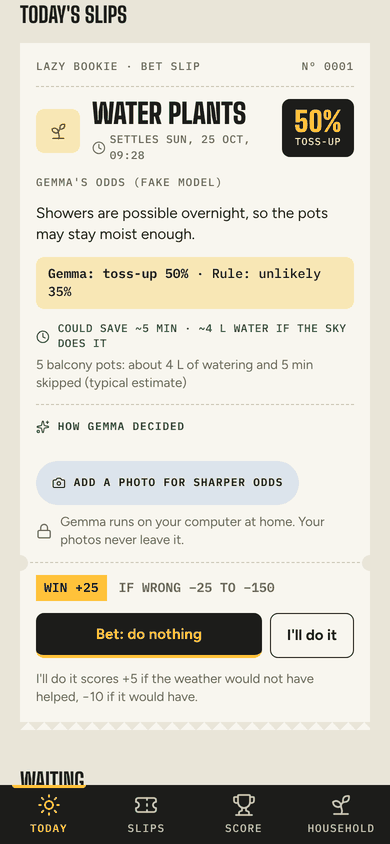
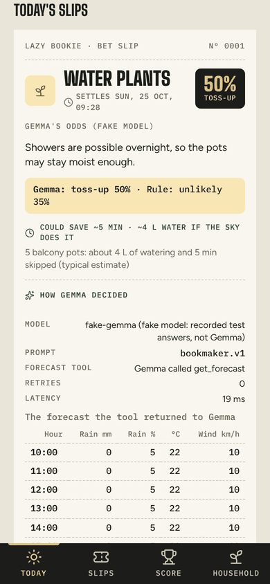
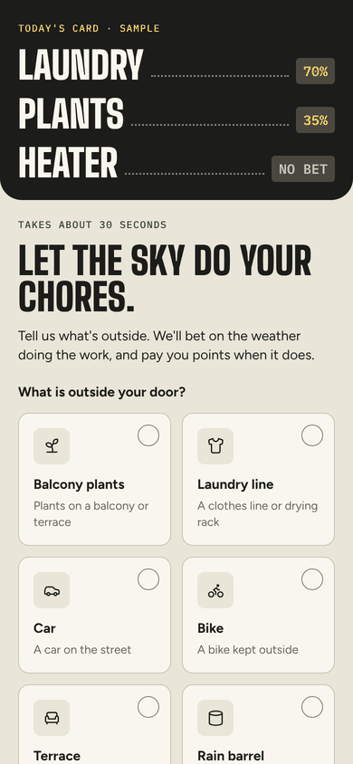
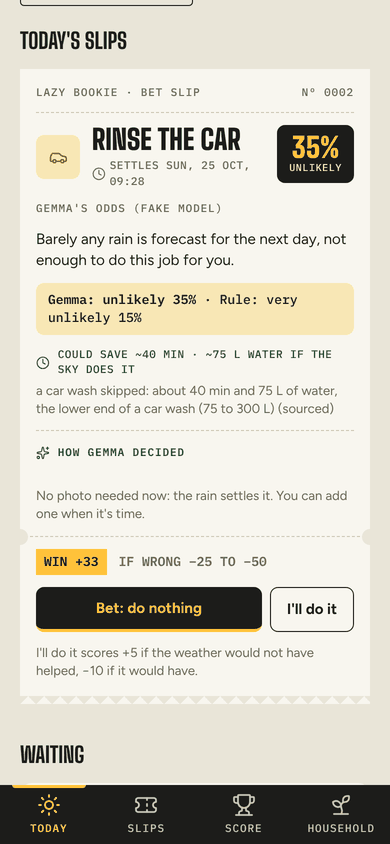
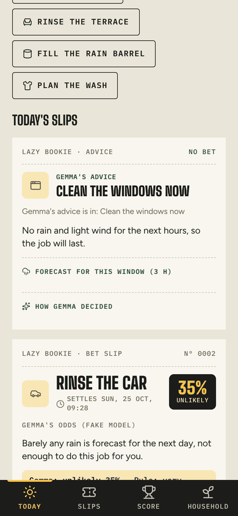
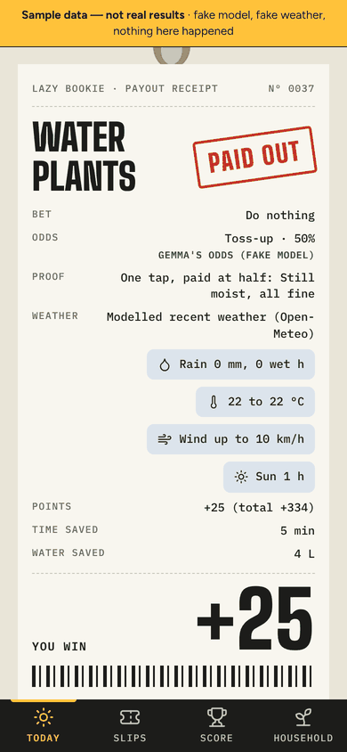
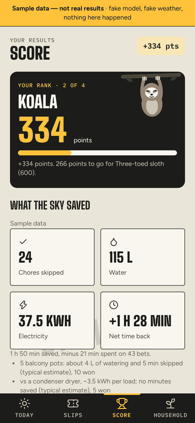
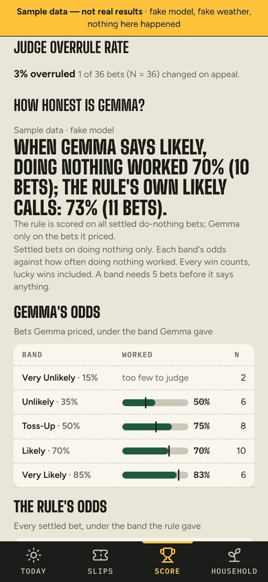

# Should I Bother?

**A local Gemma 4 bookmaker that bets on doing nothing.**

[](https://github.com/adricasi/ShouldIBother/actions/workflows/ci-node.yml)


<p align="center">
  
  &nbsp;
  
</p>

*The app on the fake model with sample data, not real results.*

"The Lazy Bookie" turns weather chores into bets on doing nothing. Balcony plants and line-drying are
the core loop; laundry overnight, the AC, the heater, city rain bets and outdoor advice cards sit behind
feature flags. **Gemma 4 E4B, running on your own laptop through Ollama, is the bookmaker and the
judge**: it reads what you type or say, looks at your photo, fetches the forecast itself with a function
call and quotes odds as one of five bands. You bet that the weather will do the job, or you do it
yourself. When the bet comes due, the app fetches the recorded weather and asks for an after photo or one
tap, Gemma gives the verdict, and the points, time, water and electricity you saved are counted with their
assumptions shown.

**Gemma decides; code executes.** Gemma makes every judgement. Code fetches the weather, enforces limits,
counts points and savings, applies a fixed safety backstop and stores everything. Your photos, chores and
habits never leave the laptop.

**No GPU? See it in a minute:** `npm ci && npm run build && npm run sib -- demo` runs the whole app on sample
data with the fake model ([Quick start](#quick-start)).

Contents: [How it works](#how-it-works) · [Features](#features) · [Quick start](#quick-start) ·
[Configuration](#configuration) · [Hosted mode](#hosted-mode-optional) · [Architecture](#architecture) ·
[Privacy and security](#privacy-and-security) · [Testing](#testing-and-quality) ·
[Project structure](#project-structure) · [Status and roadmap](#status-and-roadmap) ·
[Hacktoberfest challenge](#hacktoberfest-open-source-ai-challenge) · [Later commits](#later-commits) · [Contributing](#contributing) ·
[Licences](#licences-and-acknowledgements) · [Documentation](#documentation)

## How it works

One Node.js 24 process (Fastify) serves a React app to your phone, keeps everything in SQLite and a photo
folder outside the repository, runs a 60 s scheduler and talks to Gemma through one `ModelClient`
interface. Gemma runs in Ollama on 127.0.0.1 (llama.cpp on 127.0.0.1 for voice only). The phone pairs
over your home Wi-Fi with a one-time token. The only call that leaves the laptop at runtime is the
weather lookup to Open-Meteo.



Nine prompts for eight jobs, one runner, one rule:

| Job | What Gemma does |
|---|---|
| Listener (and voice listener) | Splits a sentence, or a voice note, into chores and classifies them |
| Bookmaker | **Calls `get_forecast` itself**, then picks an odds band, a one-line reason and a settle time |
| Inspector | Reads a photo of the plant or washing and sharpens the odds ("What Gemma saw") |
| Safety guard | Says whether a chore touches safety, on top of the fixed heat, frost and storm backstop |
| Judge (and appeal) | Decides how a bet turned out from the recorded weather and your photo or tap |
| Laundry planner | Scores the next four drying days: wash today, skip today or no good day |
| Advisor | Reads 72 hours of forecast and advises when to clean the windows, sweep, paint or feed the lawn |

What keeps a 4B model honest:

- **Bands, never raw percentages.** Five bands map to 85, 70, 50, 35 and 15 %. Points, savings,
  settle-time bounds and safety are computed by code.
- **A rule baseline beside Gemma.** Plain code prices every card too. Gemma two or more bands away from it
  must explain or ask. The rule is the fallback when Gemma is offline, and **it never settles a bet**: a
  bet waits for Gemma's verdict.
- **Tool use is enforced.** The bookmaker's only tool is a read-only `get_forecast`. An answer without a
  valid call is retried once, then the card keeps labelled rule odds.
- **Every job is checked.** A versioned prompt, a zod schema, code checks, one retry, a 30 s timeout per
  model call, a 45 s deadline per job and one FIFO queue of 8. Typed text, photos and tool results are
  untrusted data.
- **Measured, with N.** Score shows Gemma's calibration beside the rule's; `sib eval`, `sib backtest`
  (no lookahead, Sep-Oct hold-out) and a QLoRA fine-tune of the bookmaker measure it offline.

Everything about how Gemma is wired in, job by job: **[docs/gemma.md](docs/gemma.md)**.

### What you see of Gemma

Gemma is visible on every screen, not hidden behind the numbers: each card says who set the odds ("Gemma's
odds" or "Rule odds"); both bands show side by side when they differ; "How Gemma decided" opens the model,
prompt version, tool call and forecast hours from the decision log; "What Gemma saw" lists what the
inspector read in your photo; "Gemma's read" explains the verdict on the receipt; and Score asks "How honest
is Gemma?" with N per band.

<table>
  <tr>
    <td align="center"><br><sub>Onboarding</sub></td>
    <td align="center"><br><sub>City rain bet</sub></td>
    <td align="center"><br><sub>Advice, not a bet</sub></td>
    <td align="center"><br><sub>PAID OUT receipt</sub></td>
  </tr>
  <tr>
    <td align="center"><br><sub>Score and rank</sub></td>
    <td align="center"><br><sub>Gemma's calibration, with N</sub></td>
    <td colspan="2"><sub>Every screenshot is the app on the fake model with synthetic sample data (the <code>sib demo</code> banner is visible on some). The numbers are test output, not results from Gemma.</sub></td>
  </tr>
</table>

## Features

- **Capture in a sentence.** Type, tap a chip, or (flag `voice`) say your chores; one card per chore, and
  "Not a weather chore" or "Coming later" when that is true.
- **Odds from the forecast, set by Gemma.** Five bands, a one-line reason with the numbers, a settle time and
  the payout for each outcome; the rule baseline shows at once and is the fallback.
- **A photo sharpens the odds.** The inspector lists what it sees and the odds move.
- **Bet, do it, or undo.** Odds, band and payouts lock when you bet; Undo works for 5 minutes.
- **Settlement on evidence.** Recorded weather plus an after photo (full points) or one tap (half). If nobody
  answers within 24 hours, Gemma settles from the weather record at half points.
- **Honest points and savings.** Win = (100 - odds) x multiplier, losses -25, -50 or -150, a PAID OUT
  receipt, and time, water and electricity saved with the assumption shown, minus 30 s of app time per bet.
- **Advice, not a bet, for outdoor chores** (flag `adviceCards`): windows, balcony leaves, outdoor paint and
  the lawn, with a rule advice beside Gemma's and a window the forecast contradicts refused.
- **Safety is never a bet.** A fixed heat, frost and storm backstop turns risky weather into a "Do it now"
  alert that no answer can override.
- **Private by design.** Everything runs on one laptop; the only outbound call is the weather lookup.
- **Behind flags, off by default:** laundry overnight, the AC and heater, the laundry planner, rescue alerts
  and cash-out, appeals, onboarding, ranks and achievements, the split-flap weather board, city rain bets,
  voice capture and the fine-tuned bookmaker ([Configuration](#configuration)).

## Quick start

### The demo: no GPU, no model, about a minute

The demo runs the whole app on a temporary folder of made-up bets with the fake model and fake weather;
every screen says "Sample data". It never touches your own data.

```bash
git clone https://github.com/adricasi/ShouldIBother.git
cd ShouldIBother
nvm install            # reads .nvmrc (Node 24)
npm ci
npm run build
npm run sib -- demo    # prints a pairing link; open the "Laptop" link in a browser; Ctrl+C stops it
```

The demo starts on port 8788 (`--port N` changes it) and shows Gemma's surfaces on sample data: the odds
labels, "How Gemma decided", "Gemma's read" and the Score calibration. Those figures come from the fake
model's recorded fixtures, **not from Gemma**, and are never results.

### Develop on the fake model

```bash
SIB_FAKE_WEATHER=1 npm run dev   # builds the screens, starts with SIB_FAKE_MODEL=1 and fake weather, no network
```

### The real thing: Gemma 4 on your laptop

You need Windows 11 with WSL2, an NVIDIA GPU with 8 GB or more, Node.js 24, [Ollama](https://ollama.com)
and a phone on the same Wi-Fi. In short: clone, `npm ci`, `npm run build`, `ollama pull` the Gemma 4 model,
name its tag in `config/models.json`, open the app's port to your Wi-Fi, then:

```bash
npm start          # serves the app, prints a pairing link and QR code, runs the 60 s scheduler
```

The full step-by-step (Ollama, WSL networking, firewall, pairing, HTTPS with Tailscale Serve, voice) is in
**[docs/setup.md](docs/setup.md)**. If Ollama is down the app still starts: Today shows "Gemma offline" with
rule odds and a Retry button, and settlements wait until Gemma is back.

## Configuration

A few files in `config/` and some environment variables; the app starts without the git-ignored ones.

| File | What it holds |
|---|---|
| `config/models.json` | The Gemma model tag, runtime addresses (loopback only), tool-use and answer modes |
| `config/flags.json`, `flags.presets.json` | 15 feature flags, **all off by default**; presets turn several on together |
| `config/rules.json`, `rules-rain.json`, `advice-rules.json`, `savings.json` | Rule and safety thresholds (final for this version, not tuned), advice windows and the savings catalogue |
| `config/server.json`, `config/household.json` | Git-ignored: port, extra hosts and origins; your appliances and neighbourhood coordinates |

| Variable | Effect |
|---|---|
| `SIB_FAKE_MODEL=1` | The recorded-fixture model instead of Ollama, for tests, CI and development; never for real bets |
| `SIB_FAKE_WEATHER=1` | Fake weather, no Open-Meteo call |
| `SIB_DATA_DIR` | Data folder, default `~/.should-i-bother/` |
| `SIB_PORT`, `SIB_LAN_ADDRESS` | Port (default 8787) and the private LAN address to listen on |
| `SIB_MODE=hosted` and the `SIB_DO_*` family | [Hosted mode](#hosted-mode-optional) |

Flags change with `sib flags`, and `sib flags preset presentation` turns on every merged feature except
`voice` and `finetunedBookmaker`; restart the app to apply. Every setting, flag, preset and `sib` command is
in **[docs/reference.md](docs/reference.md)**.

## Hosted mode (optional)

Home mode is the default. For one household that wants to use the app away from home without a GPU,
`SIB_MODE=hosted` runs the same app on one DigitalOcean Droplet behind Caddy with automatic HTTPS, with
Gemma from DigitalOcean's Serverless Inference instead of Ollama. Releases are one command,
`deploy/digitalocean/release.sh` (build, push to the registry, deploy with automatic rollback).

**The privacy trade-off, plainly.** In hosted mode Gemma runs on DigitalOcean's inference service: your
chores, habits, answers to Gemma's questions and the area forecast are sent there. Photos stay on the server
unless you set `SIB_DO_VISION=1`. Your database and photos live on a cloud server and in its backups. The app
says so on screen. Home mode is unaffected. The DigitalOcean endpoint, model ID and wire format are
**unverified** until `sib hosted-check` has run against the real service.

Step by step, with costs and the security checklist: **[docs/deploy-digitalocean.md](docs/deploy-digitalocean.md)**.
The decision is [ADR-0011](docs/adr/0011-optional-hosted-mode-on-digitalocean.md) (REQ-032).

## Architecture



The detail is in **[docs/architecture.md](docs/architecture.md)**: goals and constraints, the context,
container and component views, the runtime and scheduler, the data model, the modes (home, hosted, demo,
fake), the security model, reliability and fallbacks, testing and deployment, with the diagrams below.
**[docs/gemma.md](docs/gemma.md)** goes deep on Gemma.

| Diagram | Shows |
|---|---|
| [Runtime architecture](docs/images/architecture/runtime-architecture.svg) | The home-mode process and its boundaries |
| [Gemma architecture](docs/images/architecture/gemma-architecture.svg) | Jobs, the runner, the tool loop, model clients, the code that executes |
| [Bet lifecycle](docs/images/architecture/bet-lifecycle.svg) | A bet from typed chore to receipt, with fallbacks |
| [Data model](docs/images/architecture/data-model.svg) | The main tables |
| [Hosted deployment](docs/images/architecture/hosted-deployment.svg) and [release flow](docs/images/architecture/release-flow.svg) | The Droplet, Caddy, backups, `release.sh` and `deploy.sh` |
| [Trust boundaries](docs/images/architecture/trust-boundaries.svg) | Untrusted input, guards, private data |
| [Fine-tune pipeline](docs/images/architecture/finetune-pipeline.svg) | Snapshot, dataset, QLoRA, GGUF, evaluation |

The Mermaid sources and how to regenerate the images are in [docs/diagrams/](docs/diagrams/).

## Privacy and security

- Photos, chore text, habits and audio stay on the laptop, in the data folder `~/.should-i-bother/`,
  outside the repository and owner-only. The app refuses to start with a data folder that git could commit.
- Photos are re-encoded without metadata (no EXIF or GPS) and resized to 1024 px at most.
- Gemma runs in Ollama on 127.0.0.1 (llama.cpp on 127.0.0.1 for voice notes, held in memory only). In home
  mode there is no cloud model, no analytics and no telemetry.
- **The only outbound call at runtime is to Open-Meteo**, with coordinates rounded to 2 decimals (and the
  place you type into the onboarding search, only when you press Search).
- Access is by a one-time pairing token and a session cookie; Host, Origin and rate-limit checks apply. On
  plain home HTTP a device already on your Wi-Fi could sniff the cookie, which is why HTTPS through Tailscale
  Serve is documented ([ADR-0007](docs/adr/0007-pairing-token-access-over-plain-http-on-the-lan.md)).
- Typed text, photos and tool results are untrusted data; Gemma's answers are enums and short strings, and
  points, settle bounds and safety are computed by code.
- Export with `sib export <dir>`, delete photos with `sib delete-photos`, delete everything with
  `sib delete-photos --all-data`. gitleaks runs in pre-commit and CI.

Full model: [architecture.md, Security model](docs/architecture.md#11-security-model). The pre-publish
network capture that confirms "only Open-Meteo" has not been run yet ([release checklist](docs/release-checklist.md)).

## Testing and quality

```bash
npm test                          # unit, integration and component tests on the fake model and fake weather: no GPU, no network
npm test -- --coverage            # with v8 coverage
npm run lint && npm run typecheck
npm run format:check
npm run build && npm run test:e2e # Playwright journeys at phone width (builds the screens first)
npm audit --audit-level=high      # dependency vulnerabilities
(cd training && uv sync && uv run ruff check . && uv run pytest)   # the Python fine-tune tooling
```

`npx vitest run` passes 2,581 tests in 144 files and `npm run test:e2e` passes 8 Playwright tests (counted on
24 October 2026); 148 of the 149 acceptance criteria are named in a test. Tests and CI never touch a real
model, the network or household data. Playwright needs a browser once (`npx playwright install chromium`).
How the criteria map to tests: [docs/how-it-was-built.md](docs/how-it-was-built.md#8-traceability-every-acceptance-criterion-to-a-test).

## Project structure

```text
src/
  server/      Fastify app, pairing and session guard, ledger (cards, bets, settlement), scheduler, weather client, photos, voice
    gemma/     the Gemma jobs and the job runner (queue, retry, deadlines)
    model/     ModelClient: Ollama, llama.cpp (audio), DigitalOcean (hosted), fixture-backed fake; loopback and proxy guards
    migrations/ numbered SQLite migrations
  domain/      pure code: rule baseline, safety backstop, bands, points, savings, outcome labels, calibration
  web/         the React app (Today, Slips, Score, Household)
  backtest/    sib snapshot, sib dataset, sib backtest
  eval/        sib eval
  demo/        sib demo (seeded sample data)
  cli.ts       the sib command
prompts/       versioned Gemma prompts, <job>.v<n>.md
config/        models, flags and presets, rules, savings, server and household settings
evals/         the 20-case sets for sib eval
test/          Vitest tests; test/fixtures/gemma/ holds the synthetic fixtures of the fake model
e2e/           the Playwright journeys
training/      the Python (uv) QLoRA fine-tune scripts, configs and tests; see training/README.md
deploy/        hosted mode: Docker Compose, Caddyfile, release.sh, deploy.sh, backup scripts
docs/          architecture.md, gemma.md, setup.md, reference.md, how-it-was-built.md, spec/, adr/, diagrams/, images/
```

## Status and roadmap

Honest state at the time of writing (details in [docs/spec/tasks.md](docs/spec/tasks.md): 32 of 42 tasks
done):

- **Built and tested on the fake model and fake weather:** capture, odds, the photo flow, bets, settlement,
  points, savings, Score, the Gemma surfaces, the flagged features, the job runner, the model clients, hosted
  mode, `sib eval`, `sib snapshot`, `sib dataset`, `sib backtest`, `sib flags` and `sib demo`.
- **Written, never run on the real stack, so UNVERIFIED:** the Ollama wire format, the llama.cpp wire format
  for voice, the DigitalOcean endpoint, model ID and wire format, the Open-Meteo query and host names, the
  training scripts' dependency pins, base model ID and GGUF conversion for Gemma 4, the real-model valid-JSON
  rate and latency, and the network capture. `config/models.json` has no model tag pinned yet.
- **Next steps (the builder's, not done):** pin the model tag and digest (T-010), run `sib eval` on the real
  E4B and the photo evaluation (T-030), take the snapshot and train the QLoRA adapter (T-031, T-012),
  compare base and fine-tuned on the hold-out (T-014), run the live week and the backtest (T-019) and the
  release checklist (T-020).
- **No real-model results are published in this repository yet.** Results will be written to `docs/results/`
  and quoted with their N; losses are reported with wins. The sample-data demo is never a result.

## Hacktoberfest Open-Source AI Challenge

An entry for the DEV Hacktoberfest Open-Source AI Challenge, Week 3 "Slow and Steady", in the categories
**Overall** and **Best Use of Gemma**. Feature freeze was Saturday 24 October 2026, 14:00 Madrid.

- **What I built, and who gets lazier.** A bookmaker for doing nothing. You tell it a weather chore (water the
  plants, dry the washing outside); Gemma looks at the forecast and quotes odds that the sky will do the job
  for you; you bet, you skip it, and the bet settles on evidence. The person who gets lazier is the household
  that was about to water the balcony in the rain, and gets points for trusting the weather and loses points
  when the weather was wrong.
- **The demo.** `npm run sib -- demo` runs everything on sample data without a GPU (see
  [Quick start](#quick-start)). Demo video (41 s): [youtube.com/shorts/VLPyTvU6a-4](https://youtube.com/shorts/VLPyTvU6a-4).
- **The code.** This repository, MIT licensed. [docs/how-it-was-built.md](docs/how-it-was-built.md) shows
  how it was built, spec first, with Claude Code.
- **Built around open-weight Gemma 4, local with Ollama.** Gemma 4 E4B makes every judgement: function
  calling for the forecast, structured output, photo reading and (for voice) audio. One `ModelClient`
  interface runs the same jobs on Ollama, llama.cpp, DigitalOcean's hosted Gemma 4 and a test fake
  ([docs/gemma.md](docs/gemma.md)).
- **Why open innovation matters here.** The model is open-weight, so photos of a home, chores and habits stay
  on the laptop and the app works at home with no cloud model; there is no vendor lock-in, since changing the
  runtime is a configuration change; the bookmaker can be fine-tuned on public weather data for one
  neighbourhood (the pipeline is built, the training run is a next step); and the whole thing, prompts, rules,
  tests and docs, can be read, run and changed.
- **The lazy payoff.** The only savings figures are the savings model's, with its assumptions stated: a win
  counts a catalogue figure for the chore against your household baseline, time only for steps you skipped,
  minus 30 s of app time per bet, and every figure carries its assumption ("typical estimate" when it has no
  cited source). There are no invented usage numbers, and the demo's figures are sample data.
- **The prize categories.** *Overall:* a complete, tested app with a spec, ADRs and a hosted option.
  *Best Use of Gemma:* Gemma is the bookmaker and the judge, measured against an untuned rule, with the
  fine-tune pipeline ready. What is not proven yet is stated above: real-model evaluations and the fine-tune
  run are next steps, not results.

## Later commits

The challenge entry is the repository as it stood at the feature freeze on Saturday 24 October 2026 at
14:00 (Madrid), commit `5577943` (PR #52). Work after the freeze, all deployment, documentation and
dependency work (no new game features):

- 24 Oct, 22:02: #53, the DigitalOcean deployment kit and guide (T-041).
- 24 Oct, 23:34: #54, one-command release through the DigitalOcean registry (T-042).
- 25 Oct, 00:29: #55, the Caddy address fix found on the first real deploy.
- 25 Oct, 00:49: #32, Dependabot dependency updates.
- 25 Oct: this documentation update (architecture, Gemma, diagrams, screenshots, README).

## Contributing

This is a spec-driven project: [docs/spec/](docs/spec/) is the source of truth and the code follows it. To
propose a change that contradicts the spec, change the spec first.

- Work on a branch, never on `main`; Conventional Commits (`type(scope): summary`) that reference the
  requirement or task IDs; one concern per pull request.
- Run the checks from [Testing and quality](#testing-and-quality) before you push; CI must stay green. Tests
  and CI use the fake model and fake weather only.
- Record significant decisions as ADRs in [docs/adr/](docs/adr/). A prompt change bumps the prompt version and
  re-records its fixtures; the rule and safety thresholds are final for this version.
- Never commit photos, the database, an export or `config/household.json`.

## Licences and acknowledgements

- This app: MIT, see [LICENSE](LICENSE).
- **Gemma 4**, the open-weight model by Google DeepMind, runs the whole app. The weights are downloaded from
  the Ollama registry, never shipped here. The spec records the licence as Apache 2.0 (NFR-008); confirm the
  exact terms on the Gemma 4 model card before relying on that.
- **Weather data by [Open-Meteo.com](https://open-meteo.com/), licensed under
  [CC BY 4.0](https://creativecommons.org/licenses/by/4.0/)**; the free tier is for non-commercial use. The
  footer of Today shows the attribution word for word:

  > Weather data by Open-Meteo.com (https://open-meteo.com/), licensed CC BY 4.0.
- [Ollama](https://ollama.com) and llama.cpp serve the model locally; Fastify, React, Vite, zod,
  better-sqlite3, sharp and pino are the application stack.
- Fonts (Big Shoulders Display, IBM Plex Mono, Figtree: SIL Open Font License 1.1, served by the app, no CDN)
  and icons ([Lucide](https://lucide.dev), ISC): see [THIRD-PARTY.md](THIRD-PARTY.md). Everything else is an
  npm dependency pinned in `package-lock.json` (Python: `training/uv.lock`).

## Documentation

| Document | For |
|---|---|
| [docs/architecture.md](docs/architecture.md) | How the system is put together |
| [docs/gemma.md](docs/gemma.md) | How Gemma is integrated: jobs, runner, clients, settlement, evaluation, fine-tune |
| [docs/setup.md](docs/setup.md) | Setting up and running home mode |
| [docs/reference.md](docs/reference.md) | Configuration, flags and `sib` commands |
| [docs/deploy-digitalocean.md](docs/deploy-digitalocean.md) | Hosted mode on DigitalOcean |
| [docs/how-it-was-built.md](docs/how-it-was-built.md) | The spec-driven method and its evidence |
| [docs/spec/](docs/spec/), [docs/adr/](docs/adr/) | The specification and the decisions |
| [docs/release-checklist.md](docs/release-checklist.md) | The pre-publish checks |
| [docs/diagrams/](docs/diagrams/) | Diagram sources and how to regenerate them |
