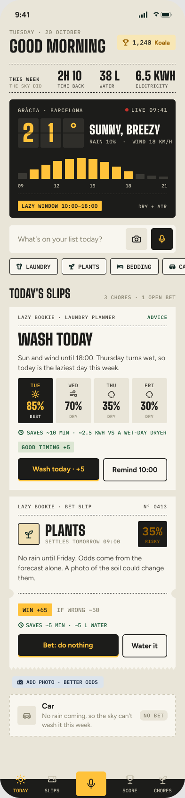

# Should I Bother?

A local Gemma 4 bookmaker that bets on doing nothing.

"The Lazy Bookie" turns weather chores (watering balcony plants and line-drying in the core loop;
laundry overnight, the AC and the heater behind feature flags) into bets on doing nothing. You tell
it a chore or send a photo; Gemma 4 E4B, running on your own laptop through Ollama, reads the
forecast and the photo and quotes odds (very likely to very unlikely). You bet that the weather
will do the job, or you do it yourself. When the bet comes due, the app fetches the recorded
weather and asks for an after photo or one tap, Gemma gives the verdict, and the points, the time,
the water and the electricity you saved are counted with their assumptions shown. Code only
executes: Gemma decides, and your photos, chores and habits never leave the laptop. It is an entry
for the DEV Hacktoberfest Open-Source AI Challenge, Week 3 "Slow and Steady".

<!-- TODO(builder): add the screenshots after T-021 (for example docs/images/02-today.png and
05-slips.png as a side-by-side) and delete this comment. Only staged or synthetic photos. -->



Contents: [What you need](#what-you-need) · [Set up](#set-up) · [Phone access](#phone-access-over-wi-fi) ·
[Pair a phone](#pair-a-phone) · [Tailscale Serve](#optional-https-with-tailscale-serve) ·
[Run](#run) · [Feature flags](#feature-flags) · [Commands](#commands-sib) · [Privacy](#privacy-and-your-data) ·
[Testing](#testing) · [Licences](#licences) · [Spec and ADRs](#specification-and-decisions)

## What you need

| | |
|---|---|
| Laptop | Windows 11 with WSL2 (Ubuntu), an NVIDIA GPU with 8 GB VRAM or more and the WSL CUDA driver, 16 GB RAM or more, about 20 GB free disk for the models |
| Software | Node.js 24 (pinned in `.nvmrc`), [Ollama](https://ollama.com), git. Python 3.12 and [uv](https://docs.astral.sh/uv/) are needed only for `training/` |
| Phone | Current iOS Safari or Android Chrome, on the same Wi-Fi as the laptop |

Target: a fresh clone to a running app in 30 minutes, not counting the model download (NFR-011).
Without a GPU you can still try the whole app on recorded fixtures, see [Run](#run).

## Set up

All commands run inside WSL2 (Ubuntu).

### 1. Clone, install, build

```bash
git clone https://github.com/adricasi/ShouldIBother.git
cd ShouldIBother
nvm install            # reads .nvmrc (Node 24); install nvm first if you have none, any Node 24 works
npm ci                 # install from the lockfile
npm run build          # compiles the server to dist/ and builds the app screens to dist/web
```

If `npm ci` fails while building `better-sqlite3` or `sharp` (they normally download prebuilt
binaries), install the build tools with `sudo apt install build-essential python3` and retry.

### 2. Install Ollama and pull Gemma 4

Check that WSL sees the GPU (`nvidia-smi`), then install Ollama in WSL following
<https://ollama.com/download> (on Linux this is the official install script, which starts the
`ollama` service; if your WSL has no systemd, run `ollama serve` in a second terminal).

**Leave `OLLAMA_HOST` unset.** Ollama then listens on 127.0.0.1:11434 only, which is what the app
requires; `config/models.json` rejects any other address.

Pull the two models the project uses:

```bash
ollama pull TODO(builder): exact E4B tag     # the model the app runs on (primary)
ollama pull TODO(builder): exact E2B tag     # the smaller model, used only for the backtest comparison
ollama list                                  # note the ID column: it starts with the model digest
```

| Model | Ollama tag | Quantization | Digest |
|---|---|---|---|
| Gemma 4 E4B | `TODO(builder): tag from T-010` | `TODO(builder)` | `TODO(builder): sha256 from T-010` |
| Gemma 4 E2B | `TODO(builder): tag from T-010` | `TODO(builder)` | `TODO(builder): sha256 from T-010` |

Tell the app which tag to use in `config/models.json`. The file is committed; `primary` names the
entry in `models` that the app runs on, and `sib start` refuses to start if that entry has no tag:

```json
{
  "primary": "e4b",
  "models": {
    "e4b": { "tag": "<tag from ollama list>", "quantization": "<q>", "digest": "<sha256>" },
    "e2b": { "tag": "<tag from ollama list>", "quantization": "<q>", "digest": "<sha256>" }
  }
}
```

The `ollama`, `gemma.toolUse` and `gemma.answerMode` keys in the same file already have working
defaults. The digest is the reference for anyone comparing results; the backtest refuses to run if
the pulled model's digest differs from the configured one. There is no script that pulls or
verifies the models yet: compare `ollama list` with the table above by hand.

<!-- TODO(builder): after T-010 commit the real tags, quantizations and digests in
config/models.json so a stranger only has to run the two `ollama pull` commands, then fill the
table above and delete the placeholders. Say here whether the fine-tuned adapter (Q-11) is
published and where. -->

### 3. Optional config files

Both are git-ignored (they name your machine or your home); the committed `*.example.json` files
are the fallback, so the app starts without them.

```bash
cp config/server.example.json config/server.json       # ports, extra hosts and origins (below)
cp config/household.example.json config/household.json # your dryer, AC and heater, and the neighbourhood coordinates
```

`config/household.json` sets the baseline behind the savings figures and the location the weather
is fetched for. Coordinates are rounded to 2 decimals (about 1 km) before every request. The
example uses Gràcia, Barcelona: change `location` to yours.

`config/server.json`:

| Key | Meaning |
|---|---|
| `port` | Port of the app, default 8787. `SIB_PORT` overrides it, and `sib pair` reads the same value |
| `allowedHosts` | Extra `Host` header values the server accepts, for example the Windows LAN IP behind a `netsh` port proxy. Any other host gets 421 (this blocks DNS rebinding) |
| `publicOrigins` | HTTPS origins that reach the app, for example `https://<machine>.<tailnet>.ts.net` for Tailscale Serve. They are added to the Origin and Host checks |

The server already allows `localhost`, `127.0.0.1` and the addresses of the active network
interfaces, and prints its allowlist at start.

## Phone access over Wi-Fi

The app listens on 127.0.0.1 and on the laptop's private LAN address only (`SIB_LAN_ADDRESS`
overrides the address; it must be a private or loopback address). Ollama stays on 127.0.0.1 and is
never exposed. WSL2 sits behind NAT by default, so the phone cannot reach it until you do one of
the following. Mirrored networking is the simpler one.

### Option A: WSL mirrored networking (recommended)

1. In Windows, create or edit `%UserProfile%\.wslconfig`:

   ```ini
   [wsl2]
   networkingMode=mirrored
   ```

2. In PowerShell: `wsl --shutdown`, then open WSL again. WSL now shares the Windows network
   addresses, so the app is reachable on the laptop's Wi-Fi IP.
3. Allow the app port through the Windows firewall, **Private profile only**. In PowerShell as
   administrator (change 8787 if you changed the port):

   ```powershell
   New-NetFirewallRule -DisplayName "Should I Bother (app)" -Direction Inbound -Protocol TCP -LocalPort 8787 -Action Allow -Profile Private
   ```

   Mirrored mode also has a Hyper-V firewall for WSL. If the phone still cannot connect, allow the
   port there too (Microsoft's documented WSL creator id):

   ```powershell
   New-NetFirewallHyperVRule -Name "SIB8787" -DisplayName "Should I Bother (app)" -Direction Inbound -VMCreatorId "{40E0AC32-46A5-438A-A0B2-2B479E8F2E90}" -Protocol TCP -LocalPorts 8787
   ```

   <!-- TODO(builder): confirm the two firewall commands on your laptop and note which one was
   needed. Make sure your Wi-Fi network is set to the Private profile in Windows. -->

4. Do **not** add a rule for port 11434. Check from WSL that only the app is exposed:

   ```bash
   ss -ltnp | grep -E ':(8787|11434)\b'    # 11434 must show 127.0.0.1, never 0.0.0.0 or *
   ```

### Option B: `netsh` port proxy (no mirrored mode)

Forward the Windows LAN port to the WSL address and list the Windows IP in `allowedHosts`
(`config/server.json`), because the `Host` header is the Windows address. Run in PowerShell as
administrator:

```powershell
$wsl = (wsl hostname -I).Trim().Split(" ")[0]
netsh interface portproxy add v4tov4 listenaddress=0.0.0.0 listenport=8787 connectaddress=$wsl connectport=8787
New-NetFirewallRule -DisplayName "Should I Bother (app)" -Direction Inbound -Protocol TCP -LocalPort 8787 -Action Allow -Profile Private
```

The WSL address changes at every WSL restart, so repeat the `portproxy` line then. Behind a port
proxy every client shares one address, see the rate-limit note below.

## Pair a phone

`npm start` (or `npm run dev`) prints the Host allowlist, a pairing link and a QR code to the
console (stderr). The link is valid for 10 minutes and for at most 3 devices. Scan the QR code with
the phone camera (or type the link): the app sets a 30-day cookie and opens the app. The pairing
token and the session ids are stored only as hashes and never logged.

```bash
npm run sib -- pair            # print a new link; older unused links stop working, devices stay signed in
npm run sib -- forget-devices  # sign every device out and cancel pending links
```

`npm start > app.log` is safe: the console output (allowlist, links, pairing lines) goes to stderr
and the JSON logs go to stdout.

### Security notes

- **Plain HTTP on the LAN has a known limit.** Someone already on your Wi-Fi can sniff the session
  cookie. Everyone else gets 401 on every route. For HTTPS use Tailscale Serve (next section,
  ADR-0007); sessions paired through an HTTPS origin get a `Secure`, `__Host-` cookie.
- Cookies are not isolated by port: another app on the same host name (for example another dev
  server on `localhost`) receives the session cookie. Do not run untrusted software on the laptop.
- The rate limit is per client address: more than 10 failed requests a minute blocks requests
  without a session for a minute. Behind Tailscale Serve or a `netsh` port proxy all clients share
  one address, so one bad client locks out everyone without a session. Paired devices are never
  affected. This is accepted for a one-household app.

## Optional: HTTPS with Tailscale Serve

Tailscale Serve gives the app an HTTPS address that only your tailnet can reach, with no
certificates to manage. Install Tailscale (on Windows or in WSL) and sign in, then, on the machine
where Tailscale runs, serve the app's port:

```bash
tailscale serve --bg 8787
tailscale serve status        # shows https://<machine>.<tailnet>.ts.net
```

Add that origin to `config/server.json` and restart the app:

```json
{ "port": 8787, "publicOrigins": ["https://<machine>.<tailnet>.ts.net"], "allowedHosts": [] }
```

Then pair the phone from a link that starts with that origin (`sib pair` prints one for every
origin). <!-- TODO(builder): confirm the `tailscale serve` syntax for your Tailscale version and
whether Serve in Windows reaches the WSL app on 127.0.0.1 in mirrored mode. -->

**Without Tailscale the app runs on plain HTTP**, and browsers expose only HTTP-safe features. The
photo buttons use the phone's own file picker and camera app, which work over HTTP. Features that
need a secure context do not: the microphone for voice capture (flag `voice`, off) is hidden over
plain HTTP, and the app uses neither geolocation nor a live in-browser camera. Location is typed
in `config/household.json` (or in onboarding) instead.

## Run

```bash
npm start                    # node dist/cli.js start: serves the app and API, runs the 60 s scheduler
```

Run `npm run build` first. The app talks to Gemma through Ollama on 127.0.0.1. If Ollama is down
the app still starts: Today shows "Gemma offline" with rule odds and a Retry button, and
settlements wait until Gemma is back (the rule never settles a bet).

On the phone: tap the "Water plants" or "Line-dry today" chip (or type a sentence), read the odds,
tap "Bet: do nothing". At the settle time (the scheduler checks every 60 s) the bet appears under
"Settle now" with one-tap answers and an after-photo option.

### Development without a GPU

```bash
npm run dev                  # builds the screens, starts with SIB_FAKE_MODEL=1 and restarts on code changes
SIB_FAKE_WEATHER=1 npm run dev   # also no network: fake weather
```

| Variable | Effect |
|---|---|
| `SIB_FAKE_MODEL=1` | The recorded-fixture model (`test/fixtures/gemma/`) instead of Ollama. A banner says so and Today shows "(fake model)". Never use it for real bets. `npm run dev` sets it |
| `SIB_FAKE_WEATHER=1` | Fake weather, no Open-Meteo call. For development and tests |
| `SIB_DATA_DIR` | Data folder, default `~/.should-i-bother/` |
| `SIB_PORT` | Port, else `port` in `config/server.json`, else 8787 |
| `SIB_LAN_ADDRESS` | The LAN address to listen on (private or loopback only) |

After editing a screen, run `npm run build:web` and reload (or restart `npm run dev`; each restart
prints a new pairing link).

## Feature flags

`config/flags.json` switches unfinished or optional features on. **Every flag is off by default**,
and a flag that is off shows no UI entry point and registers no route (REQ-029). Only the builder
turns a flag on, after merging and checking the feature. Unknown flag names are an error.

| Flag | Default | What it does when on |
|---|---|---|
| `finetunedBookmaker` | off | Reserved for the fine-tuned E4B bookmaker (REQ-019). TODO(builder): nothing on `main` reads it yet; state here whether the adapter ships |
| `safetyGuard` | off | Gemma safety guard on every card; an alert withdraws open bets on the card (the fixed heat/frost/storm backstop works without it) |
| `laundryTonight` | off | The "laundry tonight" chore, offered from one hour before sunset to two hours after |
| `score` | off | The Score screen: points, savings, judge overrule rate and Gemma-vs-rule calibration with N |
| `stampAnimation` | off | The PAID OUT stamp animation on wins (fades instead of moving with reduced motion) |
| `laundryPlanner` | off | Gemma plans laundry over the next days and you can bet on "Skip today" |
| `rescue` | off | Rescue alerts when the forecast changes, and cash-out of an open bet |
| `appeals` | off | Appeal a verdict with a photo |
| `onboarding` | off | Onboarding card and screen: your dryer, AC, heater and location |
| `ranks` | off | Ranks and achievements; shown on Score, so it needs `score` on |
| `heater` | off | The heater bet and the AC chore |
| `splitFlap` | off | The split-flap weather board on Today |
| `voice` | off | Voice capture through Gemma 4 audio. TODO(builder): not built yet on `main`; the flag does nothing |

## Commands (`sib`)

`sib` is the built binary (`node dist/cli.js`, or `npm link` to get `sib` on your PATH). In
development run the same commands through npm: `npm run sib -- <command>`.

| Command | What it does |
|---|---|
| `sib start` | Start the server (what `npm start` runs) |
| `sib pair` | Print a new pairing link and QR code |
| `sib forget-devices` | Sign out every device and cancel pending links |
| `sib export <dir>` | Write `export.json` (bets, decisions, verdicts, totals, onboarding profile, achievements) and the photos to a new, empty folder |
| `sib delete-photos [--all-data]` | Asks first; removes every photo and what Gemma read from it. With `--all-data` it also removes the database and its WAL files |
| `sib backtest [options]` | Replays the weather snapshot with the rule, a fixed routine, E2B and E4B (and the fine-tuned model) and writes a report; resumable, `--help` lists the options |
| `sib snapshot` | Downloads the Open-Meteo snapshot for the backtest and the fine-tune. **Arrives with PR #30 (T-031); not on `main` yet.** TODO(builder): remove this note when merged |
| `sib dataset` | Builds the fine-tune JSONL from the snapshot. **Arrives with PR #30 (T-031); not on `main` yet.** TODO(builder): remove this note when merged |
| `sib eval <job> [options]` | Runs the 20-case staged set of one Gemma job (`listener`, `bookmaker`, `inspector`, `judge`, `safety`, `laundry-planner`) through the real job on the configured model and reports valid JSON out of 20, tool use, model calls and latency (p50/p95/max) with the model digest and prompt version. Exit 0 when the target is met (19 of 20), 3 when missed, 2 when Gemma is unreachable. Details below |

### Evaluating Gemma (`sib eval`)

The sets are in `evals/<job>/cases.json`: synthetic text and synthetic weather, no household data.
The command checks the target of NFR-004: at least 19 of 20 schema-valid answers per job, the
bookmaker calling `get_forecast`, and the photo flow (the inspector, then the bookmaker when the inspector
saw enough; a question from the inspector ends it) valid and within 15 s in 19 of 20 cases. With `SIB_FAKE_MODEL=1` it runs on the fixtures, which only proves the
pipeline (the report says so).

```bash
npm run sib -- eval listener                 # also bookmaker, safety, laundry-planner and judge (taps)
npm run sib -- eval inspector --photos ~/eval-photos
npm run sib -- eval judge --cases evals/judge/photo-cases.json --photos ~/eval-photos
npm run sib -- eval bookmaker --out ~/sib-evals/bookmaker-1 --record-fixtures ~/sib-evals/fixtures
```

- It prints a table (valid, answer, tool use, model calls, retries, job time per case) and a summary,
  then writes `report.json` and `report.md` to `--out` (default `<data folder>/evals/<job>-<date>/`).
  A folder inside the repository is refused unless git ignores it, and an earlier report is never
  overwritten. Exit codes: 0 target met, 1 bad input, 2 Gemma unreachable, 3 target missed.
- The photo sets name the files to stage in the `--photos` folder; each case says what to photograph,
  and photos are never committed: `inspector-01-plants-dry-soil.jpg` to `inspector-20-sign-in-photo.jpg`,
  and `judge-NN-before-<what>.jpg` / `judge-NN-after-<what>.jpg` (see `evals/judge/photo-cases.json`).
  They go through the app's own photo pipeline first (at most 1024 px, no metadata).
- `--record-fixtures <dir>` also writes the model's raw answers as `<dir>/<job>/<case>.json`, in the
  format of `test/fixtures/gemma/` but under the fake's own model name. They are candidates: read each
  one, then copy the good ones into `test/fixtures/gemma/` yourself. The command never overwrites a
  file and never writes into that folder.

`export` and `delete-photos` refuse to run while the app is running (stop it first). They touch only
the files the app owns in the data folder (`sib.db` and its `-wal`/`-shm` files, and the photos);
`config/household.json` is never touched. `export` refuses a folder that is not empty or is a
symlink.

## Weather data and attribution

Odds come from the Open-Meteo forecast for the coordinates in `config/household.json`. At the
settle time the app fetches the recorded weather of the bet's window, labelled "modelled recent
weather". The weather client calls only the four Open-Meteo hosts of its allowlist
(`api.open-meteo.com`, `previous-runs-api.open-meteo.com`, `historical-forecast-api.open-meteo.com`,
`archive-api.open-meteo.com`), counts its calls (budget 1,000 a day) and refuses any other host.
The free Open-Meteo tier is for non-commercial use. The app shows this attribution in the footer of
Today:

> Weather data by Open-Meteo.com (https://open-meteo.com/), licensed CC BY 4.0.

## Privacy and your data

- Photos, chore text, habits and audio stay on the laptop, in the data folder
  `~/.should-i-bother/` (`SIB_DATA_DIR` to change it). It lives outside the repository, is kept
  owner-only (folder 0700, database 0600) and is git-ignored if you point it inside the checkout.
- Photos are re-encoded without metadata (no EXIF or GPS) and resized to 1024 px at most.
- Gemma runs in Ollama on 127.0.0.1. No cloud model, no analytics, no telemetry.
- **The only outbound call at runtime is to Open-Meteo**, with coordinates rounded to 2 decimals.
  Downloads during setup (the Ollama registry for the models, npm for packages) are the only other
  traffic. `docs/release-checklist.md` has the network-capture check.
- Logs go to the terminal; no log file is kept. Tokens, cookies and photo bytes are redacted.
- Export your data with `sib export <dir>` (keep that folder out of the repository), delete the
  photos with `sib delete-photos`, and delete everything with `sib delete-photos --all-data`.
  Deleting a photo or a bet in the app removes its files and every record derived from it.
- `config/household.json` and `config/server.json` are git-ignored. Never commit photos, the
  database or an export; gitleaks runs in pre-commit and CI.

## Testing

```bash
npm test                          # unit, integration and component tests (fake model, fake weather; no GPU, no network)
npm test -- --coverage            # with v8 coverage
npm run lint && npm run typecheck
npm run build && npm run test:e2e # Playwright journey at phone width: capture, bet, settle (builds the screens first)
npm audit --audit-level=high      # dependency vulnerabilities
(cd training && uv sync && uv run ruff check . && uv run pytest)   # the Python fine-tune tooling
```

Playwright needs a browser once: `npx playwright install chromium` (on WSL add
`--with-deps`). The e2e suite is not part of CI yet. Tests and CI never touch a real model,
the network or household data.

The fine-tune lives in `training/` (Python 3.12, uv, ruff, pytest) and runs on the builder's GPU
only. Stop Ollama (`ollama stop`) before training: one GPU user at a time.

## Licences

- This app: MIT, see [LICENSE](LICENSE).
- Gemma 4: Apache 2.0 (the model is downloaded from Ollama, not shipped in this repository).
  TODO(builder): check the licence text on the Gemma 4 model card matches before publishing.
- Weather data: [Open-Meteo](https://open-meteo.com/), CC BY 4.0, free tier for non-commercial use.
- Fonts: Big Shoulders Display, IBM Plex Mono and Figtree, SIL Open Font License 1.1, served by the
  app itself (no font CDN).
- Icons: [Lucide](https://lucide.dev), ISC.
- [THIRD-PARTY.md](THIRD-PARTY.md) lists the assets bundled in the web app; everything else is an
  npm dependency pinned in `package-lock.json` (Python: `training/uv.lock`).

## Later commits

The challenge entry is the repository as it stood at the feature freeze on Saturday 24 October 2026
at 14:00 (Madrid), `TODO(builder): freeze commit SHA or tag`. Work after the freeze is marked as
such below and is not part of the entry.

<!-- TODO(builder): after the freeze list every later commit here, one line each with the date,
and say how they are marked (for example a "Post-freeze" heading per commit or a tag). If there
are none, say "None." and keep the sentence. -->

## Specification and decisions

The specification is in [docs/spec](docs/spec/): product, requirements (with REQ and AC IDs),
design and the task plan. Architecture decisions are in [docs/adr](docs/adr/). The pre-publish
checks are in [docs/release-checklist.md](docs/release-checklist.md).

This project was built with Claude Code and the personal ai-toolkit, spec first: `/spec` writes
`docs/spec/`, `/next` implements one task, `/review-all` and `/ship` review and open the pull
request. Humans review and merge.
