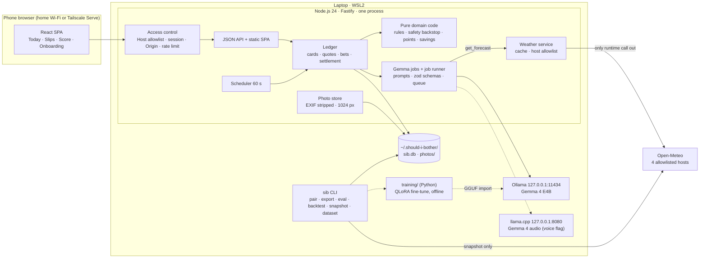

# Architecture

A concise overview of how "Should I Bother?" is put together. It is a map: for the reasoning behind
each part follow the links to [design.md](spec/design.md) (the full design, with the data model and
the interface list) and the architecture decision records in [docs/adr/](adr/). For how Gemma is
wired in, read [gemma.md](gemma.md).

## In one paragraph

One laptop (Windows 11 with WSL2 and an NVIDIA GPU) runs a single Node.js 24 process. A Fastify
server serves a React single-page app and a JSON API to a phone on the home Wi-Fi, keeps everything
in SQLite and a photo folder, and runs a 60-second scheduler. Gemma 4 runs beside it in Ollama on
127.0.0.1 (and, for voice only, in llama.cpp on 127.0.0.1). The only call that leaves the laptop at
runtime is the weather lookup to Open-Meteo. ([ADR-0002](adr/0002-run-everything-locally-on-one-laptop.md),
[ADR-0003](adr/0003-one-node-process-with-a-react-spa.md))

## Components

| Component | What it does | Where |
|---|---|---|
| Web client | React 19 + Vite SPA built to `dist/web`, following the Figma mockups (design.md Round 3 item 12): Today with a greeting header, weekly strip, weather board, one capture input and chips; Slips; Score; Onboarding; a sidebar on wide screens. Screens behind feature flags; zod-validated API data; polls every 30 s while visible. Fonts, icons and the sloth mascot (inline SVG) are bundled, no CDN, and there is deliberately no share button, because a shared slip would carry chore text off the laptop. | `src/web/`, [THIRD-PARTY.md](../THIRD-PARTY.md) |
| HTTP server | Fastify 5: static SPA, JSON API, photo files, security headers, Host allowlist, body limits. A feature whose flag is off registers no route. | `src/server/app.ts`, `src/server/core.ts` |
| Access control | Pairing token, session cookie, Host and Origin checks, rate limit (below). | `src/server/auth/` |
| Ledger | Cards, quotes, bets, the bet state machine, settlement, receipts, Score, export, rescue, appeals. All state in SQLite transactions. | `src/server/ledger/` |
| Domain | Pure functions with no I/O: rule baseline, safety backstop, bands, points, savings, outcome labels, calibration, settle-time bounds. | `src/domain/` |
| Gemma jobs | One module per job (prompt + input builder + zod schema + checks) on one `JobRunner` (FIFO queue of 8, 30 s per call, 45 s per job, one retry). | `src/server/gemma/`, `prompts/` |
| Model clients | `ModelClient` interface; Ollama, llama.cpp (audio) and a fixture-backed fake. | `src/server/model/` |
| Weather service | Open-Meteo client with a 1 h forecast cache, recorded-weather fetch for settlement, a 1,000 calls/day budget and a four-host allowlist. | `src/server/weather/` |
| Photo store | Accepts JPEG, PNG, WebP or HEIF by magic bytes (10 MB), decodes with sharp, re-encodes to JPEG at 1024 px at most with all metadata dropped, random file names. | `src/server/photos/` |
| Scheduler | In-process loop, every 60 s (below). | `src/server/scheduler.ts` |
| CLI | `sib` commands. | `src/cli.ts` |
| Backtest, eval, dataset | Offline pipelines: replay, `sib eval`, snapshot and fine-tune dataset. | `src/backtest/`, `src/eval/`, `evals/` |
| Training | Python project for the QLoRA fine-tune: config, dataset loading, training, merge and GGUF export scripts with dry runs; the real run is the builder's (T-012). | `training/` |

## The data folder

All household data lives in one folder **outside the repository**: `~/.should-i-bother/`, or
`SIB_DATA_DIR`. It is created owner-only (0700; an existing folder with group or other access is
tightened, or the start fails) and the database file is 0600 (`src/server/data-dir.ts`,
`src/server/db.ts`).

| Path | Content |
|---|---|
| `sib.db` (+ `sib.db-wal`, `sib.db-shm`) | SQLite in WAL mode with foreign keys and `secure_delete` on: pairing and sessions (hashes only), cards, quotes, bets, settlements, `gemma_decisions`, the weather cache, onboarding profile, achievements |
| `photos/` | Re-encoded photo files named by random UUID; a photo is written as `.tmp`, its row inserted, then renamed; an orphan sweep at start removes strays |
| `data-snapshots/`, `datasets/`, `evals/` | Created on demand by `sib snapshot`, `sib dataset` and `sib eval`; the commands refuse a location inside a git working tree unless git ignores it |

The app refuses to start with a data folder that git could commit (inside a git working tree and not ignored), and `sib export` refuses such a target too. Copying the folder is a full backup. `sib export <dir>` writes everything to JSON plus the photos;
`sib delete-photos [--all-data]` removes them. Both refuse to run while the app is running. The
data model is in [design.md](spec/design.md#data-model).

## Migrations

Schema changes are numbered files in `src/server/migrations/`, registered in `index.ts` and applied
at start, in order, each inside a `BEGIN IMMEDIATE` transaction, so the server and `sib pair`
starting together cannot both apply one. Applied migrations are recorded with a checksum; a changed
migration, or a database written by a newer build, is refused (`src/server/db.ts`). Migrations add
to the schema without rewriting existing rows; triggers make the bet's locked columns write-once and
enforce the status arrows (`0003-bet-locks.ts`). Current set: 0001 pairing and sessions, 0002 core
schema, 0003 bet locks, 0004 card notices, 0005 Gemma card state, 0006 card photos, 0007 settle
progress, 0008 card sunset, 0010 laundry plan, 0011 rescue, 0012 appeals, 0013 household profile,
0014 achievements, 0015 place label, 0016 decision tool result, 0017 bet decision (0009 is intentionally unused; numbers were assigned per task so parallel branches
did not clash). Migration tests run on a seeded fixture database; the builder checks each migration
on a copy of the live database before applying it (NFR-003).

## The scheduler

`createScheduler` runs a pass every 60 seconds and once at start; all state is in SQLite, so a
restart picks up every bet whose settle time passed while the server was down (NFR-003). Each pass:

1. **Mark due**: open bets whose settle time has come become `due`.
2. **Weather**: bets waiting for recorded weather ask Open-Meteo again, every 30 minutes (AC-014.5).
3. **Settlement**: stores the recorded weather for the settle screen and runs the Gemma judge for
   do-it decisions, answered bets that wait for Gemma (retried every 2 minutes) and bets with no
   answer 24 hours after their settle time.
4. **Rescue** (flag `rescue`): re-checks the forecast of open bets every 30 minutes.

Each step runs one pass at a time, so a slow Open-Meteo or a slow Gemma cannot stack passes. On
start, cards left `thinking` become "offline, restart" and photos left `inspecting` become failed
(`recoverThinkingCards`, `recoverInspections` in `src/server/core.ts`).

## Security

The threat model is a household on a Wi-Fi network: nobody else on it should see the photos or place
bets ([ADR-0007](adr/0007-pairing-token-access-over-plain-http-on-the-lan.md), design.md "Security
design").

- **Network exposure.** Fastify listens on 127.0.0.1 and one private LAN address, never `0.0.0.0`
  (`src/server/network.ts`; `SIB_LAN_ADDRESS` may override, private or loopback addresses only).
  Ollama and llama.cpp listen on 127.0.0.1 only. One Windows firewall rule for the app port, Private
  profile only; no rule for 11434.
- **Pairing.** On start and on `sib pair` the server prints a pairing link and QR code to the
  console (stderr). The token is at least 128 bits from a CSPRNG, valid 10 minutes and for at most
  3 devices, compared in constant time and stored only as a SHA-256 hash. `sib forget-devices`
  revokes every session and pending link (`src/server/auth/store.ts`, `secrets.ts`).
- **Session guard.** Every route needs a valid session, including photos and `/healthz`; the only
  exception is `/pair`. The cookie is `HttpOnly`, `SameSite=Strict`, 30 days; paired through an
  https public origin it is also `Secure` and named `__Host-sib_session`. Session ids are stored
  hashed (`src/server/auth/guard.ts`).
- **Host allowlist.** The `Host` header (with port) must be in a list built at start from `localhost`,
  `127.0.0.1`, the addresses of the active interfaces, `allowedHosts` and the hosts of
  `publicOrigins` (`config/server.json`, git-ignored). Anything else gets 421, which blocks DNS
  rebinding. The list is printed at start.
- **Origin check.** POST, PUT and DELETE need an `Origin` that is an allowlisted host over http or an
  entry of `publicOrigins`; otherwise 403.
- **Rate limit.** More than 10 failed unauthenticated requests a minute from one address blocks
  further unauthenticated requests from it for a minute; valid sessions are never affected. Behind
  Tailscale Serve or a port proxy all clients share one address, which is accepted for one household.
- **Headers.** Content-Security-Policy `default-src 'self'; img-src 'self' blob: data:;
  frame-ancestors 'none'; form-action 'self'; base-uri 'none'`, `X-Content-Type-Options: nosniff`,
  `Referrer-Policy: no-referrer`, `X-Frame-Options: DENY`; API responses are `no-store`. Fonts are
  self-hosted, so the CSP needs no external source.
- **Known limit.** On plain HTTP a device already on the Wi-Fi could sniff the session cookie.
  Everyone else gets 401. For HTTPS, use Tailscale Serve (README).
- **Input and output handling.** Uploads: 10 MB, magic-byte sniffing, one at a time, random names.
  Model output is schema-validated enums and short strings, rendered as text by React (no
  `dangerouslySetInnerHTML`). Points, savings, settle bounds and safety are computed by code, so
  injected text cannot move them (see [gemma.md](gemma.md#6-the-job-runner-every-gemma-call-goes-through)).
- **Logs.** pino JSON to stdout, no log file; tokens, cookies and photo bytes are redacted; the
  `/pair` query string is redacted; pairing lines go to stderr, not the log.
- **Supply chain.** Lockfiles (npm and uv), `npm audit` and gitleaks in CI, Dependabot, Actions
  pinned (`.github/workflows/`).

## Privacy boundaries

What the app handles that is household-private: photos, chore text, habits, the onboarding profile,
voice audio and transcripts, the decision log, the database and exports.

| It never leaves the laptop | Where it goes instead |
|---|---|
| Photos (before, after, appeal) | Re-encoded, stored in `photos/`, sent as base64 to Ollama on 127.0.0.1 only |
| Chore text, habits, onboarding answers | SQLite; sent to Ollama on 127.0.0.1 only |
| The optional place label (onboarding) | SQLite and `sib export`; shown in the weather board header only, never in an Open-Meteo request, a Gemma prompt, a decision row, a log line or a dataset row (AC-026.3) |
| Voice audio | Held in memory for the request, sent to llama.cpp on 127.0.0.1, never written or logged; the transcript is not stored in the decision log |
| Model prompts and answers | 127.0.0.1; `gemma_decisions` keeps short summaries without household text |
| Pairing tokens, session ids | Stored as hashes; never logged |

**What does leave: Open-Meteo, and nothing else at runtime.** The weather client calls only four
hosts, enforced in code by `assertAllowedUrl` (https, no credentials or port, host in the list;
redirects are errors) and by a CI test (AC-014.7):

- `api.open-meteo.com` (forecast, and recent hours for settlement)
- `previous-runs-api.open-meteo.com`, `historical-forecast-api.open-meteo.com`,
  `archive-api.open-meteo.com` (the backtest and fine-tune snapshot, run by `sib snapshot`)

Each request carries the household's coordinates **rounded to 2 decimals** (about 1 km) and the
variables asked for, nothing else; Open-Meteo also necessarily sees the laptop's IP address. There is
a budget of 1,000 calls a day (the free tier allows 10,000). Setup-time downloads are the only other
traffic and are not part of the app: the Ollama registry for the models, npm and PyPI for packages,
and Hugging Face if the builder publishes an adapter by hand. No analytics, no telemetry, no cloud
model. The release checklist ([release-checklist.md](release-checklist.md)) includes a network
capture to confirm that only Open-Meteo is contacted; that check had not been run when this was
written. The Open-Meteo host names are marked UNVERIFIED in `src/domain/open-meteo.ts` until it is.

The fine-tune dataset is the one artifact designed to leave the laptop (Colab as a fallback,
Hugging Face for the adapter): it contains public weather data and a fixed synthetic habit profile
only, and the build fails if any value from `config/household.json` appears in it.

## Environments

| Environment | Model | Weather | Needs |
|---|---|---|---|
| Dev and CI | Fake (`SIB_FAKE_MODEL=1`, fixtures in `test/fixtures/gemma/`) | Fake (`SIB_FAKE_WEATHER=1`) or recorded fixtures | Any machine with Node 24; no GPU, no network |
| Demo (`sib demo`) | Fake, on a temporary data folder seeded with synthetic bets (`model_version = 'fake-demo'`); a "Sample data" banner on every screen | Fake | Never touches the live data folder or `config/household.json` (AC-029.4) |
| Live | Gemma 4 E4B in Ollama | Open-Meteo | The builder's laptop |

CI (`.github/workflows/ci-node.yml`) runs format check, lint, typecheck, tests with coverage and the
dependency audit on Node 24, plus ruff and pytest for `training/`; `security.yml` runs gitleaks.

## Decisions

| ADR | Decision |
|---|---|
| [0002](adr/0002-run-everything-locally-on-one-laptop.md) | Run everything locally on one laptop |
| [0003](adr/0003-one-node-process-with-a-react-spa.md) | One Node process with a React SPA |
| [0004](adr/0004-ollama-for-gemma-with-llama-cpp-for-audio.md) | Ollama for Gemma, llama.cpp for audio |
| [0005](adr/0005-gemma-sets-odds-as-bands-with-a-rule-baseline.md) | Gemma sets odds as bands, scored against a rule baseline |
| [0006](adr/0006-python-training-folder-for-the-bookmaker-fine-tune.md) | A Python `training/` folder for the fine-tune |
| [0007](adr/0007-pairing-token-access-over-plain-http-on-the-lan.md) | Pairing-token access over plain HTTP on the LAN |
| [0008](adr/0008-weather-sources-for-odds-settlement-and-backtest.md) | Weather sources for odds, settlement and the backtest |
| [0009](adr/0009-cards-without-odds-are-coming-later-cards-with-a-notice.md) | Cards without odds are "coming later" cards with a notice |
| [0010](adr/0010-cash-outs-and-achievements-live-in-their-own-tables.md) | Cash-outs and achievements live in their own tables |
