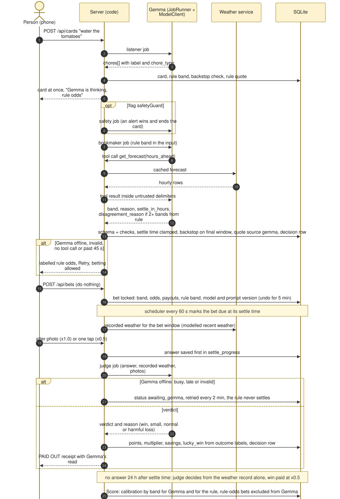

# Architecture

How "Should I Bother?" (The Lazy Bookie) is put together: the goals it was built for, the
system and its parts, how a request moves through it, where the data lives, which modes it runs in,
the security model, what happens when something fails, how it is tested and how it is deployed.

It is a map with the reasoning attached. Details live next to it: [gemma.md](gemma.md) is the deep
dive on Gemma, [spec/design.md](spec/design.md) is the approved design (data model, interface list,
traceability), [adr/](adr/) holds the decisions, [reference.md](reference.md) lists every setting and
command, and [deploy-digitalocean.md](deploy-digitalocean.md) is the hosted-mode guide. How the project
was built, spec first, is in [how-it-was-built.md](how-it-was-built.md).

Every file path below is real; every limit is the constant in the code. Where something has not been run
against the real service (the Ollama, llama.cpp, DigitalOcean and Open-Meteo wire formats), it says
**UNVERIFIED**, as the code headers do.

**Contents**

1. [Goals and constraints](#1-goals-and-constraints)
2. [System context](#2-system-context)
3. [Containers: the runtime](#3-containers-the-runtime)
4. [Components](#4-components)
5. [Gemma inside the system](#5-gemma-inside-the-system)
6. [The life of a request: a bet from start to receipt](#6-the-life-of-a-request-a-bet-from-start-to-receipt)
7. [The scheduler](#7-the-scheduler)
8. [Data model and storage](#8-data-model-and-storage)
9. [Modes](#9-modes)
10. [Configuration and feature flags](#10-configuration-and-feature-flags)
11. [Security model](#11-security-model)
12. [Privacy boundaries](#12-privacy-boundaries)
13. [Reliability and fallbacks](#13-reliability-and-fallbacks)
14. [Testing strategy](#14-testing-strategy)
15. [Deployment](#15-deployment)
16. [Key decisions](#16-key-decisions)

## 1. Goals and constraints

The product is a bet on doing nothing: the app prices a weather chore, you either do it or let the sky
do it, and the bet settles on evidence. The architecture follows from five goals and a few hard
constraints ([product.md](spec/product.md), [requirements.md](spec/requirements.md)).

| Goal | What it means in the design |
|---|---|
| **Gemma is the bookmaker and the judge** | Every judgement is a Gemma job. Code never decides a verdict, and the rule baseline never settles a bet (REQ-003, REQ-008). |
| **Code is exact and safe** | Points, savings, settle bounds and safety are pure functions, tested and locked at bet time (REQ-009, REQ-012). Gemma returns enums and short strings. |
| **Private by default** | Photos, chores, habits and audio stay on one machine. In home mode the only runtime call out is the weather lookup (NFR-001, NFR-002, ADR-0002). |
| **Honest about itself** | Every decision is logged and shown ("How Gemma decided"); Gemma is scored against an untuned rule (REQ-020, REQ-028, ADR-0005). |
| **Testable without a GPU** | One `ModelClient` seam and a fixture-backed fake, so CI runs with no model, no GPU and no network (NFR-010). |

Constraints that shaped it:

- **One household, one laptop** (Windows 11 + WSL2, NVIDIA GPU of 8 GB or more). One GPU user at a
  time, so Gemma jobs run through one FIFO queue.
- **Node.js 24, pinned** (`.nvmrc`, `engines` `>=24 <25`), because the native modules `better-sqlite3`
  and `sharp` must match.
- **Small model, strict contract.** A 4B-class model gets bands instead of percentages, short schemas,
  checks in code and a retry that quotes the error (ADR-0005).
- **No accounts.** Devices pair once with a one-time token; there is no login (REQ-001, REQ-032).
- **A fixed delivery window** (feature freeze 24 Oct 2026, 14:00 Madrid), so unfinished features ship
  behind flags that are off by default (REQ-029).
- **Optional hosted mode** for use away from home without a GPU, with a stated privacy trade-off
  (REQ-032, ADR-0011).

## 2. System context

*Source: [diagrams/system-context.mmd](diagrams/system-context.mmd).*

- **Home mode (the default).** The phone opens a web app served by one process on the laptop. Gemma
  runs on the same laptop in Ollama (and, for voice only, llama.cpp), both on 127.0.0.1. The laptop
  calls Open-Meteo for weather and nothing else.
- **Hosted mode (optional, `SIB_MODE=hosted`).** The same code runs in a container on one DigitalOcean
  Droplet behind Caddy, and Gemma comes from DigitalOcean's Serverless Inference API. Chore text, habits,
  answers and the area forecast go to that service; photos go only with `SIB_DO_VISION=1`
  ([section 9](#9-modes), ADR-0011).

## 3. Containers: the runtime

One process serves everything. There is no message bus, no second service and no external database.

*Source: [diagrams/runtime-architecture.mmd](diagrams/runtime-architecture.mmd).*

| Container | Technology | Role |
|---|---|---|
| Phone browser | React 19 SPA built by Vite to `dist/web` and served by the app | Today, Slips, Score, Household, onboarding; polls the API every 30 s while visible |
| App process | Node.js 24, Fastify 5, TypeScript (strict), ESM | Static SPA, JSON API, photo files, scheduler, Gemma jobs, weather client |
| Data folder | SQLite (better-sqlite3, WAL, foreign keys, `secure_delete`) and a `photos/` folder, outside the repository | All household data ([section 8](#8-data-model-and-storage)) |
| Ollama | Gemma 4 E4B (and the optional fine-tuned E4B) on `127.0.0.1:11434` | Every job except voice |
| llama.cpp | Gemma 4 audio on `127.0.0.1:8080`, started by hand | The voice job only (flag `voice`, ADR-0004) |
| Open-Meteo | HTTPS, five allowlisted hosts | Forecast, recorded weather, place search, backtest data |
| Offline tools | `sib` CLI, `training/` (Python, uv) | Backtest, eval, dataset and the QLoRA fine-tune, run on the laptop by hand |

The choice of one process with a React SPA and in-process scheduler is
[ADR-0003](adr/0003-one-node-process-with-a-react-spa.md); running it all on one laptop is
[ADR-0002](adr/0002-run-everything-locally-on-one-laptop.md).

## 4. Components

| Component | What it does | Where |
|---|---|---|
| Web client | Today with a greeting header, weekly strip, weather board, one capture input and chips; Slips; Score; Household and onboarding; a sidebar on wide screens. Screens behind a flag are not shown; API data is zod-validated; fonts, icons and the sloth mascot are bundled, with no CDN. There is deliberately no share button: a shared slip would carry chore text off the laptop. | `src/web/`, [THIRD-PARTY.md](../THIRD-PARTY.md) |
| HTTP server | Fastify: static SPA, JSON API (RFC 9457 problem+json errors), photo files, security headers, Host allowlist, body limits. A feature whose flag is off registers no route. | `src/server/app.ts`, `src/server/core.ts` |
| Access control | Pairing token, session cookie, Host and Origin checks, rate limit. Hosted mode adds the pairing page and the trusted-proxy rules. | `src/server/auth/` |
| Ledger | Cards, quotes, bets, the bet state machine, settlement, receipts, Score, export, rescue, appeals. All state changes are SQLite transactions. | `src/server/ledger/` |
| Domain | Pure functions with no I/O: rule baseline, safety backstop, bands, points, savings, outcome labels, calibration, lucky-win flag, advice rules, settle-time bounds. | `src/domain/` |
| Gemma jobs and runner | One module per job (prompt, input builder, zod schema, checks) on one `JobRunner` (FIFO queue of 8, 30 s per call, 45 s per job, one retry). | `src/server/gemma/`, `prompts/` |
| Model clients | The `ModelClient` interface; `OllamaClient`, `LlamaCppAudioClient`, `DigitalOceanClient` behind `CappedModelClient`, and the fixture-backed `FakeModelClient`. | `src/server/model/` |
| Weather service | Open-Meteo client with a 1 h forecast cache, recorded-weather fetch for settlement, a 1,000 calls a day budget and a five-host allowlist (the geocoding host serves the onboarding place search). | `src/server/weather/`, `src/domain/open-meteo.ts` |
| Photo store | Accepts JPEG, PNG, WebP or HEIF by magic bytes (10 MB), decodes with sharp, re-encodes to JPEG at 1024 px at most with all metadata dropped, random file names. | `src/server/photos/` |
| Voice | The `listener-audio` transcript route; audio is held in memory only. | `src/server/voice/` |
| Scheduler | In-process loop, every 60 s ([section 7](#7-the-scheduler)). | `src/server/scheduler.ts` |
| Mode and config | Home or hosted settings parsed once at start (`mode.ts`), model config, flags and presets, rules. | `src/server/mode.ts`, `config.ts`, `flags.ts`, `config/` |
| CLI | The `sib` commands. | `src/cli.ts`, `src/server/commands.ts` |
| Backtest, eval, dataset | Offline pipelines: replay, `sib eval`, snapshot and fine-tune dataset. | `src/backtest/`, `src/eval/`, `evals/` |
| Demo | `sib demo`: a temporary data folder seeded with synthetic bets, the fake model and fake weather. | `src/demo/`, `src/server/demo.ts` |
| Training | Python project for the QLoRA fine-tune: config, dataset loading, training, merge and GGUF export, a hold-out smoke test. The real run is the builder's (T-012). | `training/` |

## 5. Gemma inside the system

The jobs, the runner, the model clients and the code that sits around them are the heart of the
design, so they have their own document: **[gemma.md](gemma.md)**. The one picture to keep in mind:

*Source: [diagrams/gemma-architecture.mmd](diagrams/gemma-architecture.mmd).*

The rule that organises it: **Gemma decides, code executes.**

- Gemma returns a typed answer: an odds band, a reason of at most 140 characters, a verdict, a chore
  type. It never returns a number that moves money, time or safety.
- Code validates the answer (JSON, zod schema, per-job checks, one retry), then computes everything exact:
  band to odds, payouts, savings, settle-time bounds, the safety backstop and the lucky-win flag.
- Every Gemma job, valid or not, writes one `gemma_decisions` row, which the UI shows as "How Gemma
  decided" and the Score screen uses to separate Gemma's calibration from the rule's.

## 6. The life of a request: a bet from start to receipt

*Source: [diagrams/bet-lifecycle.mmd](diagrams/bet-lifecycle.mmd).*

1. **Capture.** `POST /api/cards` runs the listener; a quick chip (`POST /api/cards/quick`) skips it.
   The card is created at once with the rule band, the safety backstop checked and a rule quote, so
   the screen never waits for Gemma (AC-013.1).
2. **Pricing.** In the background, the safety guard (flag), then the bookmaker run. The bookmaker calls
   `get_forecast`, answers with a band, a reason and a settle time, and code checks it. The rule quote
   is replaced by a `source = gemma` quote unless a bet was placed meanwhile.
3. **Bet.** `POST /api/bets` copies the quote the person saw onto the bet and locks it (database
   triggers refuse later changes). Undo works for 5 minutes.
4. **Due.** The scheduler marks the bet due at its settle time and fetches the recorded weather
   ("modelled recent weather").
5. **Evidence and verdict.** The person sends an after photo (full points) or one tap (half). The
   answer is stored first, then the judge decides.
6. **Receipt.** Code turns the verdict into points, savings and the lucky-win flag; the Score screen
   adds the bet to the calibration of the band that priced it.

The photo path (an inspector and a bookmaker job sharing one 45 s deadline) is in
[gemma.md, section 5](gemma.md#5-the-life-of-a-bet).

## 7. The scheduler

*Source: [diagrams/scheduler.mmd](diagrams/scheduler.mmd).*

`createScheduler` (`src/server/scheduler.ts`) runs a pass at start and every 60 seconds
(`SCHEDULER_INTERVAL_MS`). All state is in SQLite, so a restart picks up every bet whose settle time
passed while the server was down (NFR-003). Each pass:

1. **Mark due** (`markDueBets`): open bets whose settle time has come become `due`.
2. **Recorded weather** (`retryAwaitingWeather`): bets waiting for weather ask Open-Meteo again every
   30 minutes (`RECORDED_WEATHER_RETRY_MS`, AC-014.5).
3. **Settlement** (`tickSettlement`): stores the recorded weather, runs the judge for do-it decisions,
   for answered bets that wait for Gemma (retried every 2 minutes, `GEMMA_RETRY_MS`) and for bets with
   no answer 24 hours after their settle time.
4. **Rescue** (flag `rescue`): re-checks the forecast of open bets every 30 minutes
   (`RESCUE_CHECK_INTERVAL_MS`).

Each step runs one pass at a time, so a slow Open-Meteo or a slow Gemma cannot stack passes. On start,
cards left `thinking` become "offline, restart" and photos left `inspecting` become failed
(`recoverThinkingCards`, `recoverInspections`, wired in `src/server/core.ts`). In hosted mode the daily
call cap can ask the settlement step to run early, so verdicts that waited for the cap's reset go first.

## 8. Data model and storage

*Source: [diagrams/data-model.mmd](diagrams/data-model.mmd). The diagram shows the key columns of the
main tables; the full list with every column and rule is in [design.md, Data model](spec/design.md#data-model).*

| Table | Holds |
|---|---|
| `pairing`, `sessions` | Pairing tokens and sessions, as SHA-256 hashes only; `pairing.max_sessions` and `sessions.device` since migration 0020 |
| `cards` | One chore card: kind (`weather`, `not_weather`, `coming_later`, `alert`), Gemma and photo state, the laundry plan and advice JSON, the stamped location (write-once) |
| `quotes` | Every price a card has had: the rule quote, the Gemma quote, the quote made with a photo |
| `bets` | The locked bet: band, odds, odds source, `gemma_band`, `rule_band`, model and prompt version, savings snapshot, settle time, status. Triggers make the locked columns write-once and enforce the status arrows (migration 0003) |
| `settlements` | The verdict, evidence, multiplier, points, `lucky_win` (computed by code); an appeal adds a second row |
| `settle_progress` | What a bet knows while it settles; the answer is stored before the judge is called |
| `photos` | Photo rows; the files are in `photos/` and served only through the session guard |
| `gemma_decisions` | One row per Gemma job: model, digest, prompt version, tool mode, short input summary, output, validity, retries, latency, the forecast hours the tool returned |
| `weather_cache`, `model_calls` | Forecast cache (1 h); hosted mode's calls per Madrid day |
| `cash_outs`, `rescue_checks`, `household_profile`, `achievements` | Flagged features, each in its own table (ADR-0010) |

**The data folder.** All household data lives in one folder outside the repository:
`~/.should-i-bother/`, or `SIB_DATA_DIR`. It is created owner-only (0700; an existing folder with group
or other access is tightened, or the start fails) and the database file is 0600
(`src/server/data-dir.ts`, `src/server/db.ts`).

| Path | Content |
|---|---|
| `sib.db` (+ `-wal`, `-shm`) | The SQLite database |
| `photos/` | Re-encoded photos named by random UUID; a photo is written as `.tmp`, its row inserted, then renamed; an orphan sweep at start removes strays |
| `data-snapshots/`, `datasets/`, `evals/` | Created on demand by `sib snapshot`, `sib dataset` and `sib eval`; refused inside a git working tree unless git ignores it |

The app refuses to start with a data folder that git could commit, and `sib export` refuses such a target
too. Copying the folder is a full backup; `sib export <dir>` writes JSON plus the photos;
`sib delete-photos [--all-data]` removes them. Both refuse to run while the app is running.

**Migrations.** Schema changes are numbered files in `src/server/migrations/`, registered in `index.ts` and
applied at start, in order, each in a `BEGIN IMMEDIATE` transaction, so the server and `sib pair`
starting together cannot both apply one. Applied migrations are recorded with a checksum; a changed
migration, or a database written by a newer build, is refused (`src/server/db.ts`). Migrations add to the
schema without rewriting rows. Current set: 0001 pairing and sessions, 0002 core schema, 0003 bet locks,
0004 card notices, 0005 Gemma card state, 0006 card photos, 0007 settle progress, 0008 card sunset,
0010 laundry plan, 0011 rescue, 0012 appeals, 0013 household profile, 0014 achievements, 0015 place label,
0016 decision tool result, 0017 bet decision, 0018 card advice, 0019 model calls, 0020 device pairing.
(0009 is intentionally unused: numbers were assigned per task so parallel branches did not clash.)

## 9. Modes

The same code runs in four situations. Only the model client, the network binding, the access flow and a
few guards differ.

| | Home (default) | Hosted | Demo (`sib demo`) | Fake (`SIB_FAKE_MODEL=1`) |
|---|---|---|---|---|
| Purpose | Real use on the laptop | Real use away from home, no GPU | Rehearsal, screenshots, a first look | Tests, CI, `npm run dev` |
| Model | Ollama on 127.0.0.1 (llama.cpp for voice) | DigitalOcean Serverless Inference (`DigitalOceanClient` in `CappedModelClient`) | `FakeModelClient`, rows marked `fake-demo` | `FakeModelClient`, fixtures in `test/fixtures/gemma/` |
| Weather | Open-Meteo | Open-Meteo | Fake, fixed date (23 Oct 2026, 10:00) | Open-Meteo, or fake with `SIB_FAKE_WEATHER=1` |
| Network | Binds 127.0.0.1 and one private LAN address; plain HTTP, or HTTPS through Tailscale Serve | Binds `SIB_BIND_ADDRESS` inside a container; Caddy terminates HTTPS | As home, on port 8788 | As home |
| Access | A pairing link printed at start; 30-day cookie | No token at start; `sib pair` prints `/pair#t=...` to the terminal; the page POSTs the token; `__Host-` cookie renewed on use | A pairing link; a "Sample data" banner on every screen | A pairing link; a loud console notice, "(fake model)" on Today |
| Data | `~/.should-i-bother/` | `/srv/sib/data` on the Droplet | A temporary folder deleted on exit | The normal data folder, or a test database |
| Selection | `selectModel` in `src/server/model/select.ts` | `SIB_MODE=hosted` plus its variables, validated once in `src/server/mode.ts` | `src/server/demo.ts` | `SIB_FAKE_MODEL=1` only, never chosen any other way |

Rules that hold across modes:

- **The fake never poses as Gemma.** It is chosen only by `SIB_FAKE_MODEL=1` (or by `sib demo`), the
  console says so, and Score leaves fake-model bets out of the calibration (`model_version LIKE
  'fake%'`). The demo's figures are labelled "Sample data" and are never results.
- **Hosted mode switches four things and nothing else:** the model, the photo policy (photos stay on the
  server unless `SIB_DO_VISION=1`), the network and access flow, and a daily spend cap
  (`SIB_DAILY_MODEL_CALLS`). Voice and the fine-tuned bookmaker are forced off.
  Hosted settings set in home mode are ignored with one warning.
- **Every screen that names where Gemma runs reads the mode** from the API status, so hosted mode says
  "Gemma 4 · DigitalOcean · <model ID>" and the privacy line says what leaves the server (AC-032.6).

## 10. Configuration and feature flags

Settings come from three places: files in `config/`, environment variables and (hosted) one root-owned
env file. The complete tables are in [reference.md](reference.md); the shape is:

| Source | Holds |
|---|---|
| `config/models.json` (committed) | The primary model tag, runtime addresses (loopback only), `gemma.toolUse` (`native` or `injected`), `gemma.answerMode` |
| `config/flags.json` (committed, all off) and `flags.presets.json` | 15 feature flags; the `presentation` preset turns on every merged feature except `voice` and `finetunedBookmaker` |
| `config/rules.json`, `rules-rain.json`, `advice-rules.json`, `savings.json` (committed) | The rule baseline, safety thresholds, advice windows and the savings catalogue; final for this version, not tuned |
| `config/server.json`, `config/household.json` (git-ignored) | Port, extra hosts and origins; the household's baseline and location |
| Environment | `SIB_FAKE_MODEL`, `SIB_FAKE_WEATHER`, `SIB_DATA_DIR`, `SIB_PORT`, `SIB_LAN_ADDRESS`, and the `SIB_MODE` family for hosted mode |

**Flags.** Every flag is off by default; a flag that is off shows no UI entry point and registers no
route (REQ-029). Unknown flag names are an error. A running app reads the flags at start. This is how
an unfinished feature ships safely at a feature freeze.

**Prompts and fixtures are versioned files.** A prompt change bumps `prompts/<job>.v<n>.md` and
re-records the job's fixtures; fixtures are keyed by job and scenario name, never by input hash.

## 11. Security model

The threat model is a household on a Wi-Fi network (and, in hosted mode, a public host): nobody else
should see the photos or place bets, and nothing a stranger types or photographs should move a score.
See [ADR-0007](adr/0007-pairing-token-access-over-plain-http-on-the-lan.md) and
[design.md, Security design](spec/design.md#security-design).

*Source: [diagrams/trust-boundaries.mmd](diagrams/trust-boundaries.mmd).*

**Where untrusted input enters, and what stops it**

| Entry point | Guard |
|---|---|
| Typed text (500 characters) and the voice transcript | Inside `<untrusted_data>` delimiters, JSON-encoded with `<` escaped (`untrustedBlock`, `src/server/gemma/untrusted.ts`); every prompt says the block is data |
| Photos | 10 MB, magic-byte sniffing, one upload at a time, sharp decode, JPEG at 1024 px, no metadata, random names (`src/server/photos/`) |
| Model output | zod schema, per-job checks, enums and short strings, one retry; rendered as text by React (no `dangerouslySetInnerHTML`); points, savings, settle bounds and safety are computed by code, so injected text cannot move them |
| Weather rows and tool results | Fixed host allowlist, https only, no redirects, a daily budget, rounded coordinates; tool results are fenced like any untrusted data |
| Other devices, web pages, DNS rebinding | Pairing, session, Host, Origin and rate-limit guards (below) |

**Access control** (`src/server/auth/`)

- **Network exposure.** Home mode listens on 127.0.0.1 and one private LAN address, never `0.0.0.0`
  (`src/server/network.ts`; `SIB_LAN_ADDRESS` may override, private or loopback addresses only). Ollama
  and llama.cpp listen on 127.0.0.1 only. One Windows firewall rule for the app port, Private profile
  only; no rule for 11434. Hosted mode binds inside the container and publishes no port; only Caddy
  does.
- **Pairing.** The token is at least 128 bits from a CSPRNG, valid 10 minutes and for at most 3 devices
  (hosted: 1 unless `sib pair --devices N`), compared in constant time and stored only as a SHA-256 hash.
  `sib forget-devices` revokes every session and pending link.
- **Session guard.** Every route needs a valid session, including photos and `/healthz`; the only
  exception is `/pair` (and, in hosted mode, `/healthz` for a request from 127.0.0.1 inside the
  container, which is how the container health check works). The cookie is `HttpOnly`,
  `SameSite=Strict`, 30 days; paired through an https origin it is also `Secure` and named
  `__Host-sib_session`. Session ids are stored hashed.
- **Host allowlist.** The `Host` header must be in a list built at start from `localhost`, `127.0.0.1`,
  the active interfaces, `allowedHosts` and the hosts of `publicOrigins`; anything else gets 421, which
  blocks DNS rebinding. Hosted mode accepts exactly `SIB_PUBLIC_ORIGIN`.
- **Origin check.** POST, PUT and DELETE need an allowlisted `Origin`; otherwise 403.
- **Rate limit.** More than 10 failed unauthenticated requests a minute from one address blocks further
  unauthenticated requests from it for a minute; valid sessions are never affected. Hosted mode believes
  `X-Forwarded-For` only from `SIB_TRUSTED_PROXY` (Caddy's fixed address).
- **Headers.** `Content-Security-Policy: default-src 'self'; img-src 'self' blob: data:;
  frame-ancestors 'none'; form-action 'self'; base-uri 'none'`, `X-Content-Type-Options: nosniff`,
  `Referrer-Policy: no-referrer`, `X-Frame-Options: DENY`; API responses are `no-store`. Fonts are
  self-hosted, so the CSP needs no external source.
- **Known limit.** On plain HTTP a device already on the Wi-Fi could sniff the session cookie; everyone
  else gets 401. For HTTPS use Tailscale Serve (ADR-0007).

**Model traffic** stays local by four layers (`src/server/model/`): `config/models.json` accepts only a
literal loopback address; the clients refuse redirects and cap answers at 1 MiB; a proxy guard refuses to
start when `NODE_USE_ENV_PROXY=1` could route model traffic through a proxy; and Ollama itself must keep
its default 127.0.0.1 binding. In hosted mode the only inference host is `inference.do-ai.run`
(**UNVERIFIED**), checked again before every request, and the key is a `Secret` that prints as
`[redacted]` and is stripped from every error.

**Logs.** pino JSON to stdout, no log file; tokens, cookies and photo bytes are redacted; the `/pair`
query string is dropped; pairing lines go to stderr. Caddy writes no access log.

**Supply chain.** Lockfiles (npm and uv), `npm audit` in CI, gitleaks in pre-commit and CI, Dependabot,
GitHub Actions pinned by commit, container base image pinned by digest.

## 12. Privacy boundaries

What the app handles that is household-private: photos, chore text, habits, the onboarding profile,
voice audio and transcripts, the decision log, the database and exports.

| It never leaves the laptop (home mode) | Where it goes instead |
|---|---|
| Photos (before, after, appeal) | Re-encoded, stored in `photos/`, sent as base64 to Ollama on 127.0.0.1 only |
| Chore text, habits, onboarding answers | SQLite; sent to Ollama on 127.0.0.1 only |
| The optional place label (onboarding) | SQLite and `sib export`; shown in the weather board header only, never in an Open-Meteo request, a Gemma prompt, a decision row, a log line or a dataset row (AC-026.3) |
| Voice audio | Held in memory for the request, sent to llama.cpp on 127.0.0.1, never written or logged; the transcript is not stored in the decision log |
| Model prompts and answers | 127.0.0.1; `gemma_decisions` keeps short summaries without household text |
| Pairing tokens, session ids | Stored as hashes; never logged |

**What does leave in home mode: Open-Meteo, and nothing else at runtime.** The weather client calls only
five hosts, enforced by `assertAllowedUrl` (https, no credentials or port, host in the list; redirects are
errors) and by a CI test (AC-014.7):

- `api.open-meteo.com` (forecast, and recent hours for settlement)
- `previous-runs-api.open-meteo.com`, `historical-forecast-api.open-meteo.com`,
  `archive-api.open-meteo.com` (the backtest and fine-tune snapshot, run by `sib snapshot`)
- `geocoding-api.open-meteo.com` (the onboarding place search, `GET /api/geocode`, flag `onboarding`)

Each request carries the household's coordinates **rounded to 2 decimals** (about 1 km) and the variables
asked for. The one exception is the place search: the text typed into it (2 to 60 characters, only when
the person presses Search) is sent by the laptop, never by the page. It is limited to 10 searches a minute
per session and 50 a day, dropped from request logs, not cached or stored, and never part of a Gemma
prompt or decision. Open-Meteo also necessarily sees the laptop's IP address. The call budget is 1,000 a
day (the free tier allows 10,000). Setup-time downloads (the Ollama registry, npm, PyPI, Hugging Face if
the builder publishes an adapter) are not part of the app. No analytics, no telemetry. The release
checklist ([release-checklist.md](release-checklist.md)) includes a network capture to confirm that only
Open-Meteo is contacted; that check had not been run when this was written. The host names are marked
UNVERIFIED in `src/domain/open-meteo.ts` until it is.

**What changes in hosted mode.** The app also calls DigitalOcean's inference host. Sent there: chore
text, habits, answers to Gemma's questions, inspector observations and the area forecast; photos only with
`SIB_DO_VISION=1`. DigitalOcean states it does not store this data or train on it (a search-engine extract,
**unverified**); the processing region is not documented. The database and photos live on a cloud server
and in its backups. The app says all this on screen (ADR-0011, [deploy guide](deploy-digitalocean.md)).

The **fine-tune dataset** is the one artifact designed to leave the laptop (Colab as a fallback, Hugging
Face for the adapter): it contains public weather data and a fixed synthetic habit profile only, and the
build fails if any value from `config/household.json` appears in it.

## 13. Reliability and fallbacks

| Failure | Behaviour |
|---|---|
| Gemma not running, past the 45 s deadline, invalid after the retry, no tool call after the retry | The card keeps **labelled rule odds** and offers Retry; betting stays allowed and the bet is stored with `odds_source = rule` (never counted in Gemma's calibration) |
| The judge cannot answer | The person's answer is saved, the bet moves to `awaiting_gemma` ("Settle when Gemma is back") and is retried every 2 minutes. **No code path settles a bet by the rule.** |
| No answer 24 h after the settle time | The judge decides from the recorded weather alone and a win pays at x0.5 |
| Model still loading | Status "Gemma is waking up"; a warm-up call runs at start |
| Gemma queue full (8 jobs) | 503 "Gemma is busy" before any state changes; a quick chip still creates its card with rule odds |
| Open-Meteo down | The cached forecast is used with its age; no new bet when none under 24 h old exists (AC-014.4); settlement retries every 30 minutes |
| Server or laptop restart | All state is in SQLite; the scheduler resumes from the database; `thinking` cards become "offline, restart" |
| Phone loses Wi-Fi | The SPA shows "Can't reach the laptop" and keeps polling |
| Disk full or a database error | The request fails with problem+json; nothing is half-written (transactions) |
| A weather alert (heat, frost, storm) | The **fixed backstop** turns the card into a "Do it now" alert whatever Gemma said; it needs no model |
| Hosted: daily cap reached | From 80 % only judge verdicts call Gemma (cards say "Gemma's daily limit"); at the cap verdicts wait for the next Madrid day and go first after the reset |
| Hosted: a bad release | `deploy.sh` backs up the database, waits for health and rolls back to the previous image by itself |

Gemma is allowed to be late or wrong; the app is not allowed to be unsafe or to invent a verdict.

## 14. Testing strategy

CI and local tests never touch a real model, the network or household data (NFR-010).

| Layer | What | How |
|---|---|---|
| Unit | Points and rounding, rule bands, drying index, safety backstop, settle-time clamps, savings, bet state machine, auth helpers | Vitest; every AC with deterministic logic has a test named after it, for example `it("AC-003.6: ...")` |
| Integration | API routes with an in-memory SQLite, the `FakeModelClient` (recorded fixtures, including invalid JSON, "unsure", timeout and no tool call) and fake weather | Vitest with Fastify `inject`; covers the requirements without a GPU |
| Component | Screens, the bet slip, settle, receipt, empty states, accessibility | Vitest and Testing Library in jsdom, with axe checks |
| End to end | Capture, bet and settle at phone width on the fake model; the demo; flags on | Playwright (`npm run test:e2e`, not part of CI yet) |
| Migrations | Every migration on a seeded fixture database; the builder checks each on a copy of the live database at merge | Vitest |
| Live evals | `sib eval <job>`: 20-case sets per job on the real model, with valid-JSON rate, tool use and latency | Run by hand on the laptop; **no real-model results exist yet** |
| Backtest | Six months of weather replayed without lookahead against the rule and a fixed routine | `sib backtest`; the live run is the builder's |
| Python | `training/`: config, dataset loading, dry runs, on a tiny synthetic dataset | ruff and pytest in CI, no GPU |

At the time of writing `npx vitest run` passes **2,581 tests in 144 files**, and 148 of the 149
acceptance criteria are named in a test (the missing one is AC-019.2, the real training run's smoke
test). The quality bar is `npm run format:check`, `npm run lint`, `npm run typecheck`, `npm test --
--coverage`, `npm audit --audit-level=high` and, for `training/`, ruff and pytest; pre-commit runs
prettier, eslint and gitleaks. CI (`.github/workflows/ci-node.yml`) runs them on Node 24;
`security.yml` runs gitleaks.

## 15. Deployment

**Home mode** is a clone, `npm ci`, `npm run build`, `ollama pull`, `npm start` ([setup.md](setup.md)).
There is no installer and no container; the target is a fresh clone to a running app in 30 minutes
without the model download (NFR-011).

**Hosted mode** is one DigitalOcean Droplet that the builder creates by hand (no Terraform), following
[deploy-digitalocean.md](deploy-digitalocean.md).

*Source: [diagrams/hosted-deployment.mmd](diagrams/hosted-deployment.mmd).*

- **Edge.** A Cloud Firewall (22 from the builder's IP only, 80 and 443 public) and `ufw`; a reserved IP
  and a DNS A record. Caddy (`deploy/digitalocean/Caddyfile`) gets a Let's Encrypt certificate, sets HSTS
  and writes no access log, answers 404 on `/healthz` and limits bodies to 11 MB.
- **App container.** The image is built by the `Dockerfile` (multi-stage, Node 24 slim pinned by digest,
  `npm ci --omit=dev`, a build-time check that `better-sqlite3` and `sharp` load). It runs as uid 10001
  with a read-only root filesystem, a tmpfs `/tmp`, all capabilities dropped, no-new-privileges, memory
  limits and a health check, and publishes no port (`deploy/digitalocean/compose.yaml`).
- **Data and backups.** `/srv/sib/data` (owner-only) holds the database and photos; daily Droplet backups
  cover it, and `backup.sh` makes a nightly online copy (`VACUUM INTO` plus a photos tar) at 03:30 UTC,
  newest 7 kept.
- **Secrets.** The inference key is in `/etc/sib/sib.env` (root, 0600), never in git.

*Source: [diagrams/release-flow.mmd](diagrams/release-flow.mmd).*

`deploy/digitalocean/release.sh` builds the image for `linux/amd64` tagged with the 12-character commit,
pushes it with a doctl credential that lasts 30 minutes, then runs `deploy.sh` on the Droplet over SSH with
a read-only pull credential that lasts 10 minutes and is deleted after the pull. `deploy.sh` backs up the
database (`/srv/sib/backups/pre-deploy`, newest 3), switches the image, waits up to 180 seconds for health
and rolls back by itself if the app is not healthy. A migration cannot be undone by switching the image
back, which is why the backup comes first.

The DigitalOcean prices and several platform facts in the guide are marked `[S]` (taken from a
search-engine extract, not read on the page) or `[verify]`; the inference host, the model ID and the wire
format are **UNVERIFIED** until `sib hosted-check` has run against the real service.

## 16. Key decisions

| ADR | Decision |
|---|---|
| [0001](adr/0001-record-architecture-decisions.md) | Record architecture decisions |
| [0002](adr/0002-run-everything-locally-on-one-laptop.md) | Run everything locally on one laptop |
| [0003](adr/0003-one-node-process-with-a-react-spa.md) | One Node process with a React SPA |
| [0004](adr/0004-ollama-for-gemma-with-llama-cpp-for-audio.md) | Ollama for Gemma, llama.cpp for audio (still "Proposed" until the T-001 spike runs) |
| [0005](adr/0005-gemma-sets-odds-as-bands-with-a-rule-baseline.md) | Gemma sets odds as bands, scored against a rule baseline |
| [0006](adr/0006-python-training-folder-for-the-bookmaker-fine-tune.md) | A Python `training/` folder for the fine-tune |
| [0007](adr/0007-pairing-token-access-over-plain-http-on-the-lan.md) | Pairing-token access over plain HTTP on the LAN |
| [0008](adr/0008-weather-sources-for-odds-settlement-and-backtest.md) | Weather sources for odds, settlement and the backtest |
| [0009](adr/0009-cards-without-odds-are-coming-later-cards-with-a-notice.md) | Cards without odds are "coming later" cards with a notice |
| [0010](adr/0010-cash-outs-and-achievements-live-in-their-own-tables.md) | Cash-outs and achievements live in their own tables |
| [0011](adr/0011-optional-hosted-mode-on-digitalocean.md) | Optional hosted mode on DigitalOcean with Serverless Inference Gemma (Proposed; amends 0002 and 0007 for hosted mode only) |
