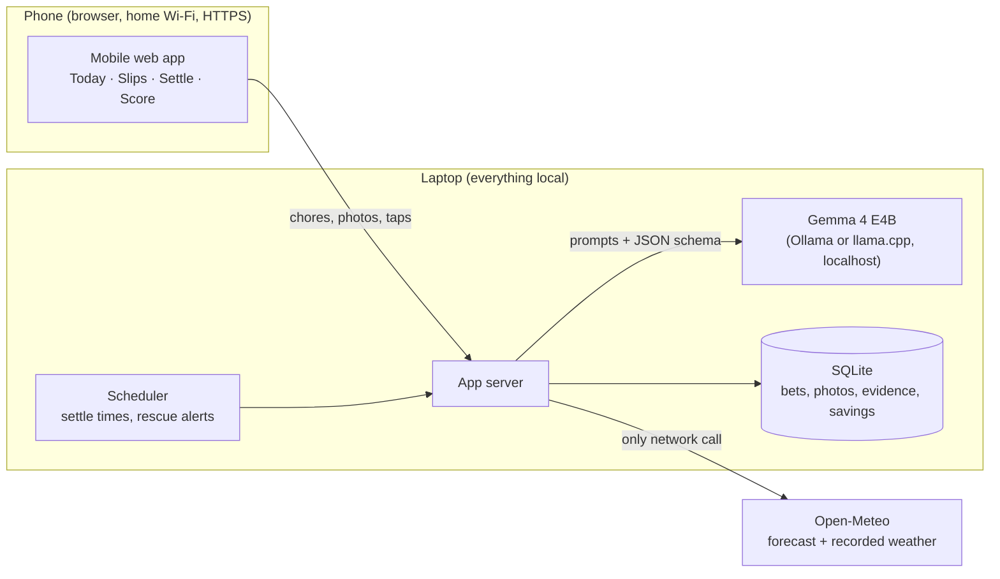

# Product concept: Should I Bother? — The Lazy Bookie

- Last updated: 2026-10-20 · Author: Adri
- Role: the detailed product rules behind `idea-brief.md`. `/spec` should take requirements, points, settlement and savings rules from here; screens and tokens are in `design-handoff.md`.

## Summary

Should I Bother? is a local Gemma 4 app that turns household chores into bets on the weather: when the rain, sun, wind or temperature can do a chore for you, you bet on doing nothing, and you win points when you were right. Wrong bets lose points, so laziness only pays when it is smart.

| Item | Detail |
| --- | --- |
| Challenge | DEV Hacktoberfest Open-Source AI Challenge, Week 3: "Slow and Steady", build something that rewards laziness |
| Deadline | Sunday 25 October, 11:59 PM PDT = Monday 26 October, 07:59 Madrid |
| Main targets | Overall winner and Best Use of Gemma |
| Core promise | Every chore gets odds, a reason, a payout and a penalty; every win reports time, water and electricity saved |
| Why open | Photos of your home, your voice and your habits never leave your device; it runs free and offline except for the weather forecast |
| Name and look | "The Lazy Bookie": a betting-shop design with receipt slips, a split-flap odds board and a red PAID OUT stamp |

One line for the post: "I let a local AI be my bookmaker for a week. Doing nothing won most of the bets, and here is exactly how much time, water and electricity it saved."

## The problem and the insight

Many chores are done out of habit, not need: watering before a storm, running the dryer on a sunny day, switching on the AC on a breezy night. The weather would have done the job, but nobody checks.

The insight: doing nothing is often the right call, but only when the weather really delivers. A weather app gives a forecast; it cannot say whether this basil can wait until Thursday, or whether this load dries outside tonight. That judgement needs the item (a photo), the sky (a forecast) and the person's situation (what they need, and when).

The game makes the judgement honest:

- Gemma states the odds and the reason before you decide.
- You choose: bet on doing nothing, or do the chore.
- The bet settles on evidence: recorded weather plus a photo or a one-tap answer.
- Right laziness earns points and real savings; wrong laziness costs points. A plant that wilts costs three times a normal loss.

What it is not: it never bets on safety. Heatwaves, frost, storms and anything involving vulnerable people become alerts that tell you to act now.

## How it works

A chore goes from one sentence to a settled bet in six steps; most steps take one tap or none.

1. Capture. Type, say or photograph your chores: "I have to wash the car, do the laundry and water the plants." Gemma splits it into one card per chore. Anything without a weather link ("call the bank") is shown as "not a weather chore".
2. Safety check. If the chore touches safety (heatwave watering, frost, storms), the card becomes a red "Do it now" alert with no bet.
3. Odds. Gemma combines the forecast, the photo if any, and your habits, then shows: odds that doing nothing works, a one-line reason, the settle time, the payout, the penalty, and the time, water and electricity at stake. A photo can raise or lower the odds.
4. Decide. "Bet: do nothing" or "I'll do it". Undo is always available. Odds are locked when you bet.
5. Wait. Bets sit on the Slips screen with a countdown. If the forecast turns bad, a rescue alert offers a cash-out: do the chore now and lose only 10 points.
6. Settle. At settle time the app reads the recorded weather, then asks for the outcome: an after photo (full points) or one tap (half points). Gemma gives the verdict with its evidence. A win prints a receipt with a red PAID OUT stamp and adds to the savings totals.

Unanswered bets settle on their own after 24 hours from the weather record, without bonus, so users cannot report only their wins.

## Chore catalogue

14 chores can be bets, 3 more save electricity only, 5 are advice and 3 are rescue alerts. Figures are per won bet and approximate; ranges with a source are listed under Sources, the rest are typical estimates to label as such in the post.

### Bets: the rain does it

| Chore | How doing nothing saves | Time | Water | Electricity | Settles by |
| --- | --- | --- | --- | --- | --- |
| Water balcony pots (5) | Rain waters them; you skip watering | 5 min | 3–5 L | — | After photo + recorded rain |
| Water garden or lawn (about 20 m²) | Rain waters it; you skip the hose or sprinkler | 15 min | 100–200 L | — | Recorded rain in mm |
| Rinse terrace or outdoor furniture | Rain rinses it; you skip hosing down | 15 min | 20–50 L | — | After photo |
| Fill rain barrel, pond or bird bath | Rain fills it; you skip the tap | 5 min | 10–50 L | — | One tap |
| Rinse the car | Rain rinses it; you skip a wash (not with dusty rain) | 40 min | 75–500 L | — | After photo |
| Rinse the bike | Rain rinses it | 10 min | about 20 L | — | After photo |
| Rinse dusty solar panels | Rain cleans them; you skip climbing up | 30 min | 20–50 L | — | Panel output or photo |

### Bets: the sun and wind do it

| Chore | How doing nothing saves | Time | Water | Electricity | Settles by |
| --- | --- | --- | --- | --- | --- |
| Laundry: leave it out tonight | A dry, breezy night finishes it; you skip bringing it in and the rack or dryer | about 10 min | — | 1–2 kWh | Morning one tap or photo |
| Laundry: skip today | You don't wash on a bad day; a better day dries it outside | about 10 min | — | 2–5 kWh | Photo on the chosen day |

### Bets: the temperature does it

| Chore | How doing nothing saves | Time | Water | Electricity | Settles by |
| --- | --- | --- | --- | --- | --- |
| Cool the home | A night breeze cools it; the AC stays off | 0 min | — | 2–3 kWh per evening | Comfort, one tap |
| Warm the home | Sun through the windows warms it; the heater stays off | 0 min | — | 3–4 kWh | Comfort, one tap |

### Bets: waiting does it (dry spell or winter)

| Chore | How doing nothing saves | Time | Water | Electricity | Settles by |
| --- | --- | --- | --- | --- | --- |
| Mow the lawn | Dry weather slows growth; you skip a mow | 45 min | — | about 0.5 kWh | Photo or one tap |
| Weed the garden | Dry weather slows weeds; you skip a session | 20 min | — | — | One tap |
| Clear snow (not walkways) | Sun or rain melts it; you skip shovelling | 30 min | — | — | Photo |

### Electricity only (you still do the task)

| Chore | What you skip | Time | Water | Electricity |
| --- | --- | --- | --- | --- |
| Hang laundry instead of tumble drying | The dryer | 0 min | — | 2–5 kWh |
| Dry shoes or gear outside | Heater or dryer | 0 min | — | about 1 kWh |
| Air the home | Dehumidifier | 0 min | — | 1–2 kWh per day |

### Advice only (no bet, no time counted)

| Chore | Advice |
| --- | --- |
| Laundry: wash today | Best drying day this week; +5 for good timing |
| Clean windows | Rain due, clean after it |
| Paint or varnish outdoors | Wait for a dry window |
| Fertilise or treat the lawn | Wait until after the heavy rain |
| Sweep balcony leaves | Wind may help or bring more leaves |

### Rescue alerts (never bets)

| Situation | Alert |
| --- | --- |
| Rain coming while laundry is out | Bring it in before the rain starts |
| Heatwave | Water plants now; keep cooling on for vulnerable people |
| Frost or strong wind | Bring pots in, secure furniture, salt walkways |

First version (fits strongly, verifiable, testable in Barcelona this week): balcony plants, laundry (leave it out tonight, skip today, wash today), skip the AC, skip the heater.

## Laundry planner

Laundry is a timing decision, so it gets its own card. Gemma scores drying weather (sun, wind, humidity, rain) for the next four days and the card takes one of three states. Only waiting is a bet.

| State | When it appears | Bet? | Points | What it saves |
| --- | --- | --- | --- | --- |
| Wash today | Today is the best drying day this week | No, advice | +5 for good timing if followed | A wet-day dryer run (2–5 kWh) and the indoor-rack shuffle (about 10 min) |
| Skip today | Today is poor and a clearly better day is coming | Yes, bet on waiting | Win +15 at 85%, wrong −50 | The same, if the better day delivers |
| No good day | Poor drying all week | No | None | Nothing; the card says to use the dryer when needed |

A fourth laundry bet sits beside the planner: "Leave it out tonight". When a load is almost dry at sunset and the night is dry and breezy with no dew, you leave it out instead of bringing it in to finish. It wins if it is dry in the morning and loses if dew or rain dampened it.

Rules that keep it honest:

- Before offering Skip today, ask "Need anything washed before Thursday?" If yes, the card switches to Wash today.
- Skip today wins only if the load dried outside on the chosen day; if that day was wet too and the dryer was needed, it loses.
- Hanging laundry instead of tumble drying saves electricity, not minutes. Time counts only when a step is skipped.
- Savings are measured against the user's normal habit, asked once in onboarding: dryer (and type), indoor rack, or line.

## Betting, settlement and points

A "do nothing" bet means: doing nothing will be fine until the settle time. The outcome decides; the weather is supporting evidence. A plant that survives without rain still wins, recorded as a "lucky win" so it does not inflate Gemma's accuracy.

### Points

| Your move | Result | Points |
| --- | --- | --- |
| Do nothing | Win | (100 − odds) × evidence multiplier; a 35% bet pays +65, an 85% bet pays +15 |
| Do nothing | Small loss (slightly damp) | −25 |
| Do nothing | Normal loss (had to do it anyway) | −50 |
| Do nothing | Harmful loss (plant wilted, deadline nearly missed) | −150 |
| Do nothing | Cashed out after a rescue alert | −10 |
| I'll do it | Weather would not have helped | +5 |
| I'll do it | It rained right after (wasted effort) | −10 |
| Advice followed | Wash today on the best drying day | +5 |

### Evidence

| Level | How it is checked | Multiplier on a win |
| --- | --- | --- |
| Automatic | Recorded weather at your location | Settles the weather part |
| Photo | Live in-app after photo, timestamped, compared by Gemma with the before photo | ×1.0 |
| One tap | "Yes, dry" or "Still damp" | ×0.5 |

### Settlement rules

1. Gemma sets a settle time that fits the chore: laundry the same evening or next morning, plants the next morning, the car a day after the rain.
2. Odds are locked when you bet; a forecast change later does not move them.
3. At settle time the app checks the recorded weather, then asks for the outcome.
4. Gemma gives the verdict with its evidence: weather numbers, before and after photos, one-line reason. If unsure, it asks a yes or no question instead of guessing.
5. No answer within 24 hours: the bet settles from the weather record and Gemma's estimate, at ×0.5, so users cannot report only their wins.
6. One appeal per bet with a new photo; the second verdict is final.
7. Safety situations are never bets.

### Ranks and achievements

Ranks: Hyperactive squirrel (0), Koala (200), Three-toed sloth (600), Grand master of inaction (1,800). Achievements include First nap (first win), Cloud whisperer (won at 40% odds or less), Sky freeloader (three wins in a row) and Knows when to fold (first cash-out).

## Savings accounting

The app reports three separate savings and never converts one into another: net time, water and electricity.

- Time counts only when a step is skipped, never when one task replaces another. Hanging laundry instead of tumble drying is 0 minutes.
- Only won bets count. A lost bet saves nothing.
- App time is subtracted: about 30 seconds per bet for capture and settlement. Score shows "net time back" with a note such as "7 h 11 min saved, minus 31 min spent placing and settling 62 bets".
- Savings use the user's own baseline, asked once in onboarding: dryer type (heat pump about 2 kWh per load, vented about 5 kWh), how they wash the car (bucket or hose), whether they use AC or a heater.

Where the savings appear:

| Screen | What it shows |
| --- | --- |
| Bet slip | "Saves \~10 min · 2–5 kWh (no dryer)" before you bet |
| Today | "This week the sky did: 2 h 10 time back · 38 L water · 6.5 kWh electricity" |
| Win receipt | Rows for time saved and water or electricity saved |
| Score | Tiles for chores skipped, water, electricity and net time back |

## What Gemma does

One local Gemma 4 model does every judgement in the app; the code around it only fetches weather, stores bets and counts points. The small E2B and E4B models take text, images and audio, so a laptop can run the whole thing.

| Job | Input | Output |
| --- | --- | --- |
| Listener | Typed sentence or voice note in Spanish, Catalan or English | One structured card per chore; non-weather chores flagged |
| Inspector | Photo of the plant, laundry, car or room | Species, soil dryness, wilting, cover from rain, dirt level |
| Forecaster | Weather tool results (function calling) + photo + habits | Odds that doing nothing works, reason, settle time |
| Safety guard | Chore + forecast | Switches heat, frost and storm cases to "Do it now" alerts |
| Judge | Before and after photos + recorded weather | Win, lose or unsure, with severity and a one-line verdict |
| Laundry planner | Four-day drying forecast + "need it by" | Wash today, Skip today or No good day |

Prompting approach: each job is a short system prompt with structured JSON output, so the app can validate every answer and fall back to "unsure, ask the user" instead of guessing.

Gemma's own scoreboard tracks two numbers: forecast calibration (when it said 70%, how often doing nothing worked) and judge agreement (how often users appealed, and how often they were right). Both feed the evaluation in the post.

## Architecture

Gemma, the app server, the database and the scheduler run on one laptop; the phone opens the app over home Wi-Fi, and only the weather lookup leaves the device.

- Model: Gemma 4 E4B served locally (Ollama or llama.cpp), with text, image and audio input and structured JSON output.
- App: a phone-friendly web page grown from the clickable prototype, served from the laptop.
- Storage: SQLite for bets, photos, evidence and savings totals.
- Weather: Open-Meteo for the forecast and the recorded weather used to settle bets; free and no account needed.
- Scheduler: wakes at each settle time and sends rescue alerts when the forecast turns bad.

## Product and design

The app is designed as "The Lazy Bookie": the visual language of a betting shop, because the product is a bet on doing nothing. Mobile screens and components are in the [Figma file](https://www.figma.com/design/hDYVCSZCGhxGRsU4Nbz02z).

### Visual direction

- Receipt slips: paper off-white, dashed rules, "Lazy Bookie · Bet slip · Nº 0412" header, perforated stub, torn bottom edge.
- Split-flap odds board: odds and today's temperature in yellow digits on black tiles; a live departure-board look for the weather.
- Red rubber stamp: "PAID OUT" or "PAID +30" lands on settled slips; the one animation worth perfecting for the demo video.
- Type: Big Shoulders Display for headlines, IBM Plex Mono for odds and receipts, Figtree for body text.
- Palette: newsprint, ink black, stamp red, sun yellow for odds and wins, racing green for positive values.
- Mascot: a sleepy sloth hanging from a branch, used sparingly (win screen, score card).

### Screens

| Screen | Purpose | Key elements |
| --- | --- | --- |
| Onboarding | Set up outdoors, habits and location | "Today's card" race list, what's outside your door, privacy note |
| Today | Turn chores into bets | Weekly savings strip, weather board with hourly lazy window, capture bar, quick chips, slips and laundry planner |
| Voice capture | One sentence to many cards | Live transcript with chores highlighted, what Gemma found |
| Place a bet | Commit with full information | Your photo, what Gemma saw, odds meter, payout table, settle time |
| Slips | Track and settle | Settle now, waiting bets with countdown and cash-out, settled with stamps |
| Settle | Close a bet with evidence | Before and after photos, recorded weather, Gemma's read, your answer |
| You won | The payoff moment | Payout receipt, +65, PAID OUT stamp, time and water saved, achievement |
| Score | The Lazy Payoff | Rank card, savings tiles, Gemma calibration chart, achievements |

### UX rules

1. Never block: the first odds come from the forecast alone within seconds; photos only improve them.
2. Cards, not chat: questions appear inside the card as tap answers.
3. Verdict first, details on tap; plain words next to every percentage.
4. Undo on every bet; one primary action per screen.
5. Mobile first: the user is on the balcony with a phone.

## Evaluation and Lazy Payoff plan

The post needs real numbers from two sources: a backtest that does not depend on this week's weather, and a live week of real bets.

### 1. Backtest: six months of Barcelona weather

- Data: recorded daily and hourly weather for Gràcia from April to October 2026 (rain, sun, wind, humidity, temperature).
- Simulate a lazy household that follows Gemma's calls against a fixed routine (water pots every two days, tumble dry every load, AC on every warm evening).
- Report: waterings skipped, dryer runs avoided, AC evenings avoided, time, water and electricity saved, and days a plant would have been at risk.
- Gemma role: run the forecaster prompt on each day's forecast only (no peeking at the outcome), then judge against the recorded weather.

### 2. Live week: Wednesday 21 to Sunday 25 October

- Target: 25 to 30 real bets on balcony plants, laundry, cooling and heating.
- Settle every bet with a photo where possible, so the results carry full evidence.
- Expect a dry week (5–20% daily rain chance in the forecast on 20 October): most rain bets will say "water it", which is an honest result worth reporting.

### 3. Gemma's accuracy

- Calibration chart: predicted odds in bands (30, 50, 70, 90%) against how often doing nothing worked.
- Judge agreement: verdicts you overruled on appeal.
- One honest failure story: the bet Gemma got wrong, why, and what changed in the prompt.

### What goes in the Lazy Payoff section

| Figure | Source |
| --- | --- |
| Bets placed and won this week | Live week |
| Net time back, water and electricity saved | Live week, using the catalogue figures |
| Six-month projection for one household | Backtest |
| Gemma calibration and appeals | Live week + backtest |

## Build plan

Six days to the deadline; the live week starts Wednesday, so the core loop must work by Tuesday night.

| Day | Build | Done when |
| --- | --- | --- |
| Tue 20 Oct | Gemma 4 E4B running locally; weather tool; phone-friendly web page from the prototype | One typed sentence returns cards with odds |
| Wed 21 Oct | Forecaster, safety guard and laundry planner prompts; bets stored in SQLite | First real bets placed on plants and laundry |
| Thu 22 Oct | Photo inspector and judge; settlement flow; points and evidence multipliers | First bets settled with before and after photos |
| Fri 23 Oct | Backtest script over six months of weather; voice capture | Backtest table and calibration numbers |
| Sat 24 Oct | Lazy Bookie styling, stamp animation, Score screen; record demo video | Demo video recorded |
| Sun 25 Oct | Write and publish the post; README with setup steps; repo public | Post live before Monday 26 October, 07:59 Madrid |

Cut list if time runs short: voice capture, then the backtest's heating arena, then achievements. Never cut photo settlement or the savings numbers; they carry the post.

Repository rule: the repo must be created and finished inside the challenge window; any later commit must be noted in the README.

## Risks and mitigations

| Risk | Mitigation |
| --- | --- |
| Dry week in Barcelona: few rain bets win | Lean on sun, wind and temperature chores; the backtest covers rain; report "Gemma told me to water anyway" honestly |
| Looks like a weather app | Show the photo-plus-forecast judgement a weather app cannot make, and the settlement with evidence |
| Inflated savings | Count skipped steps only, subtract app time, use the user's habit baseline, cite sources for water and energy |
| Small-model mistakes (plant type, dampness) | Structured output with an "unsure" path; one appeal per bet; report errors in the post |
| Safety | Safety guard turns heat, frost, storms and vulnerable people into alerts, never bets |
| Gaming the points | Live, timestamped photos; auto-settle after 24 hours; tap-only wins pay half |
| Scope too wide for six days | First version limited to plants, laundry, cooling and heating; cut list ready |
| Laptop performance | E4B model; process photos at reduced size; batch the backtest overnight |

## DEV post outline

Writing quality is weighted most heavily, so the post follows the official template with one clear story: a week of letting a local AI be my bookmaker.

| Template section | What goes in it |
| --- | --- |
| Title | "I let a local AI be my bookmaker for a week. Doing nothing won X of Y bets." |
| What I Built | The pitch, who it is for, and one slip shown as an image |
| Demo | 60–90 second video: sentence to slips, a photo raising odds, settling with the PAID OUT stamp |
| Code | Public repo with license and setup steps |
| How I Built It | Gemma 4 E4B on a laptop; the six jobs Gemma does; structured prompts; weather tool; architecture diagram |
| Why Does Open Innovation Matter? | Home photos, voice and habits stay on the device; works offline except the forecast; free to run; model can be swapped or fine-tuned |
| My Agent Session | Optional DevRelay session of the build |
| The Lazy Payoff | Live-week bets, net time, water and electricity saved, six-month backtest, Gemma's calibration and the one bet it got wrong |
| Prize Categories | Best Use of Gemma; any partner tool actually used |

Tone: plain, specific, a little funny. Every savings number states its assumption; the laundry note ("hanging laundry saves electricity, not time") shows the numbers are honest.

## Sources

- [Week 3 announcement: Slow and Steady](https://dev.to/devteam/join-the-hacktoberfest-open-source-ai-challenge-slow-and-steady-2850-in-prizes-across-21-3iee): theme, template, deadline, judging criteria
- [HF26 DEV Challenge Hub](https://dev.to/challenges/hf26): rules, prize categories, Best Use of Gemma
- [Gemma 4 on LM Studio](https://lmstudio.ai/models/gemma-4): model sizes; audio on E2B and E4B
- [Haier: tumble dryer running costs](https://www.haier-europe.com/en_GB/blogs/news/how-much-does-a-tumble-dryer-cost-to-run): about 5.3 kWh vented, 2.2 kWh heat pump per 9 kg load
- [Harvey Water Softeners: washing machine water use](https://www.harveywatersofteners.co.uk/blog/how-much-water-does-a-washing-machine-use/): 40–60 L per load for efficient models
- [Universitat de Barcelona: washing the car](https://ub.edu/ossma/en?p=37419): hose up to 500 L, car wash 75–300 L
- [Costway: split air conditioner consumption](https://www.costway.com/blog/mini-split-air-conditioners/split-air-conditioner-electricity-consumption.html): 0.4–0.8 kWh per hour for small units
- [Figma design file](https://www.figma.com/design/hDYVCSZCGhxGRsU4Nbz02z): screens and components
