# How it was built: spec first, with Claude Code

"Should I Bother?" was built in about five days (the first commit is dated 20 October 2026, the feature
freeze was Saturday 24 October at 14:00 Madrid) by one builder working with Claude Code. The method was
**spec-driven development**: an idea brief, then an approved specification with stable IDs, then one task
at a time, each with tests written from the acceptance criteria first. This page describes that method and
shows the evidence for it that sits in the repository. Nothing here is a claim about the product's
results; for what has and has not been measured, read [gemma.md](gemma.md#1-status-what-is-verified-and-what-is-not).



*Source: [diagrams/timeline.mmd](diagrams/timeline.mmd). Dates are the merge dates of the pull requests
(`git log --merges`).*

## 1. The idea brief

Before any spec, the idea was explored with the `ideate` skill of the builder's AI toolkit and written down
in [docs/discovery/](discovery/):

| File | What it is |
|---|---|
| [idea-brief.md](discovery/idea-brief.md) | The one-pager: problem, users, competition, business model, feasibility, risks, scope and the verdict |
| [research-notes.md](discovery/research-notes.md) | Sources and evidence |
| [product-concept.md](discovery/product-concept.md) | The full product rules: chore catalogue, points, settlement, savings, Gemma jobs, evaluation, build plan |
| [design-handoff.md](discovery/design-handoff.md) | Screens, components, tokens and accessibility notes from the Figma design |

The verdict, revisited on 20 October 2026, was **Go, with a cut scope**: still distinctive, on-theme and
measurable, but the original plan was a three-week product in six days, so the brief names what is in, what
is deferred and what must work first (the core loop running from the phone, and time to write the post).
The brief was then copied into the repository as input for the spec (`new-project --from-idea`).

## 2. The specification

The spec lives in [docs/spec/](spec/) and is the source of truth for the code:

| Document | Answers | Size at the time of writing |
|---|---|---|
| [product.md](spec/product.md) | Why: goals, users, scope tiers | |
| [requirements.md](spec/requirements.md) | What: requirements with acceptance criteria | **32 requirements** (REQ-001 to REQ-032), **149 acceptance criteria** (AC-nnn.n) and **13 non-functional requirements** (NFR-001 to NFR-013) |
| [design.md](spec/design.md) | How: components, data model, interfaces, security, reliability, a traceability table from every REQ to a design section | |
| [tasks.md](spec/tasks.md) | The plan: tasks with the requirements they implement, dependencies and a "Done when" | **42 tasks** (T-001 to T-042): 32 done, 10 open |
| [adr/](adr/) | The significant decisions | **11 ADRs** (0001 to 0011) |

(Counted from the files: `### REQ-` headings, `AC-nnn.n` bullets, the NFR table rows, `- [ ] T-nnn` and
`- [x] T-nnn` lines, and `docs/adr/*.md`.)

**IDs are permanent.** Requirements, criteria, NFRs and tasks are never renumbered or reused; a deprecated
one is struck through with a note. That is what lets a commit, a test name and a review comment point at the
same thing.

**Criteria are testable and in EARS style:** `WHEN <trigger> THE SYSTEM SHALL <response>`, or `IF <unwanted
condition> THEN THE SYSTEM SHALL <response>`. For example, AC-003.6: *if the bookmaker answers without
calling the `get_forecast` tool, the system shall retry once and, if the tool is still not called, keep the
labelled rule odds and record the miss.* That sentence became a test, a branch in the job runner and a
column in the decision log.

**Fixed values live in one block** at the top of the requirements (odds bands, payouts, timeouts, the retry
budget, the time zone), so no number is defined twice.

### Reviews before implementation

The spec was reviewed before the first line of product code was merged. It went through the `spec-reviewer`
subagent, and the history shows it: *write* (`docs(spec): write product, requirements,
design and task plan`), *apply second review fixes*, then *mark product, requirements, design and tasks
approved* on 21 October 2026. The `implement-task` skill warns and stops if the spec is not approved.

### Every change is a spec change first

When a requirement changes, the spec changes in its own commit and is reviewed before code follows. Three
requirements were added late this way, each as a docs-only commit, a spec review and a fix commit, and
only then a task:

| Requirement | Spec commits (subjects) | Then |
|---|---|---|
| REQ-030 City rain bets, REQ-031 Advice cards | `docs(spec): city rain bets and advice cards (REQ-030, REQ-031; T-038, T-039)`, then `apply the spec review of REQ-030 and REQ-031` | T-038 (PR #49), T-039 (PR #50) |
| REQ-032 Optional hosted mode, NFR-013 | `docs(spec): optional hosted mode on DigitalOcean (REQ-032, NFR-013)`, `apply the hosted-mode spec review; add ADR-0011`, `hosted mode without Terraform; device remembered 30 days` | T-040 (PR #52), T-041 (PR #53), T-042 (PR #54) |

Earlier rounds did the same for the presentation round (AC-011.7, AC-026.3, AC-029.3, AC-029.4), the Gemma
surfaces (AC-028.3, AC-028.4) and the location picker (AC-024.3, AC-024.4). When implementation found that
the spec was silent or wrong, the decision was recorded back into
[design.md](spec/design.md#implementation-decisions-2026-10-22) rather than left in the code.

## 3. The project kit

After the spec was approved, the `project-kit` skill tailored the toolkit to this project
(AGENTS.md, "Project kit"). Two project-specific pieces were added, each justified by spec IDs:

- **The `gemma-job` skill**: a checklist for adding or changing a Gemma job: a versioned prompt file, a zod
  output schema, registration in the job runner with its retry budget and deadline, fixtures by job and
  scenario, decision logging and the 20-case eval set. It encodes the rule that a prompt change bumps the
  version and re-records the fixtures.
- **The `bookie-rules-reviewer` subagent**: a read-only reviewer that checks a diff against the game and
  evaluation rules: odds bands, points and rounding, evidence multipliers, settlement states, savings and
  net time, outcome labels, calibration populations and leakage into the fine-tune. It runs beside the
  generic `code-reviewer` on the tasks that touch those rules.

The rest of the review team is global: `code-reviewer`, `security-auditor`, `ux-reviewer` and
`spec-reviewer`.

## 4. One task at a time

Each task was built with the `implement-task` skill:

1. Read the task, its linked requirements and the design sections that implement them.
2. Branch from the parent the brief names and mark the task in progress.
3. **Write tests from the acceptance criteria first**, named after them (`it("AC-003.6: ...")`), and watch
   them fail for the right reason.
4. Implement the minimum that passes, run the targeted tests, then the full checks once.
5. Review, fix, commit with a Conventional Commit that references the IDs, and update the task.

Rules that kept this honest:

- **Fake Gemma, recorded synthetic fixtures, no GPU in CI.** The model sits behind one `ModelClient`
  interface. Tests and CI use `FakeModelClient`, which replays hand-written synthetic answers from
  `test/fixtures/gemma/<job>/<scenario>.json` (keyed by job and scenario, never by input hash), with fake
  weather. The fakes cover the awkward cases too: invalid JSON, an unsure answer, a timeout, no tool call.
  Only builder tasks touch the real model, and they are still open ([gemma.md](gemma.md#1-status-what-is-verified-and-what-is-not)).
- **Stacked pull requests.** A task branches from the task it depends on, and the builder merges in stack
  order, which is why many pull requests merged within minutes of each other on 22 October.
- **Migrations are numbered in the brief.** Parallel branches each add a SQLite migration, so the task
  brief assigns the number (which is why 0009 is unused).
- **Flags for unfinished work.** Should and Could features ship behind flags in `config/flags.json`, off by
  default, so a feature freeze never forces a half-built feature into the product.
- **No silent divergence.** A spec discrepancy stops the task; the worker proposes the spec change instead
  of coding around it.

## 5. The review loop

Every pull request went through one review pass on its final diff:

| Reviewer | When |
|---|---|
| `code-reviewer` | Every diff |
| `bookie-rules-reviewer` | Diffs that touch odds, points, settlement, savings, rules, outcome labels, calibration or the dataset |
| `security-auditor` | Auth, input handling, tokens, secrets, dependencies, the container and the deployment kit |
| `ux-reviewer` | UI changes (usability and WCAG 2.2 AA) |
| `spec-reviewer` | Changes to `docs/spec/`, before the code that depends on them |

Findings are grouped as Blocker, Should-fix and Nit with a file, a line and a concrete fix. The builder (or
the coordinating session) fixes the Blockers and Should-fix items, verifies each fix by reading the changed
lines and running the targeted test, and puts the findings and their resolution in the pull request
description so a human does not repeat the review. The history shows the loop: 28 commit subjects on `main`
name a review round, for example `fix(chores): review round for the city rain bets (T-038)`,
`fix(hosted): review round for T-040 (cap, trusted proxy, devices, copy)` and `fix(deploy): security review
round for the DigitalOcean kit (T-041)`.

The last pull requests (#41 to #55) were merged on local verification because GitHub Actions runners were
unavailable at the time; their descriptions say so, with the commands that were run.

## 6. Claude Code as coordinator, with parallel workers

Claude Code was the primary coding agent. One coordinating session held the plan and the context; it
delegated each task to a worker session with a short brief (task ID, requirement IDs, files, parent branch,
migration number) and reviewed the result. Workers each had their own git worktree, at most two implementation
workers ran in parallel, and the coordinator checkout was never touched by a worker. A worker's report listed
the commits, the acceptance criteria covered and the tests that prove them, the decisions it took and the spec
questions it found, so the coordinator could review the diff without rereading the task.

What agents were not allowed to do is part of the method: push to `main`, force-push, merge, change branch
protection, read the household's data, run infrastructure or deployment commands, or edit the agent
configuration. Commits carry the builder's git identity and the agent attribution lines; **humans review and
merge**. Agents prepared the hosted-mode deployment kit and guide; the builder creates the server and deploys.

## 7. The quality bar

Before every commit:

```bash
npm ci
npm run format:check && npm run lint && npm run typecheck
npm test -- --coverage          # unit, integration and component tests on the fake model, no GPU, no network
npm run build
npm audit --audit-level=high
uvx pre-commit run --all-files  # prettier, eslint, gitleaks and file hygiene
(cd training && uv run ruff check . && uv run pytest)
```

Current counts, measured on this branch:

| Check | Result |
|---|---|
| `npx vitest run` | **2,581 tests passed in 144 test files** (the same figure the latest pull request descriptions report) |
| Playwright journeys (`npm run test:e2e`) | **8 tests passed** (3 spec files: the capture, bet and settle journey at phone width, the sample-data demo, and all flags on; plus axe and layout checks at 320, 375, 768 and 1280 px), run on the fake model and fake weather |
| Pull requests | `git log --merges --oneline origin/main \| wc -l` prints **108** merge commits; **54** of them are `Merge pull request #N` commits (numbers #1 to #55), the rest merge branches into each other inside the stack |
| Commits on `main` | 268 (`git log --oneline origin/main \| wc -l`) |

## 8. Traceability: every acceptance criterion to a test

The chain is: requirement, then criterion, then design section (the table at the end of
[design.md](spec/design.md#traceability)), then task, then test, then commit. The mapping from criterion to
test is by name: a test that proves AC-008.8 says so in its name or description. Counting the distinct
`AC-nnn.n` identifiers that appear in test files (`*.test.ts`, `*.test.tsx`, `*.spec.ts`) gives **148 of the
149 acceptance criteria**. The one that does not is **AC-019.2**, which needs the real QLoRA training run
(T-012) and so is the builder's.

```bash
# which criteria are named in a test (run from the repository root)
grep -rohE 'AC-[0-9]{3}\.[0-9]+' test e2e src --include='*.test.ts' --include='*.test.tsx' --include='*.spec.ts' | sort -u | wc -l
```

A criterion named in a test is not proof the criterion is perfectly covered; it is proof that someone wrote
a test against it and that a reviewer could find it. The criteria that need a real model, a real phone or a
real network (for example NFR-004 latency, or the network capture of NFR-002) are listed as open tasks, not
hidden in green checkmarks: see the open tasks in [tasks.md](spec/tasks.md) (T-001, T-010, T-012, T-014,
T-019, T-020, T-021, T-028, T-030, T-031).

## 9. What the method bought, and what it did not

It bought a product whose behaviour is written down before it exists, a test for nearly every promise, a
review loop that found real defects early (the `fix(...)` commits above), and the ability to add three
requirements in the last 24 hours without losing track of what the product does.

It did not buy real-model evidence. Everything that depends on Gemma's actual behaviour (valid-JSON rate,
latency, calibration, the fine-tune) is built and tested against a fake and waits for the builder's laptop.
That is stated plainly in the README and in [gemma.md](gemma.md#13-limitations-and-what-is-unverified).
