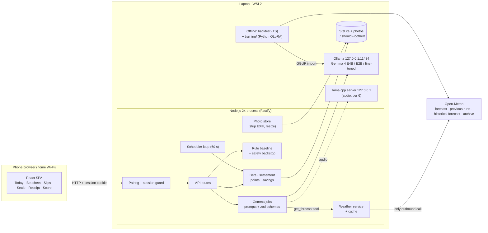

<!--
BUILDER READ-ME (delete this block before publishing; DEV hides HTML comments anyway)

What this file is: the skeleton of the DEV post for the Week 3 challenge (T-029). It is a real draft,
not just headings, but it contains NO results yet. Every number is a {{placeholder}}.

Conventions
- {{name}}                 a number or link filled in on Sat 24 Oct (T-021) from the file named in the
                           comment on the same line.
- src comment             an HTML comment on the same line, "src: file · metric", naming the source file
                           and the exact metric to copy. If the metric is missing from the file, fix the
                           report (T-014 / T-019), do not invent the number.
- {{screenshot: ...}}      a picture to take or pick. It points at a mockup in docs/images/ to use as a
                           stand-in. Final images must be real screenshots of the app with STAGED or
                           synthetic photos. Never a photo of the home. Check every image by hand.
- builder comment         (an HTML comment starting "builder:") prose to rewrite in your own voice, or a decision to take.
- Wording rule: prose must stay true whichever way the numbers come out. Where a sentence only makes
  sense for one outcome, a builder note says so.

Result files (written by T-014 and T-019):
- docs/results/live-week.md   live bets, savings, photo ablation, judge agreement, latency, valid JSON
- docs/results/backtest.md    Gemma E4B / E2B vs rule vs fixed routine; calibration; tool-call miss rate
- docs/results/finetune.md    base vs fine-tuned E4B on the Sep-Oct hold-out; dataset manifest

Before publishing: search this file for "{{" (must find none), "builder:" (must find none), and check
the repo is public, the tags are devchallenge + hf26challenge, and the video link works.
-->

*This is a submission for the Hacktoberfest Open-Source AI Challenge Week 3: Slow and Steady*

<!-- builder: the theme rewards laziness. Open with the joke, then earn it with evidence. A possible first paragraph is below; rewrite it so it sounds like you. -->

I suspect that on a lot of evenings I water the balcony plants right before the sky would have done it for me. A weather app can't tell me which evenings. It says "20% rain", not "this basil can wait until Thursday".

So I built a bookmaker. It looks at the forecast and a photo of the actual plant, and offers odds that doing nothing will be fine. Later it checks what the weather really did, asks for an after photo, and pays me points if I was right or takes them if I wasn't. Wins get a PAID OUT stamp; losses stay on the record.

## What I Built

**Should I Bother?** ("The Lazy Bookie") is a local app where Gemma 4 turns weather chores into bets on doing nothing. Type a sentence or snap a photo; it answers with odds, a reason and a settle time. A win prints a receipt and counts what the sky saved me: minutes, litres, kilowatt-hours.

<!-- builder: pick the single best slip image for this spot; the post outline asks for "one slip shown as an image". -->
{{screenshot: a bet slip with odds, Gemma's reason and the payout table}} <!-- src: docs/images/04-place-a-bet.png (mockup stand-in) → real screenshot with a staged photo, T-021 -->

Three rules keep it honest:

- **Safety is never a bet.** Heat, frost and storms become a red "Do it now" alert.
- **Settlement needs evidence.** Recorded weather, then Gemma judges an after photo (full points) or one tap (half). No answer in 24 hours and it settles itself at half points, so I can't report only my wins.
- **Points only.** No money. A win pays (100 − odds) × the evidence multiplier; a wilted plant costs three times a normal loss.

The week in one sentence, to be written last:
<!-- builder: write this after the numbers are in; keep it to one honest sentence. If doing nothing lost more often than it won, say so here and lead with that. -->
Over {{live_days}} days I placed {{bets_placed}} bets, settled {{bets}} of them, and doing nothing won {{wins}}. <!-- src: docs/results/live-week.md · live_days = days between first and last bet; bets_placed = all do-nothing bets placed (not undone); bets = settled do-nothing bets; wins = settled do-nothing bets won -->

<!-- builder: the title and the intro say "a week". If the live bets span fewer days than that, change the title to the real length (for example "four days") rather than stretching the truth. -->

## Demo

{{video_url}} <!-- src: docs/spec/tasks.md T-021 · the 60-90 s demo video, uploaded and embedded with DEV's  -->

<!-- builder: storyboard for 60-90 s, from the concept. Keep the stamp for the last five seconds.
1. Say or type one sentence; three cards appear (and one says "not a weather chore").
2. Open a card: odds from the forecast alone, within seconds.
3. Add a photo: the odds move, and the screen says by how much and why ("What Gemma saw").
4. Place the bet. Cut to the Slips screen with a countdown.
5. Settle with an after photo; Gemma's read; PAID OUT stamp; the savings strip updates.
Use staged photos only. No shot may show the home. -->

Screenshots:

| Step | Screen |
|---|---|
| Today | {{screenshot: Today screen with the capture bar and quick chips}} <!-- src: docs/images/02-today.png (mockup stand-in) → real screenshot, T-021 --> |
| Voice capture | {{screenshot: voice capture sheet with chores highlighted}} <!-- src: docs/images/03-voice-capture.png (mockup stand-in); show only if voice capture shipped (flag), otherwise delete this row --> |
| Bet sheet: odds before and after the photo | {{screenshot: bet sheet where the photo moved the odds}} <!-- src: docs/images/04-place-a-bet.png (mockup stand-in) → real screenshot with a staged photo, T-021 --> |
| Slips | {{screenshot: Slips screen with a waiting bet}} <!-- src: docs/images/05-slips.png (mockup stand-in) → real screenshot, T-021 --> |
| Settle: before, after, Gemma's read | {{screenshot: settle screen with a before and an after photo}} <!-- src: docs/images/06-settle-a-bet.png (mockup stand-in) → real screenshot with staged photos, T-021 --> |
| The payoff | {{screenshot: payout receipt with the stamp}} <!-- src: docs/images/07-you-won.png (mockup stand-in) → real screenshot, T-021 --> |

## Code

The code is MIT-licensed: https://github.com/adricasi/ShouldIBother <!-- src: docs/spec/product.md · Q-7 repo name; builder: confirm the repo is public (T-020) before publishing -->

Setup in one breath: clone, `npm ci`, install Ollama, `npm run setup`, WSL2 mirrored networking plus a firewall rule for the phone, `npm start`, scan the QR code. <!-- builder: the steps here must match README.md (T-020). Add one true sentence about the step that bit you during setup, or nothing. -->

You need an NVIDIA GPU laptop (8 GB of VRAM or more) and a phone on the same Wi-Fi. Mine: {{gpu_model}} with {{vram_gb}} GB of VRAM. <!-- src: docs/results/backtest.md · run environment (GPU, VRAM). builder: if the report does not list the hardware, add a line to the report first -->

The fine-tuned adapter (public weather data only): {{adapter_url}} <!-- src: docs/spec/product.md · Q-11 Hugging Face repo, published by hand in T-020; delete this sentence if the adapter is not published -->

## How I Built It

Everything runs on one laptop: a Node.js process serves a React app to my phone over home Wi-Fi, stores everything in SQLite, and talks to **Gemma 4 E4B** through **Ollama** on the laptop GPU. Gemma 4 E2B is the smaller comparison in the backtest. The only request that leaves the laptop is the weather lookup.

The rule: **Gemma decides, code executes.** Gemma makes every judgement. Code fetches the weather, stores bets, counts points and savings, and enforces a safety backstop that Gemma cannot overrule.

### Six jobs, one model

| Job | What Gemma gets | What comes back |
|---|---|---|
| **Listener** | A typed sentence (or a voice note, if audio shipped) | One card per chore |
| **Inspector** | A photo of the plant or washing | What it sees, or "unsure" plus a question |
| **Bookmaker** | Chore, habits, inspector notes, the rule's band, a `get_forecast` **function call** | An odds band, a short reason, a settle time |
| **Safety guard** | The chore and the forecast | Alert or not (a fixed backstop applies even if Gemma is off) |
| **Judge** | Before / after photos or a tap, recorded weather | Win, a loss grade, or "unsure" plus a question |
| **Laundry planner** | A four-day drying forecast | Wash today, skip today, or no good day |

<!-- builder: the safety guard and the laundry planner are tier 3 and tier 5 and sit behind flags. If either is off at the freeze (Sat 14:00), mark its row "next" instead of listing it as built. The post must not claim a job that is not in the shipped app. Same for voice: say "typed" unless the Gemma audio path shipped; if whisper.cpp was the fallback, say so here. -->

### Bands, not percentages

I didn't trust a 4B model to produce calibrated percentages, so Gemma picks one of five bands and code maps each to fixed odds:

| Band | Very likely | Likely | Toss-up | Unlikely | Very unlikely |
|---|---|---|---|---|---|
| Odds that doing nothing works | 85% | 70% | 50% | 35% | 15% |

Every bet also stores a **rule baseline**: odds from plain code on forecast numbers, thresholds written once and never tuned. If Gemma lands two or more bands from the rule, it must explain or ask. Gemma's odds are only worth anything if they beat the rule; the results below show whether they do. <!-- builder: this sentence is safe whichever way it goes; keep it. -->

### Does a small model keep its promises?

Every job has a versioned prompt and a schema, and the inspector and judge may say *unsure* and ask instead of guessing. 20 tries per job on the laptop:

| Job | Valid JSON (of 20) | Median latency |
|---|---|---|
| Listener | {{valid_json_listener}} <!-- src: docs/results/live-week.md · valid-JSON count out of 20, listener --> | {{latency_listener}} <!-- src: docs/results/live-week.md · median latency per job, listener --> |
| Inspector | {{valid_json_inspector}} <!-- src: docs/results/live-week.md · valid-JSON count out of 20, inspector --> | {{latency_inspector}} <!-- src: docs/results/live-week.md · median latency per job, inspector --> |
| Bookmaker (photo + forecast) | {{valid_json_bookmaker}} <!-- src: docs/results/live-week.md · valid-JSON count out of 20, bookmaker --> | {{latency_bookmaker}} <!-- src: docs/results/live-week.md · median latency, photo + forecast judgement (target 15 s or less) --> |
| Judge | {{valid_json_judge}} <!-- src: docs/results/live-week.md · valid-JSON count out of 20, judge --> | {{latency_judge}} <!-- src: docs/results/live-week.md · median latency per job, judge --> |

<!-- builder: add a safety guard row only if it shipped. If a job missed the 19-of-20 bar, say so in a sentence and state what the app does about it (the T-001 fallbacks: text-only odds, two-step tool use, or injected forecast). The tool-call miss rate is reported once, in the backtest table. -->



- The bookmaker's only tool is a read-only `get_forecast`; an answer without a call is retried once, then the card shows labelled rule odds. The first odds come from the forecast alone, and a photo then moves the band. The app stores the band with and without the photo on every bet, which makes the ablation below possible.
- Invalid JSON gets one retry with the validation error, then a clear failure. The card keeps the labelled rule odds and offers Retry; settlements wait until Gemma is back.
- User text, photos and tool results go to the model as untrusted data inside delimiters. Points, settle bounds and safety are computed by code, so "ignore your instructions" in a photo caption cannot move a score.
- Each job is allowed at most four model calls and a 45-second deadline, and jobs run one at a time through a single queue so the GPU is never shared.
- The tool-call miss rate (answers that came without a `get_forecast` call) is reported once, in the backtest table.



### Architecture

<!-- builder: DEV may not render Mermaid. Publish a preview first; if the diagram does not render, export it to PNG (mermaid.live) and replace the block with the image. Source of truth: docs/spec/design.md, Overview. -->

The phone pairs with a one-time QR token; photos lose their EXIF data and are served only to paired devices.

### Would it have worked in the autumn?

A live week is a small sample, so I also replayed April to October 2026 for Gràcia without peeking: each decision uses only a forecast from a model run that started before it. The headline is the **September to October** hold-out, which the fine-tune never saw.



- Each chore has a fixed decision time of day. Forecasts come from Open-Meteo's Previous Runs API (day-1 lead).
- The outcome is read afterwards from recorded weather, with one small function per chore that asks "would the weather have done the chore?"
- Four strategies play the same days: Gemma 4 E4B, Gemma 4 E2B, the rule baseline, and a **fixed routine** (the habit baseline: water every other day, tumble-dry every load, AC on every warm evening).
- No photos and no household data go into the backtest.
- April to August is shown separately and labelled in-sample.

<!-- builder: if Previous Runs lacked a variable and the harness fell back to the Historical Forecast API, the report labels those results "short-lead forecast (optimistic)" (or "perfect-forecast upper bound"). Copy that label next to the numbers; never drop it. -->



### Fine-tuning taught Gemma the local base rates

A general model knows how rain works, not how often a few millimetres on a June evening in Gràcia leave a pot moist by morning. That is a base rate, and a small model can learn it. I fine-tuned the bookmaker with QLoRA on public Barcelona weather: April to August to train, September to October held out.

{{rows_train}} training rows and {{rows_holdout}} hold-out rows, across {{chores_in_dataset}} chores. <!-- src: docs/results/finetune.md · dataset manifest: total rows (training, hold-out) and number of chores; per-chore and per-band counts are in the same manifest -->

**The honest caveat.** The labels come from *recorded weather*, not from observed plants. The model learns "the weather did the chore", a proxy for "my basil survived"; plants also wilt for reasons the weather record cannot see (the pot, the sun angle, the species). So I report the fine-tune as a change in *weather base rates*, and it says nothing about keeping a specific plant alive. <!-- builder: keep this paragraph close to as is. It is the honest-limit moment the judges will remember. -->



- **Method:** QLoRA on Gemma 4 E4B, text only, on the same laptop GPU. The merged model is converted to GGUF and imported into Ollama.
- **Data:** public Open-Meteo weather only. Each row is the conversation the live bookmaker sees: the prompt, the chore, a synthetic habit profile, the rule's band, and the `get_forecast` call with the forecast as known at decision time.
- **Targets:** for each training day I take the 30 most similar forecasts for the same chore in the training period, count how often the weather did the chore, and turn that success rate into one of the five bands. Reasons are templated from the forecast numbers (for example "6 mm of rain overnight; pots will be watered"), not written by a model.
- **Split:** no hold-out day touches any target.
- **No home data:** habits come from a made-up profile, and the dataset build fails if any value from my real household config appears in a row.
- Some chores have thin data in the training months (the heater in April to August), so every fine-tune table shows its N.



## Why Does Open Innovation Matter?

This app sees the inside of my home, hears my voice and learns my habits: exactly the data I don't want in someone else's cloud.

- **My photos, voice and habits never leave the laptop.** Gemma runs on `127.0.0.1`, and a CI test refuses any host but Open-Meteo. Network capture of a full cycle: {{outbound_hosts_seen}}. <!-- src: docs/results/live-week.md · T-020 network capture: hosts contacted during one capture → settle cycle (expected: Open-Meteo only). builder: if the capture shows anything else, say so and fix it before publishing -->
- **Offline, apart from the forecast, and free to run.** No API key, subscription or per-call bill. Without Open-Meteo it uses the cached forecast; without Gemma, labelled rule odds.
- **The model can be swapped or fine-tuned.** One small interface, and I did fine-tune it, on public weather data, so the result can be shared without anyone's photos or habits in it.

The honest limit: you need a GPU laptop and patience with WSL2 networking, and the phone talks to it over plain HTTP behind a pairing token.

## My Agent Session

{{devrelay_session_url}} <!-- src: docs/spec/tasks.md T-021 · the DevRelay session link of the build, shared by the builder -->

I built this spec-first: a written specification with numbered requirements and testable acceptance criteria, then a task list. Coding agents implemented the tasks against a recorded fake Gemma, so CI never needed a GPU, while I ran the real model and reviewed and merged their work. <!-- builder: rewrite in your own voice and name the tools you really used. Add one concrete moment from the session (a spec change an agent forced, a bug it caught) if you have one. Do not describe tools you did not use. -->

## The Lazy Payoff

Every figure comes from a results file in the repo and shows its N. Losses are reported along with wins.

<!-- builder: write the lead sentence last. Follow the evidence: if Gemma beat the rule, say by how much and with what N; if it did not, say that the honest result is the story. -->

### The live week

| Metric | Value |
|---|---|
| Days from first to last bet | {{live_days}} <!-- src: docs/results/live-week.md · days between first and last bet --> |
| Bets placed | {{bets_placed}} <!-- src: docs/results/live-week.md · bets placed --> |
| Bets settled | {{bets}} <!-- src: docs/results/live-week.md · settled do-nothing bets --> |
| Won | {{wins}} <!-- src: docs/results/live-week.md · settled do-nothing bets won --> |
| Lost (small / normal / harmful) | {{losses_small}} / {{losses_normal}} / {{losses_harmful}} <!-- src: docs/results/live-week.md · losses by severity (small, normal, harmful) --> |
| Lucky wins (the weather didn't deliver, doing nothing still worked) | {{lucky_wins}} <!-- src: docs/results/live-week.md · lucky_win count (computed by code from the outcome labels) --> |
| Settled by after photo / by tap / automatically | {{settled_photo}} / {{settled_tap}} / {{settled_auto}} <!-- src: docs/results/live-week.md · settlements by evidence type --> |
| Chore types betted on | {{chore_types}} <!-- src: docs/results/live-week.md · number and names of distinct chore types among settled bets --> |
| Points | {{points_total}} <!-- src: docs/results/live-week.md · total points --> |
| "I'll do it" decisions and cash-outs | {{do_it_count}} <!-- src: docs/results/live-week.md · count of do-it decisions (cash-outs only if the rescue flag shipped) --> |

<!-- builder: the product target is at least 8 settled bets, at least 3 by after photo, and at least 2 chore types. If a target was missed, state the shortfall here in one plain sentence; do not hide it. -->

**What it saved** (wins only, subtracting app time):

| Saving | Total |
|---|---|
| Chores skipped | {{chores_skipped}} <!-- src: docs/results/live-week.md · chores skipped (won do-nothing bets) --> |
| Time saved by skipped steps | {{time_saved}} <!-- src: docs/results/live-week.md · gross time saved on wins --> |
| Minus app time (about 30 s per bet placed) | {{app_time}} <!-- src: docs/results/live-week.md · app time = 30 s × bets placed --> |
| **Net time back** | {{net_time}} <!-- src: docs/results/live-week.md · net time back --> |
| Water | {{water_saved}} <!-- src: docs/results/live-week.md · water saved (litres) --> |
| Electricity | {{kwh_saved}} <!-- src: docs/results/live-week.md · electricity saved (kWh) --> |

{{screenshot: the Score screen with savings tiles and the "How honest is Gemma?" calibration chart}} <!-- src: docs/images/08-score.png (mockup stand-in) → real screenshot of the Score screen after the week, T-021 -->

### What those savings assume

A win saves only the steps it skipped; each bet costs about 30 seconds of app time, which I subtract. Linked figures have a source; the rest are my typical estimates.

| Chore (won bet) | What doing nothing skipped | Time | Water | Electricity | Where the figure comes from |
|---|---|---|---|---|---|
| Water the balcony pots (5) | Watering by hand | 5 min | 3-5 L | none | **Typical estimate** |
| Line-dry today instead of the tumble dryer | The dryer run (I hang the washing either way) | 0 min | none | 2-5 kWh | Haier: about 2.2 kWh per 9 kg load heat-pump, about 5.3 kWh vented |
| Leave the laundry out tonight | Bringing it in and finishing indoors | about 10 min | none | 1-2 kWh | **Typical estimate** |
| Skip the AC on a cool night | The AC for an evening | 0 min | none | 2-3 kWh | Costway: 0.4-0.8 kWh per hour, small split unit; hours of running are **my estimate** |
| Skip the heater on a sunny day | The heater for a day | 0 min | none | 3-4 kWh | **Typical estimate** |

Sources: [Haier, tumble dryer running costs](https://www.haier-europe.com/en_GB/blogs/news/how-much-does-a-tumble-dryer-cost-to-run) · [Costway, split air conditioner consumption](https://www.costway.com/blog/mini-split-air-conditioners/split-air-conditioner-electricity-consumption.html) · catalogue figures: `docs/discovery/product-concept.md`, Chore catalogue.
<!-- builder: only list the rows for chores that really settled in the live week or the backtest; delete the rest. Keep the "typical estimate" label on every figure without a link. -->

My baseline for the electricity figures is {{baseline_dryer_type}} drying and {{baseline_ac_heater}} for cooling and heating. <!-- src: config/household.json · dryer type and whether an AC or heater is used this season (A-6, the builder's own habits). builder: decide whether you are happy to publish this, or describe it generically -->

**Hanging laundry saves electricity, not time.** Line-drying instead of running the dryer saves kilowatt-hours and zero minutes: you still hang it up. The app counts 0 minutes, because I would rather report a smaller honest number than a big one a reader can pick apart.

### The backtest

Gemma against the rule and my old fixed routine, on the same days. **Hold-out: September to October 2026.** <!-- src: docs/results/backtest.md · date range of the hold-out (the snapshot's last archive day is in the manifest) -->

| Strategy | Skips taken | Skips that worked | Plant-risk days | Time saved | Water saved | Electricity saved |
|---|---|---|---|---|---|---|
| Fixed routine | {{bt_fixed_skips}} <!-- src: docs/results/backtest.md · Sep-Oct, fixed routine, skips taken --> | {{bt_fixed_worked}} <!-- src: docs/results/backtest.md · Sep-Oct, fixed routine, skips that worked --> | {{bt_fixed_risk}} <!-- src: docs/results/backtest.md · Sep-Oct, fixed routine, plant-risk days --> | {{bt_fixed_time}} <!-- src: docs/results/backtest.md · Sep-Oct, fixed routine, time saved --> | {{bt_fixed_water}} <!-- src: docs/results/backtest.md · Sep-Oct, fixed routine, water saved --> | {{bt_fixed_kwh}} <!-- src: docs/results/backtest.md · Sep-Oct, fixed routine, kWh saved --> |
| Rule baseline | {{bt_rule_skips}} <!-- src: docs/results/backtest.md · Sep-Oct, rule, skips taken --> | {{bt_rule_worked}} <!-- src: docs/results/backtest.md · Sep-Oct, rule, skips that worked --> | {{bt_rule_risk}} <!-- src: docs/results/backtest.md · Sep-Oct, rule, plant-risk days --> | {{bt_rule_time}} <!-- src: docs/results/backtest.md · Sep-Oct, rule, time saved --> | {{bt_rule_water}} <!-- src: docs/results/backtest.md · Sep-Oct, rule, water saved --> | {{bt_rule_kwh}} <!-- src: docs/results/backtest.md · Sep-Oct, rule, kWh saved --> |
| Gemma 4 E2B | {{bt_e2b_skips}} <!-- src: docs/results/backtest.md · Sep-Oct, E2B, skips taken --> | {{bt_e2b_worked}} <!-- src: docs/results/backtest.md · Sep-Oct, E2B, skips that worked --> | {{bt_e2b_risk}} <!-- src: docs/results/backtest.md · Sep-Oct, E2B, plant-risk days --> | {{bt_e2b_time}} <!-- src: docs/results/backtest.md · Sep-Oct, E2B, time saved --> | {{bt_e2b_water}} <!-- src: docs/results/backtest.md · Sep-Oct, E2B, water saved --> | {{bt_e2b_kwh}} <!-- src: docs/results/backtest.md · Sep-Oct, E2B, kWh saved --> |
| Gemma 4 E4B | {{bt_e4b_skips}} <!-- src: docs/results/backtest.md · Sep-Oct, E4B base, skips taken --> | {{bt_e4b_worked}} <!-- src: docs/results/backtest.md · Sep-Oct, E4B base, skips that worked --> | {{bt_e4b_risk}} <!-- src: docs/results/backtest.md · Sep-Oct, E4B base, plant-risk days --> | {{bt_e4b_time}} <!-- src: docs/results/backtest.md · Sep-Oct, E4B base, time saved --> | {{bt_e4b_water}} <!-- src: docs/results/backtest.md · Sep-Oct, E4B base, water saved --> | {{bt_e4b_kwh}} <!-- src: docs/results/backtest.md · Sep-Oct, E4B base, kWh saved --> |

Simulated days per strategy: {{bt_days}}; decisions per strategy: {{bt_decisions}}. <!-- src: docs/results/backtest.md · Sep-Oct, number of simulated days and number of decisions (N) -->

*Plant-risk days* matter most: a strategy that skips everything saves a lot and kills the basil. {{bt_headline_sentence}} <!-- src: docs/results/backtest.md · the one-sentence comparison of E4B vs rule vs fixed routine on plant-risk days and skips that worked. builder: write it from the table, honest about ties and losses -->

**Calibration: when Gemma said "likely", how often was it?**

| Band (odds) | Gemma E4B: N | Gemma E4B: doing nothing worked | Rule: N | Rule: doing nothing worked |
|---|---|---|---|---|
| Very likely (85%) | {{cal_bt_gemma_n_vl}} <!-- src: docs/results/backtest.md · Sep-Oct calibration, E4B base, very likely, N --> | {{cal_bt_gemma_rate_vl}} <!-- src: docs/results/backtest.md · Sep-Oct calibration, E4B base, very likely, share worked --> | {{cal_bt_rule_n_vl}} <!-- src: docs/results/backtest.md · Sep-Oct calibration, rule, very likely, N --> | {{cal_bt_rule_rate_vl}} <!-- src: docs/results/backtest.md · Sep-Oct calibration, rule, very likely, share worked --> |
| Likely (70%) | {{cal_bt_gemma_n_l}} <!-- src: docs/results/backtest.md · Sep-Oct calibration, E4B base, likely, N --> | {{cal_bt_gemma_rate_l}} <!-- src: docs/results/backtest.md · Sep-Oct calibration, E4B base, likely, share worked --> | {{cal_bt_rule_n_l}} <!-- src: docs/results/backtest.md · Sep-Oct calibration, rule, likely, N --> | {{cal_bt_rule_rate_l}} <!-- src: docs/results/backtest.md · Sep-Oct calibration, rule, likely, share worked --> |
| Toss-up (50%) | {{cal_bt_gemma_n_t}} <!-- src: docs/results/backtest.md · Sep-Oct calibration, E4B base, toss-up, N --> | {{cal_bt_gemma_rate_t}} <!-- src: docs/results/backtest.md · Sep-Oct calibration, E4B base, toss-up, share worked --> | {{cal_bt_rule_n_t}} <!-- src: docs/results/backtest.md · Sep-Oct calibration, rule, toss-up, N --> | {{cal_bt_rule_rate_t}} <!-- src: docs/results/backtest.md · Sep-Oct calibration, rule, toss-up, share worked --> |
| Unlikely (35%) | {{cal_bt_gemma_n_u}} <!-- src: docs/results/backtest.md · Sep-Oct calibration, E4B base, unlikely, N --> | {{cal_bt_gemma_rate_u}} <!-- src: docs/results/backtest.md · Sep-Oct calibration, E4B base, unlikely, share worked --> | {{cal_bt_rule_n_u}} <!-- src: docs/results/backtest.md · Sep-Oct calibration, rule, unlikely, N --> | {{cal_bt_rule_rate_u}} <!-- src: docs/results/backtest.md · Sep-Oct calibration, rule, unlikely, share worked --> |
| Very unlikely (15%) | {{cal_bt_gemma_n_vu}} <!-- src: docs/results/backtest.md · Sep-Oct calibration, E4B base, very unlikely, N --> | {{cal_bt_gemma_rate_vu}} <!-- src: docs/results/backtest.md · Sep-Oct calibration, E4B base, very unlikely, share worked --> | {{cal_bt_rule_n_vu}} <!-- src: docs/results/backtest.md · Sep-Oct calibration, rule, very unlikely, N --> | {{cal_bt_rule_rate_vu}} <!-- src: docs/results/backtest.md · Sep-Oct calibration, rule, very unlikely, share worked --> |

Brier score, E4B base vs rule: {{bt_brier_e4b}} vs {{bt_brier_rule}} (lower is better). <!-- src: docs/results/backtest.md · Sep-Oct Brier score for E4B base and for the rule --> Tool-call miss rate (answers that came without a `get_forecast` call): {{bt_tool_miss_e4b}} for E4B and {{bt_tool_miss_e2b}} for E2B. <!-- src: docs/results/backtest.md · tool-call miss rate, E4B base and E2B -->

**E2B vs E4B.** The smaller model against the bigger one: {{bt_e2b_vs_e4b_sentence}} <!-- src: docs/results/backtest.md · E2B vs E4B comparison on the rows above (skips that worked, plant-risk days, Brier). builder: one honest sentence, including "no real difference" if that is the result -->

Bands with fewer than 5 cases count as "too few to judge". The fixed routine has no odds, so no calibration.

<!-- builder: the April-August (in-sample) numbers are in docs/results/backtest.md too. Show them only as a short sentence or a second table, always labelled "in-sample" for the rule thresholds and the fine-tune. The headline stays on September to October. -->

### Fine-tuning: base vs fine-tuned

Same hold-out, prompt and band mapping; only the weights differ. The labels are weather, a proxy for plant health.

| Band (odds) | Base E4B: N | Base E4B: worked | Fine-tuned: N | Fine-tuned: worked |
|---|---|---|---|---|
| Very likely (85%) | {{ft_base_n_vl}} <!-- src: docs/results/finetune.md · hold-out calibration, base E4B, very likely, N --> | {{ft_base_rate_vl}} <!-- src: docs/results/finetune.md · hold-out calibration, base E4B, very likely, share worked --> | {{ft_tuned_n_vl}} <!-- src: docs/results/finetune.md · hold-out calibration, fine-tuned, very likely, N --> | {{ft_tuned_rate_vl}} <!-- src: docs/results/finetune.md · hold-out calibration, fine-tuned, very likely, share worked --> |
| Likely (70%) | {{ft_base_n_l}} <!-- src: docs/results/finetune.md · hold-out calibration, base E4B, likely, N --> | {{ft_base_rate_l}} <!-- src: docs/results/finetune.md · hold-out calibration, base E4B, likely, share worked --> | {{ft_tuned_n_l}} <!-- src: docs/results/finetune.md · hold-out calibration, fine-tuned, likely, N --> | {{ft_tuned_rate_l}} <!-- src: docs/results/finetune.md · hold-out calibration, fine-tuned, likely, share worked --> |
| Toss-up (50%) | {{ft_base_n_t}} <!-- src: docs/results/finetune.md · hold-out calibration, base E4B, toss-up, N --> | {{ft_base_rate_t}} <!-- src: docs/results/finetune.md · hold-out calibration, base E4B, toss-up, share worked --> | {{ft_tuned_n_t}} <!-- src: docs/results/finetune.md · hold-out calibration, fine-tuned, toss-up, N --> | {{ft_tuned_rate_t}} <!-- src: docs/results/finetune.md · hold-out calibration, fine-tuned, toss-up, share worked --> |
| Unlikely (35%) | {{ft_base_n_u}} <!-- src: docs/results/finetune.md · hold-out calibration, base E4B, unlikely, N --> | {{ft_base_rate_u}} <!-- src: docs/results/finetune.md · hold-out calibration, base E4B, unlikely, share worked --> | {{ft_tuned_n_u}} <!-- src: docs/results/finetune.md · hold-out calibration, fine-tuned, unlikely, N --> | {{ft_tuned_rate_u}} <!-- src: docs/results/finetune.md · hold-out calibration, fine-tuned, unlikely, share worked --> |
| Very unlikely (15%) | {{ft_base_n_vu}} <!-- src: docs/results/finetune.md · hold-out calibration, base E4B, very unlikely, N --> | {{ft_base_rate_vu}} <!-- src: docs/results/finetune.md · hold-out calibration, base E4B, very unlikely, share worked --> | {{ft_tuned_n_vu}} <!-- src: docs/results/finetune.md · hold-out calibration, fine-tuned, very unlikely, N --> | {{ft_tuned_rate_vu}} <!-- src: docs/results/finetune.md · hold-out calibration, fine-tuned, very unlikely, share worked --> |

| | Base E4B | Fine-tuned |
|---|---|---|
| Brier score on the hold-out (lower is better) | {{ft_brier_base}} <!-- src: docs/results/finetune.md · Brier score, base E4B --> | {{ft_brier_tuned}} <!-- src: docs/results/finetune.md · Brier score, fine-tuned --> |
| Tool-call miss rate | {{ft_miss_base}} <!-- src: docs/results/finetune.md · tool-call miss rate, base E4B --> | {{ft_miss_tuned}} <!-- src: docs/results/finetune.md · tool-call miss rate, fine-tuned --> |
| Hold-out decisions (N) | {{ft_n_base}} <!-- src: docs/results/finetune.md · hold-out decisions evaluated, base E4B --> | {{ft_n_tuned}} <!-- src: docs/results/finetune.md · hold-out decisions evaluated, fine-tuned --> |

{{ft_verdict_sentence}} <!-- src: docs/results/finetune.md · the decision on whether the fine-tuned bookmaker is on in the live app (finetunedBookmaker flag). builder: state it plainly. The product spec commits to reporting the result whether or not it improves -->

<!-- builder: if the fine-tune did not improve calibration, keep this section and say so: "fine-tuning taught Gemma the local base rates" becomes "...and here is how much (or how little) that helped". If training did not finish, replace this section with one honest paragraph and delete the "Fine-tuning" subsection in How I Built It or label it "tried, did not finish". -->

### Does the photo help?

| What the photo did to the band | Bets (N) | Doing nothing worked |
|---|---|---|
| Raised it | {{photo_raised_n}} <!-- src: docs/results/live-week.md · photo ablation, bets where the band with the photo was higher than without, N --> | {{photo_raised_worked}} <!-- src: docs/results/live-week.md · photo ablation, share worked, band raised --> |
| Lowered it | {{photo_lowered_n}} <!-- src: docs/results/live-week.md · photo ablation, bets where the band with the photo was lower than without, N --> | {{photo_lowered_worked}} <!-- src: docs/results/live-week.md · photo ablation, share worked, band lowered --> |
| Left it unchanged | {{photo_same_n}} <!-- src: docs/results/live-week.md · photo ablation, bets where the band did not change, N --> | {{photo_same_worked}} <!-- src: docs/results/live-week.md · photo ablation, share worked, band unchanged --> |

{{photo_sentence}} <!-- src: docs/results/live-week.md · photo ablation summary. builder: one honest sentence. With a handful of bets this is an anecdote, not a finding; say N and say that -->

### How often did I overrule the judge?

| | |
|---|---|
| Verdicts given by Gemma | {{judge_verdicts}} <!-- src: docs/results/live-week.md · settled bets with a Gemma verdict (N) --> |
| Verdicts I appealed | {{judge_appeals}} <!-- src: docs/results/live-week.md · appeals filed --> |
| Appeals that changed the verdict | {{judge_overruled}} <!-- src: docs/results/live-week.md · judge overrule rate numerator, with N above --> |
| Verdicts that came back "unsure" | {{judge_unsure}} <!-- src: docs/results/live-week.md · judge verdicts with status unsure --> |

<!-- builder: appeals are a Could feature (REQ-023, flag `appeals`). If it did not ship, delete the second and third rows and write "appeals off: I could not overrule the judge, so agreement is untested" instead. Never imply the judge was checked if it was not. -->

### The bet Gemma got wrong

<!-- builder: this is the section readers will remember. Pick the loss that taught you the most (the live-week report lists every loss) and tell it as a short story in your voice. Do not tidy it up. If Gemma lost nothing in the live week, say that, show the closest call, and use the worst backtest miss instead. -->

- **The chore and the slip:** {{wrong_bet_chore}} <!-- src: docs/results/live-week.md · losses list, the loss chosen for the story (chore, slip number, odds) -->
- **What Gemma said:** {{wrong_bet_gemma_read}} <!-- src: docs/results/live-week.md · losses list, the chosen loss: the band and Gemma's one-line reason, copied word for word from the decision log (sib export) -->
- **What the weather and the plant did:** {{wrong_bet_what_happened}} <!-- src: docs/results/live-week.md · losses list, the chosen loss: recorded weather, after-photo verdict and points lost -->
- **Why I think it was wrong:** {{wrong_bet_diagnosis}} <!-- builder: your explanation, e.g. the photo misread, a forecast that changed, a plant type the model did not know. Mark guesses as guesses -->
- **What I changed, if anything:** {{wrong_bet_fix}} <!-- src: docs/results/live-week.md · prompt version or rule change made afterwards, if any. If nothing changed, say so: the thresholds and the live prompt are frozen by design -->

{{screenshot: the losing slip, with its negative points}} <!-- src: real screenshot of the chosen slip from the app (T-021); mockup stand-in docs/images/05-slips.png (settled list) -->

### What these numbers do not show

Small N, one household, weather labels rather than observed plants:



- **One household, one city.** Everything is my balcony in Gràcia, Barcelona. N is small, and I show it everywhere so you can decide how much to trust it.
- **Modelled weather, not a station.** Both the live settlements and the backtest use Open-Meteo's modelled data for my neighbourhood.
- **Labels are weather, not plants.** The backtest and the fine-tune ask "did the weather do the chore?". Only the live bets look at a real plant, and there are few of them.
- **Savings are estimates with stated assumptions.** Every figure in the assumptions table is either linked to a source or marked as a typical estimate.
- **The fixed routine is a habit baseline written down as a rule.** It is a stand-in for "what I did before", not for what everyone does.



## Prize Categories

- **Best Use of Gemma.** Gemma 4 E4B makes every judgement in the app, using text, images, function calling and schema-validated JSON. It runs locally through Ollama, and I fine-tuned it and compared base against fine-tuned on a hold-out. <!-- builder: add "audio" only if Gemma 4 audio shipped; if whisper.cpp was the fallback, say that instead and drop the audio claim. Mention E2B as the comparison model only because it appears in the backtest. -->
- **Overall.** A bet-and-settle loop on real evidence, with the losses reported.

<!-- builder: the other featured categories are listed on https://dev.to/challenges/hf26. Add one only if this project genuinely uses that partner's tool (for example, if a category covers Hugging Face and you publish the adapter there, decide whether that counts). Do not claim a category just to enter it. -->

---

**Credits and licences.** Weather data by [Open-Meteo.com](https://open-meteo.com/), licensed under [CC BY 4.0](https://creativecommons.org/licenses/by/4.0/); non-commercial use. Code: MIT. Gemma 4: Apache 2.0. Fonts: Big Shoulders Display, IBM Plex Mono, Figtree (SIL OFL). Icons: Lucide (ISC). All photos here are staged or synthetic; none are of my home.
<!-- builder: check Open-Meteo's attribution wording at https://open-meteo.com/en/licence and use their exact text. The same attribution must be in the app and README (AC-014.6, T-020). -->
