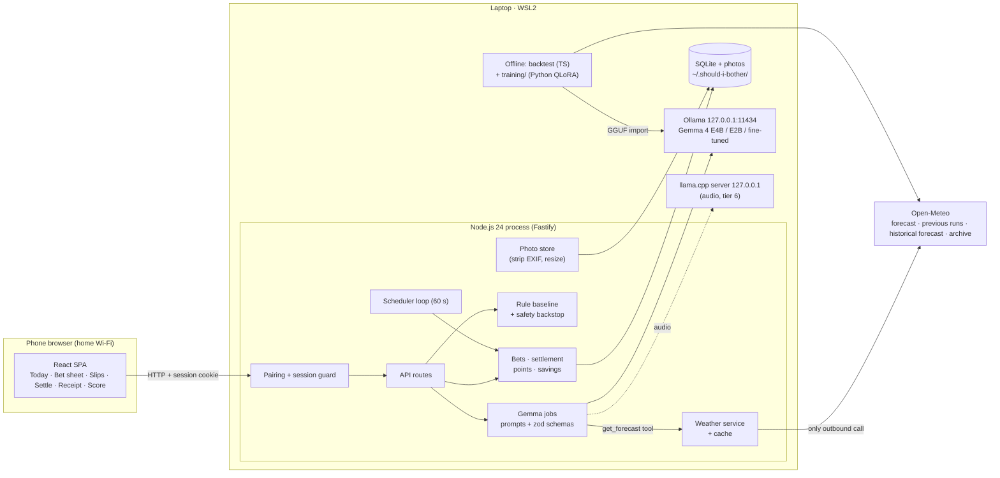

<!--
BUILDER READ-ME (delete this block before publishing; DEV hides HTML comments anyway)

What this file is: the skeleton of the DEV post for the Week 3 challenge (T-029). It is a real draft,
not just headings, but it contains NO results yet. Every number is a {{placeholder}}.

Conventions
- {{name}}                 a number or link filled in on Sat 24 Oct (T-021) from the file named in the
                           comment on the same line.
- src comment             an HTML comment on the same line, "src: file · metric", naming the source file
                           and the exact metric to copy. If the metric is missing from the file, fix the
                           report (T-014 / T-019), do not invent the number.
- {{screenshot: ...}}      a picture to take or pick. It points at a mockup in docs/images/ to use as a
                           stand-in. Final images must be real screenshots of the app with STAGED or
                           synthetic photos. Never a photo of the home. Check every image by hand.
- builder comment         (an HTML comment starting "builder:") prose to rewrite in your own voice, or a decision to take.
- Wording rule: prose must stay true whichever way the numbers come out. Where a sentence only makes
  sense for one outcome, a builder note says so.

Result files (written by T-014 and T-019):
- docs/results/live-week.md   live bets, savings, photo ablation, judge agreement, latency, valid JSON
- docs/results/backtest.md    Gemma E4B / E2B vs rule vs fixed routine; calibration; tool-call miss rate
- docs/results/finetune.md    base vs fine-tuned E4B on the Sep-Oct hold-out; dataset manifest

Before publishing: search this file for "{{" (must find none), "builder:" (must find none), and check
the repo is public, the tags are devchallenge + hf26challenge, and the video link works.
-->

*This is a submission for the Hacktoberfest Open-Source AI Challenge Week 3: Slow and Steady*

<!-- builder: the theme rewards laziness. Open with the joke, then earn it with evidence. A possible first paragraph is below; rewrite it so it sounds like you. -->

I suspect that on a lot of evenings I water the balcony plants right before the sky would have done it for me. I can't tell which evenings, and neither can a weather app. It says "20% rain". It does not say "this basil can wait until Thursday".

So I built a bookmaker. It takes a chore, looks at the forecast and at a photo of the actual plant, and offers me odds that doing nothing will be fine. I can take the bet or do the chore. When the bet is due, it checks the weather that really happened, asks me for an after photo, and pays out points if I was right and takes them if I was wrong. Every bet is settled on evidence, and every loss stays on the record.

## What I Built

**Should I Bother?** ("The Lazy Bookie") is a local app where Gemma 4 turns weather chores into bets on doing nothing. You type a sentence or take a photo. It answers with odds, a one-line reason and a settle time. If you bet and win, a red PAID OUT stamp lands on your slip and the app counts what the sky saved you: minutes, litres of water, kilowatt-hours.

<!-- builder: pick the single best slip image for this spot; the post outline asks for "one slip shown as an image". -->
{{screenshot: a bet slip with odds, Gemma's reason and the payout table}} <!-- src: docs/images/04-place-a-bet.png (mockup stand-in) → real screenshot with a staged photo, T-021 -->

How a chore becomes a bet, in six steps:

1. **Capture.** "Water the plants and dry the laundry." Gemma splits it into one card per chore. Anything without a weather link ("call the bank") is labelled *not a weather chore*.
2. **Safety check.** Heat, frost and storms are never bets. They become a red "Do it now" alert.
3. **Odds.** Gemma reads the forecast through a tool call, looks at the photo if there is one, and picks one of five bands, from *very unlikely* to *very likely*. Code turns the band into fixed odds, so Gemma never invents a percentage.
4. **Decide.** Bet on doing nothing, or tap "I'll do it". Undo is available for five minutes after betting.
5. **Wait.** Open bets sit on the Slips screen with a countdown.
6. **Settle.** At the settle time the app reads the recorded weather and asks for an after photo (full points) or one tap (half points). Gemma gives the verdict and shows its evidence. If I never answer, the bet settles itself after 24 hours at half points, so I can't report only my wins.

What it is not: there is no money, no stake and no gambling. Points only. A win pays (100 − odds) × an evidence multiplier, so a bold bet pays more than a safe one, and a plant that wilts costs three times a normal loss.

The week in one sentence, to be written last:
<!-- builder: write this after the numbers are in; keep it to one honest sentence. If doing nothing lost more often than it won, say so here and lead with that. -->
Over {{live_days}} days I placed {{bets_placed}} bets, settled {{bets}} of them, and doing nothing won {{wins}}. <!-- src: docs/results/live-week.md · live_days = days between first and last bet; bets_placed = all do-nothing bets placed (not undone); bets = settled do-nothing bets; wins = settled do-nothing bets won -->

<!-- builder: the title and the intro say "a week". If the live bets span fewer days than that, change the title to the real length (for example "four days") rather than stretching the truth. -->

## Demo

{{video_url}} <!-- src: docs/spec/tasks.md T-021 · the 60-90 s demo video, uploaded and embedded with DEV's  -->

<!-- builder: storyboard for 60-90 s, from the concept. Keep the stamp for the last five seconds.
1. Say or type one sentence; three cards appear (and one says "not a weather chore").
2. Open a card: odds from the forecast alone, within seconds.
3. Add a photo: the odds move, and the screen says by how much and why ("What Gemma saw").
4. Place the bet. Cut to the Slips screen with a countdown.
5. Settle with an after photo; Gemma's read; PAID OUT stamp; the savings strip updates.
Use staged photos only. No shot may show the home. -->

The tour, as screenshots, in case you don't want to press play:

| Step | Screen |
|---|---|
| Today: one sentence, many cards | {{screenshot: Today screen with the capture bar and quick chips}} <!-- src: docs/images/02-today.png (mockup stand-in) → real screenshot, T-021 --> |
| Voice: Gemma finds the chores in what I said | {{screenshot: voice capture sheet with chores highlighted}} <!-- src: docs/images/03-voice-capture.png (mockup stand-in); show only if voice capture shipped (flag), otherwise delete this row --> |
| Bet sheet: "What Gemma saw", odds before and after the photo | {{screenshot: bet sheet where the photo moved the odds}} <!-- src: docs/images/04-place-a-bet.png (mockup stand-in) → real screenshot with a staged photo, T-021 --> |
| Slips: countdown and settle now | {{screenshot: Slips screen with a waiting bet}} <!-- src: docs/images/05-slips.png (mockup stand-in) → real screenshot, T-021 --> |
| Settle: before and after, recorded weather, Gemma's read | {{screenshot: settle screen with a before and an after photo}} <!-- src: docs/images/06-settle-a-bet.png (mockup stand-in) → real screenshot with staged photos, T-021 --> |
| The payoff: receipt and PAID OUT stamp | {{screenshot: payout receipt with the stamp}} <!-- src: docs/images/07-you-won.png (mockup stand-in) → real screenshot, T-021 --> |

## Code

The code is on GitHub under the MIT licence: https://github.com/adricasi/ShouldIBother <!-- src: docs/spec/product.md · Q-7 repo name; builder: confirm the repo is public (T-020) before publishing -->

Setup in one breath: clone, `npm ci`, install Ollama, `npm run setup` (pulls the pinned Gemma tags and checks their digests), turn on WSL2 mirrored networking and one Windows firewall rule for the phone, `npm start`, scan the QR code. <!-- builder: the steps here must match README.md (T-020). Add one true sentence about the step that bit you during setup, or nothing. -->

What you need: a laptop with an NVIDIA GPU (8 GB of VRAM or more) and enough RAM for Gemma 4 E4B, plus a phone on the same Wi-Fi. My machine: {{gpu_model}} with {{vram_gb}} GB of VRAM. <!-- src: docs/results/backtest.md · run environment (GPU, VRAM). builder: if the report does not list the hardware, add a line to the report first -->

The fine-tuned adapter (public weather data only) is here: {{adapter_url}} <!-- src: docs/spec/product.md · Q-11 Hugging Face repo, published by hand in T-020; delete this sentence if the adapter is not published -->

Licences: repo MIT; Gemma 4 Apache 2.0; fonts (Big Shoulders Display, IBM Plex Mono, Figtree) SIL OFL; icons Lucide (ISC); weather data Open-Meteo, CC BY 4.0 (see the end of this post).

## How I Built It

### The short version

Everything runs on one laptop. A single Node.js process (TypeScript, Fastify) serves a React web app to my phone over home Wi-Fi, keeps everything in SQLite, and talks to **Gemma 4 E4B** through **Ollama** on a laptop GPU. Gemma 4 E2B runs alongside it in the backtest as the smaller comparison. The only request that ever leaves the laptop is the one to the Open-Meteo weather API.

The rule I held myself to: **Gemma decides, code executes.** Gemma makes every judgement. Code fetches the weather, stores bets, counts points and savings, and enforces a safety backstop that Gemma cannot overrule.

### Six jobs, one model

| Job | What Gemma gets | What comes back | What code does with it |
|---|---|---|---|
| **Listener** | A typed sentence (or a voice note, if the audio tier shipped) | One card per chore; non-weather chores flagged | Shows cards; unknown chores become "coming later" |
| **Inspector** | A photo of the plant or the washing | Observations: soil dryness, wilting, cover from rain, dampness, or "unsure" with a question | Shows them as "What Gemma saw" |
| **Bookmaker** | Chore, habits, the inspector's notes, the rule's band, and a `get_forecast` **function call** | An odds band, a reason of at most 140 characters, a settle time | Maps the band to fixed odds, clamps the settle time, locks the bet |
| **Safety guard** | The chore and the forecast | Alert or not, with a reason | Shows a "Do it now" card; a fixed heat / frost / storm backstop applies even if Gemma is off |
| **Judge** | Before and after photos or a tap answer, the recorded weather, the bet | Win, small loss, normal loss, harmful loss, or "unsure" with a question | Computes points; never replaced by a rule |
| **Laundry planner** | A four-day drying forecast and "need it by" | Wash today, skip today, or no good day | Shows the card; only *skip today* is a bet |

<!-- builder: the safety guard and the laundry planner are tier 3 and tier 5 and sit behind flags. If either is off at the freeze (Sat 14:00), mark its row "next" instead of listing it as built. The post must not claim a job that is not in the shipped app. Same for voice: say "typed" unless the Gemma audio path shipped; if whisper.cpp was the fallback, say so here. -->

Two details I'm happy about:

- **Function calling is enforced, not hoped for.** The bookmaker has exactly one tool, `get_forecast`, and it is read-only. If Gemma answers without calling it, the app retries once and then shows the rule's odds, clearly labelled. Those misses are counted. The miss rate is in the results below.
- **Photos can only help.** The first odds come from the forecast alone within seconds. A photo then moves the band up or down. The app stores the band with and without the photo on every bet, which is what makes the photo ablation in The Lazy Payoff possible.

### Bands, not percentages

I didn't trust a 4B model to produce calibrated percentages on its own, and pretending it could would be the dishonest part of this project. So Gemma picks one of five bands and code maps each band to a fixed number:

| Band | Odds that doing nothing works |
|---|---|
| Very likely | 85% |
| Likely | 70% |
| Toss-up | 50% |
| Unlikely | 35% |
| Very unlikely | 15% |

Every bet also stores a **rule baseline**: odds computed by plain code from forecast numbers, with no model involved. For watering it looks at rain in millimetres, the highest hourly rain probability and the day's maximum temperature. For washing on the line it uses a drying index built from wind, humidity, sunshine and rain. For the AC it looks at the night minimum and the wind. The thresholds live in `config/rules.json`, I wrote them once, and I never tuned them, so the rule is an honest baseline and not something I fitted to look bad. If Gemma lands two or more bands away from the rule, it has to explain why or ask me a question.

Gemma's odds are only worth anything if they beat the rule. The results below show whether they do. <!-- builder: this sentence is safe whichever way it goes; keep it. -->

### Schema-validated JSON and an "unsure" path

Every Gemma job has a versioned prompt file and a zod schema. Answers are enums plus short strings; code never acts on free text. If the JSON is invalid, the app retries once with the validation error, then fails clearly. Inspector and judge are allowed to say **unsure**, and then the card asks a yes/no question instead of guessing. User text, photos and tool results are passed to the model as untrusted data in delimiters, and points, settle bounds and safety are computed by code, so "ignore your instructions" in a photo caption cannot move a score.

Does a small model keep that promise? I ran 20 tries per job on the laptop:

| Job | Valid JSON (of 20) | Median latency |
|---|---|---|
| Listener | {{valid_json_listener}} <!-- src: docs/results/live-week.md · valid-JSON count out of 20, listener --> | {{latency_listener}} <!-- src: docs/results/live-week.md · median latency per job, listener --> |
| Inspector | {{valid_json_inspector}} <!-- src: docs/results/live-week.md · valid-JSON count out of 20, inspector --> | {{latency_inspector}} <!-- src: docs/results/live-week.md · median latency per job, inspector --> |
| Bookmaker (photo + forecast) | {{valid_json_bookmaker}} <!-- src: docs/results/live-week.md · valid-JSON count out of 20, bookmaker --> | {{latency_bookmaker}} <!-- src: docs/results/live-week.md · median latency, photo + forecast judgement (target 15 s or less) --> |
| Judge | {{valid_json_judge}} <!-- src: docs/results/live-week.md · valid-JSON count out of 20, judge --> | {{latency_judge}} <!-- src: docs/results/live-week.md · median latency per job, judge --> |

<!-- builder: add a safety guard row only if it shipped. If a job missed the 19-of-20 bar, say so in a sentence and state what the app does about it (the T-001 fallbacks: text-only odds, two-step tool use, or injected forecast). The tool-call miss rate is reported once, in the backtest table. -->

### Architecture

<!-- builder: DEV may not render Mermaid. Publish a preview first; if the diagram does not render, export it to PNG (mermaid.live) and replace the block with the image. Source of truth: docs/spec/design.md, Overview. -->

The phone pairs with the laptop with a one-time token printed as a QR code. Photos are stripped of EXIF data and shrunk before they are stored, and they are served only to paired devices.

### Settling on evidence

Settling a bet takes two inputs: what the weather did, and what actually happened to the plant or the washing.

- **Weather:** Open-Meteo's recent hours for my neighbourhood. I call this *modelled recent weather*, because it is not a station on my balcony.
- **Outcome:** an after photo (full points) or one tap (half points), judged by Gemma against the before photo.

Savings only count on **won** bets. Time only counts when a step is skipped, and every bet costs about 30 seconds of app time that I subtract. The assumptions table is in The Lazy Payoff.

### The backtest: would this have worked in the autumn?

A live week is a small sample. So I also replayed April to October 2026 for my neighbourhood in Barcelona, and I was strict about not letting the model peek:

- Each simulated decision is made at a fixed time of day for that chore, using only the forecast from a weather-model run that **started before that time** (Open-Meteo's Previous Runs API, day-1 lead).
- The outcome is read afterwards from recorded weather, using one small function per chore that asks "would the weather have done the chore?"
- Four strategies play the same days: Gemma 4 E4B, Gemma 4 E2B, the rule baseline, and a **fixed routine** (the habit baseline: water every other day, tumble-dry every load, AC on every warm evening).
- No photos and no household data go into the backtest.
- The headline is the **September to October** hold-out, which the fine-tune never saw. April to August is shown separately and labelled in-sample.

<!-- builder: if Previous Runs lacked a variable and the harness fell back to the Historical Forecast API, the report labels those results "short-lead forecast (optimistic)" (or "perfect-forecast upper bound"). Copy that label next to the numbers; never drop it. -->

### Fine-tuning taught Gemma the local base rates

A general model knows how rain works. It does not know how often a forecast of a few millimetres on a June evening in Gràcia actually leaves a balcony pot moist the next morning. That is a base rate, and base rates are exactly what a small model can learn.

So I fine-tuned the bookmaker:

- **Method:** QLoRA on Gemma 4 E4B, text only, on the same laptop GPU. The merged model is converted to GGUF and imported into Ollama.
- **Data:** public Barcelona weather only, from Open-Meteo. Each training row is the conversation the live bookmaker sees: the prompt, the chore, a synthetic habit profile, the rule's band, and the `get_forecast` call with the forecast as it was known at decision time.
- **Targets:** for every training day, I look at the 30 most similar forecasts for the same chore in the training period, count how often the weather did the chore, and turn that success rate into one of the five bands. Reasons are templated from the forecast numbers (for example "6 mm of rain overnight; pots will be watered"), not written by a model.
- **Split:** April to August for training, September to October as the hold-out. No hold-out day touches any target.
- **No home data:** the habits in every row come from a made-up profile, and the dataset build fails if any value from my real household config appears in a row. The training data and the adapter carry public weather and nothing else.

{{rows_train}} training rows and {{rows_holdout}} hold-out rows, across {{chores_in_dataset}} chores. <!-- src: docs/results/finetune.md · dataset manifest: total rows (training, hold-out) and number of chores; per-chore and per-band counts are in the same manifest -->

**The honest caveat.** The labels come from *recorded weather*, not from observed plants. The fine-tuned model learns "the weather did the chore", which is a proxy for "my basil survived". On a real balcony, plants wilt for reasons the weather record cannot see: the pot, the sun angle, the soil, the species. So the fine-tune improves the bookmaker's *weather base rates* and I report it that way. It says nothing about how much better it would be at keeping a specific plant alive. <!-- builder: keep this paragraph close to as is. It is the honest-limit moment the judges will remember. -->

Some chores have thin data in the training months (the heater in April to August, for example), so every fine-tune table shows its N.

## Why Does Open Innovation Matter?

This app looks at the inside of my home, listens to my voice and learns my habits. That is exactly the data I do not want in somebody else's cloud, and it is the reason this only works with an open model.

- **My photos, voice and habits never leave the laptop.** Gemma runs on `127.0.0.1`. The weather client is allowed to call four Open-Meteo hosts and nothing else, and a CI test refuses any other host. In a full capture-to-settle cycle I checked the network traffic: {{outbound_hosts_seen}}. <!-- src: docs/results/live-week.md · T-020 network capture: hosts contacted during one capture → settle cycle (expected: Open-Meteo only). builder: if the capture shows anything else, say so and fix it before publishing -->
- **It works offline, apart from the forecast.** With Open-Meteo unreachable, the app uses the latest cached forecast and shows its age. With Gemma unreachable, the card shows the rule's odds, labelled, and settlements wait until Gemma is back.
- **It's free to run.** No API key, no subscription, no per-call bill. Open-Meteo's free tier covers it for non-commercial use.
- **The model can be swapped or fine-tuned.** The app talks to Gemma through one small interface, so another model is a config change. And I actually did the second part: the fine-tuned bookmaker learned local base rates from public weather data and can be published without anyone's photos or habits in it.

The honest limits: you need a GPU laptop and some patience with WSL2 networking, and the phone talks to the laptop over plain HTTP on the home network, protected by a pairing token. The README documents a tailnet-private HTTPS option for people who want one. "Private by design" does not mean "easy to install".

## My Agent Session

{{devrelay_session_url}} <!-- src: docs/spec/tasks.md T-021 · the DevRelay session link of the build, shared by the builder -->

I built this spec-first: an idea brief, then a written specification with numbered requirements and testable acceptance criteria, then a task list. Coding agents implemented the tasks one at a time against a recorded fake Gemma, so CI never needed a GPU, while I ran the real model in my own time slots and reviewed and merged their work. <!-- builder: rewrite in your own voice and name the tools you really used. Add one concrete moment from the session (a spec change an agent forced, a bug it caught) if you have one. Do not describe tools you did not use. -->

## The Lazy Payoff

Every figure below comes from a results file in the repo, and every table shows its N. Savings are measured against stated assumptions, not against a vague "typical household". Losses are reported along with wins.

<!-- builder: write the lead sentence last. Follow the evidence: if Gemma beat the rule, say by how much and with what N; if it did not, say that the honest result is the story. -->

### The live week

| Metric | Value |
|---|---|
| Days from first to last bet | {{live_days}} <!-- src: docs/results/live-week.md · days between first and last bet --> |
| Bets placed (do nothing, not undone) | {{bets_placed}} <!-- src: docs/results/live-week.md · bets placed --> |
| Bets settled | {{bets}} <!-- src: docs/results/live-week.md · settled do-nothing bets --> |
| Won | {{wins}} <!-- src: docs/results/live-week.md · settled do-nothing bets won --> |
| Lost (small / normal / harmful) | {{losses_small}} / {{losses_normal}} / {{losses_harmful}} <!-- src: docs/results/live-week.md · losses by severity (small, normal, harmful) --> |
| "Lucky wins" among the wins (the weather did not deliver, doing nothing still worked) | {{lucky_wins}} <!-- src: docs/results/live-week.md · lucky_win count (computed by code from the outcome labels) --> |
| Settled by after photo / by tap / automatically | {{settled_photo}} / {{settled_tap}} / {{settled_auto}} <!-- src: docs/results/live-week.md · settlements by evidence type --> |
| Chore types betted on | {{chore_types}} <!-- src: docs/results/live-week.md · number and names of distinct chore types among settled bets --> |
| Points | {{points_total}} <!-- src: docs/results/live-week.md · total points --> |
| "I'll do it" decisions and cash-outs | {{do_it_count}} <!-- src: docs/results/live-week.md · count of do-it decisions (cash-outs only if the rescue flag shipped) --> |

<!-- builder: the product target is at least 8 settled bets, at least 3 by after photo, and at least 2 chore types. If a target was missed, state the shortfall here in one plain sentence; do not hide it. -->

**What it saved** (wins only, subtracting app time):

| Saving | Total |
|---|---|
| Chores skipped | {{chores_skipped}} <!-- src: docs/results/live-week.md · chores skipped (won do-nothing bets) --> |
| Time saved by skipped steps | {{time_saved}} <!-- src: docs/results/live-week.md · gross time saved on wins --> |
| Minus app time (about 30 s per bet placed) | {{app_time}} <!-- src: docs/results/live-week.md · app time = 30 s × bets placed --> |
| **Net time back** | {{net_time}} <!-- src: docs/results/live-week.md · net time back --> |
| Water | {{water_saved}} <!-- src: docs/results/live-week.md · water saved (litres) --> |
| Electricity | {{kwh_saved}} <!-- src: docs/results/live-week.md · electricity saved (kWh) --> |

{{screenshot: the Score screen with savings tiles and the "How honest is Gemma?" calibration chart}} <!-- src: docs/images/08-score.png (mockup stand-in) → real screenshot of the Score screen after the week, T-021 -->

### What those savings assume

A win saves the steps it skipped, nothing more. I used these per-chore figures, and I mark which come from a source and which are my own typical estimates.

| Chore (won bet) | What doing nothing skipped | Time | Water | Electricity | Where the figure comes from |
|---|---|---|---|---|---|
| Water the balcony pots (5) | Watering by hand | 5 min | 3-5 L | none | **Typical estimate** (minutes and litres are mine) |
| Line-dry today instead of the tumble dryer | The dryer run. I hang the washing either way | 0 min | none | 2-5 kWh | Haier: about 2.2 kWh per 9 kg load for a heat-pump dryer, about 5.3 kWh vented. Which end applies depends on the dryer in my baseline. |
| Leave the laundry out tonight | Bringing it in and finishing it on the rack or in the dryer | about 10 min | none | 1-2 kWh | **Typical estimate** |
| Skip the AC on a cool, breezy night | The AC for an evening | 0 min | none | 2-3 kWh | Costway: 0.4-0.8 kWh per hour for a small split unit. The evening total assumes a few hours of running, which is **my estimate**. |
| Skip the heater on a sunny day | The heater for a day | 0 min | none | 3-4 kWh | **Typical estimate** |

Sources: [Haier, tumble dryer running costs](https://www.haier-europe.com/en_GB/blogs/news/how-much-does-a-tumble-dryer-cost-to-run) · [Costway, split air conditioner consumption](https://www.costway.com/blog/mini-split-air-conditioners/split-air-conditioner-electricity-consumption.html) · catalogue figures: `docs/discovery/product-concept.md`, Chore catalogue.
<!-- builder: only list the rows for chores that really settled in the live week or the backtest; delete the rest. Keep the "typical estimate" label on every figure without a link. -->

My baseline for the electricity figures is {{baseline_dryer_type}} drying and {{baseline_ac_heater}} for cooling and heating. <!-- src: config/household.json · dryer type and whether an AC or heater is used this season (A-6, the builder's own habits). builder: decide whether you are happy to publish this, or describe it generically -->

**Why "hanging laundry saves electricity, not time".** Hanging washing on a line instead of running the dryer saves a few kilowatt-hours and exactly zero minutes: you still have to hang it up. The app counts it as 0 minutes. Time is only counted when a step truly disappears, such as not watering. I'd rather report a smaller honest number than a big one that a reader can pick apart in a comment.

### The backtest

Gemma against the rule and against my old fixed routine, on the same days, deciding only from forecasts available before each decision. **Hold-out: September to October 2026.** <!-- src: docs/results/backtest.md · date range of the hold-out (the snapshot's last archive day is in the manifest) -->

| Strategy | Skips taken | Skips that worked | Plant-risk days | Time saved | Water saved | Electricity saved |
|---|---|---|---|---|---|---|
| Fixed routine | {{bt_fixed_skips}} <!-- src: docs/results/backtest.md · Sep-Oct, fixed routine, skips taken --> | {{bt_fixed_worked}} <!-- src: docs/results/backtest.md · Sep-Oct, fixed routine, skips that worked --> | {{bt_fixed_risk}} <!-- src: docs/results/backtest.md · Sep-Oct, fixed routine, plant-risk days --> | {{bt_fixed_time}} <!-- src: docs/results/backtest.md · Sep-Oct, fixed routine, time saved --> | {{bt_fixed_water}} <!-- src: docs/results/backtest.md · Sep-Oct, fixed routine, water saved --> | {{bt_fixed_kwh}} <!-- src: docs/results/backtest.md · Sep-Oct, fixed routine, kWh saved --> |
| Rule baseline | {{bt_rule_skips}} <!-- src: docs/results/backtest.md · Sep-Oct, rule, skips taken --> | {{bt_rule_worked}} <!-- src: docs/results/backtest.md · Sep-Oct, rule, skips that worked --> | {{bt_rule_risk}} <!-- src: docs/results/backtest.md · Sep-Oct, rule, plant-risk days --> | {{bt_rule_time}} <!-- src: docs/results/backtest.md · Sep-Oct, rule, time saved --> | {{bt_rule_water}} <!-- src: docs/results/backtest.md · Sep-Oct, rule, water saved --> | {{bt_rule_kwh}} <!-- src: docs/results/backtest.md · Sep-Oct, rule, kWh saved --> |
| Gemma 4 E2B | {{bt_e2b_skips}} <!-- src: docs/results/backtest.md · Sep-Oct, E2B, skips taken --> | {{bt_e2b_worked}} <!-- src: docs/results/backtest.md · Sep-Oct, E2B, skips that worked --> | {{bt_e2b_risk}} <!-- src: docs/results/backtest.md · Sep-Oct, E2B, plant-risk days --> | {{bt_e2b_time}} <!-- src: docs/results/backtest.md · Sep-Oct, E2B, time saved --> | {{bt_e2b_water}} <!-- src: docs/results/backtest.md · Sep-Oct, E2B, water saved --> | {{bt_e2b_kwh}} <!-- src: docs/results/backtest.md · Sep-Oct, E2B, kWh saved --> |
| Gemma 4 E4B | {{bt_e4b_skips}} <!-- src: docs/results/backtest.md · Sep-Oct, E4B base, skips taken --> | {{bt_e4b_worked}} <!-- src: docs/results/backtest.md · Sep-Oct, E4B base, skips that worked --> | {{bt_e4b_risk}} <!-- src: docs/results/backtest.md · Sep-Oct, E4B base, plant-risk days --> | {{bt_e4b_time}} <!-- src: docs/results/backtest.md · Sep-Oct, E4B base, time saved --> | {{bt_e4b_water}} <!-- src: docs/results/backtest.md · Sep-Oct, E4B base, water saved --> | {{bt_e4b_kwh}} <!-- src: docs/results/backtest.md · Sep-Oct, E4B base, kWh saved --> |

Simulated days per strategy: {{bt_days}}; decisions per strategy: {{bt_decisions}}. <!-- src: docs/results/backtest.md · Sep-Oct, number of simulated days and number of decisions (N) -->

The number that matters most is the *plant-risk days* column: a strategy that skips everything saves a lot and kills the basil. {{bt_headline_sentence}} <!-- src: docs/results/backtest.md · the one-sentence comparison of E4B vs rule vs fixed routine on plant-risk days and skips that worked. builder: write it from the table, honest about ties and losses -->

**Calibration: when Gemma said "likely", how often was it?**

| Band (odds) | Gemma E4B: N | Gemma E4B: doing nothing worked | Rule: N | Rule: doing nothing worked |
|---|---|---|---|---|
| Very likely (85%) | {{cal_bt_gemma_n_vl}} <!-- src: docs/results/backtest.md · Sep-Oct calibration, E4B base, very likely, N --> | {{cal_bt_gemma_rate_vl}} <!-- src: docs/results/backtest.md · Sep-Oct calibration, E4B base, very likely, share worked --> | {{cal_bt_rule_n_vl}} <!-- src: docs/results/backtest.md · Sep-Oct calibration, rule, very likely, N --> | {{cal_bt_rule_rate_vl}} <!-- src: docs/results/backtest.md · Sep-Oct calibration, rule, very likely, share worked --> |
| Likely (70%) | {{cal_bt_gemma_n_l}} <!-- src: docs/results/backtest.md · Sep-Oct calibration, E4B base, likely, N --> | {{cal_bt_gemma_rate_l}} <!-- src: docs/results/backtest.md · Sep-Oct calibration, E4B base, likely, share worked --> | {{cal_bt_rule_n_l}} <!-- src: docs/results/backtest.md · Sep-Oct calibration, rule, likely, N --> | {{cal_bt_rule_rate_l}} <!-- src: docs/results/backtest.md · Sep-Oct calibration, rule, likely, share worked --> |
| Toss-up (50%) | {{cal_bt_gemma_n_t}} <!-- src: docs/results/backtest.md · Sep-Oct calibration, E4B base, toss-up, N --> | {{cal_bt_gemma_rate_t}} <!-- src: docs/results/backtest.md · Sep-Oct calibration, E4B base, toss-up, share worked --> | {{cal_bt_rule_n_t}} <!-- src: docs/results/backtest.md · Sep-Oct calibration, rule, toss-up, N --> | {{cal_bt_rule_rate_t}} <!-- src: docs/results/backtest.md · Sep-Oct calibration, rule, toss-up, share worked --> |
| Unlikely (35%) | {{cal_bt_gemma_n_u}} <!-- src: docs/results/backtest.md · Sep-Oct calibration, E4B base, unlikely, N --> | {{cal_bt_gemma_rate_u}} <!-- src: docs/results/backtest.md · Sep-Oct calibration, E4B base, unlikely, share worked --> | {{cal_bt_rule_n_u}} <!-- src: docs/results/backtest.md · Sep-Oct calibration, rule, unlikely, N --> | {{cal_bt_rule_rate_u}} <!-- src: docs/results/backtest.md · Sep-Oct calibration, rule, unlikely, share worked --> |
| Very unlikely (15%) | {{cal_bt_gemma_n_vu}} <!-- src: docs/results/backtest.md · Sep-Oct calibration, E4B base, very unlikely, N --> | {{cal_bt_gemma_rate_vu}} <!-- src: docs/results/backtest.md · Sep-Oct calibration, E4B base, very unlikely, share worked --> | {{cal_bt_rule_n_vu}} <!-- src: docs/results/backtest.md · Sep-Oct calibration, rule, very unlikely, N --> | {{cal_bt_rule_rate_vu}} <!-- src: docs/results/backtest.md · Sep-Oct calibration, rule, very unlikely, share worked --> |

Brier score, E4B base vs rule: {{bt_brier_e4b}} vs {{bt_brier_rule}} (lower is better). <!-- src: docs/results/backtest.md · Sep-Oct Brier score for E4B base and for the rule --> Tool-call miss rate (answers that came without a `get_forecast` call): {{bt_tool_miss_e4b}} for E4B and {{bt_tool_miss_e2b}} for E2B. <!-- src: docs/results/backtest.md · tool-call miss rate, E4B base and E2B -->

**E2B vs E4B.** The smaller model against the bigger one: {{bt_e2b_vs_e4b_sentence}} <!-- src: docs/results/backtest.md · E2B vs E4B comparison on the rows above (skips that worked, plant-risk days, Brier). builder: one honest sentence, including "no real difference" if that is the result -->

Bands with fewer than 5 cases are marked "too few to judge" in the app and should be treated the same way here. The fixed routine has no odds, so it has no calibration.

<!-- builder: the April-August (in-sample) numbers are in docs/results/backtest.md too. Show them only as a short sentence or a second table, always labelled "in-sample" for the rule thresholds and the fine-tune. The headline stays on September to October. -->

### Fine-tuning: base vs fine-tuned

Same hold-out, same prompt, same band-to-odds mapping. Only the weights differ. These weather labels are a proxy for plant health (see the caveat above).

| Band (odds) | Base E4B: N | Base E4B: worked | Fine-tuned: N | Fine-tuned: worked |
|---|---|---|---|---|
| Very likely (85%) | {{ft_base_n_vl}} <!-- src: docs/results/finetune.md · hold-out calibration, base E4B, very likely, N --> | {{ft_base_rate_vl}} <!-- src: docs/results/finetune.md · hold-out calibration, base E4B, very likely, share worked --> | {{ft_tuned_n_vl}} <!-- src: docs/results/finetune.md · hold-out calibration, fine-tuned, very likely, N --> | {{ft_tuned_rate_vl}} <!-- src: docs/results/finetune.md · hold-out calibration, fine-tuned, very likely, share worked --> |
| Likely (70%) | {{ft_base_n_l}} <!-- src: docs/results/finetune.md · hold-out calibration, base E4B, likely, N --> | {{ft_base_rate_l}} <!-- src: docs/results/finetune.md · hold-out calibration, base E4B, likely, share worked --> | {{ft_tuned_n_l}} <!-- src: docs/results/finetune.md · hold-out calibration, fine-tuned, likely, N --> | {{ft_tuned_rate_l}} <!-- src: docs/results/finetune.md · hold-out calibration, fine-tuned, likely, share worked --> |
| Toss-up (50%) | {{ft_base_n_t}} <!-- src: docs/results/finetune.md · hold-out calibration, base E4B, toss-up, N --> | {{ft_base_rate_t}} <!-- src: docs/results/finetune.md · hold-out calibration, base E4B, toss-up, share worked --> | {{ft_tuned_n_t}} <!-- src: docs/results/finetune.md · hold-out calibration, fine-tuned, toss-up, N --> | {{ft_tuned_rate_t}} <!-- src: docs/results/finetune.md · hold-out calibration, fine-tuned, toss-up, share worked --> |
| Unlikely (35%) | {{ft_base_n_u}} <!-- src: docs/results/finetune.md · hold-out calibration, base E4B, unlikely, N --> | {{ft_base_rate_u}} <!-- src: docs/results/finetune.md · hold-out calibration, base E4B, unlikely, share worked --> | {{ft_tuned_n_u}} <!-- src: docs/results/finetune.md · hold-out calibration, fine-tuned, unlikely, N --> | {{ft_tuned_rate_u}} <!-- src: docs/results/finetune.md · hold-out calibration, fine-tuned, unlikely, share worked --> |
| Very unlikely (15%) | {{ft_base_n_vu}} <!-- src: docs/results/finetune.md · hold-out calibration, base E4B, very unlikely, N --> | {{ft_base_rate_vu}} <!-- src: docs/results/finetune.md · hold-out calibration, base E4B, very unlikely, share worked --> | {{ft_tuned_n_vu}} <!-- src: docs/results/finetune.md · hold-out calibration, fine-tuned, very unlikely, N --> | {{ft_tuned_rate_vu}} <!-- src: docs/results/finetune.md · hold-out calibration, fine-tuned, very unlikely, share worked --> |

| | Base E4B | Fine-tuned |
|---|---|---|
| Brier score on the hold-out (lower is better) | {{ft_brier_base}} <!-- src: docs/results/finetune.md · Brier score, base E4B --> | {{ft_brier_tuned}} <!-- src: docs/results/finetune.md · Brier score, fine-tuned --> |
| Tool-call miss rate | {{ft_miss_base}} <!-- src: docs/results/finetune.md · tool-call miss rate, base E4B --> | {{ft_miss_tuned}} <!-- src: docs/results/finetune.md · tool-call miss rate, fine-tuned --> |
| Hold-out decisions (N) | {{ft_n_base}} <!-- src: docs/results/finetune.md · hold-out decisions evaluated, base E4B --> | {{ft_n_tuned}} <!-- src: docs/results/finetune.md · hold-out decisions evaluated, fine-tuned --> |

{{ft_verdict_sentence}} <!-- src: docs/results/finetune.md · the decision on whether the fine-tuned bookmaker is on in the live app (finetunedBookmaker flag). builder: state it plainly. The product spec commits to reporting the result whether or not it improves -->

<!-- builder: if the fine-tune did not improve calibration, keep this section and say so: "fine-tuning taught Gemma the local base rates" becomes "...and here is how much (or how little) that helped". If training did not finish, replace this section with one honest paragraph and delete the "Fine-tuning" subsection in How I Built It or label it "tried, did not finish". -->

### Does the photo help?

Every bet that had a photo stores the odds band with the photo and without it, so the same bet can be compared with and without what Gemma saw.

| What the photo did to the band | Bets (N) | Doing nothing worked |
|---|---|---|
| Raised it | {{photo_raised_n}} <!-- src: docs/results/live-week.md · photo ablation, bets where the band with the photo was higher than without, N --> | {{photo_raised_worked}} <!-- src: docs/results/live-week.md · photo ablation, share worked, band raised --> |
| Lowered it | {{photo_lowered_n}} <!-- src: docs/results/live-week.md · photo ablation, bets where the band with the photo was lower than without, N --> | {{photo_lowered_worked}} <!-- src: docs/results/live-week.md · photo ablation, share worked, band lowered --> |
| Left it unchanged | {{photo_same_n}} <!-- src: docs/results/live-week.md · photo ablation, bets where the band did not change, N --> | {{photo_same_worked}} <!-- src: docs/results/live-week.md · photo ablation, share worked, band unchanged --> |

{{photo_sentence}} <!-- src: docs/results/live-week.md · photo ablation summary. builder: one honest sentence. With a handful of bets this is an anecdote, not a finding; say N and say that -->

### How often did I overrule the judge?

| | |
|---|---|
| Verdicts given by Gemma | {{judge_verdicts}} <!-- src: docs/results/live-week.md · settled bets with a Gemma verdict (N) --> |
| Verdicts I appealed | {{judge_appeals}} <!-- src: docs/results/live-week.md · appeals filed --> |
| Appeals where the second verdict differed | {{judge_overruled}} <!-- src: docs/results/live-week.md · judge overrule rate numerator, with N above --> |
| Verdicts that came back "unsure" and asked me a question | {{judge_unsure}} <!-- src: docs/results/live-week.md · judge verdicts with status unsure --> |

<!-- builder: appeals are a Could feature (REQ-023, flag `appeals`). If it did not ship, delete the second and third rows and write "appeals off: I could not overrule the judge, so agreement is untested" instead. Never imply the judge was checked if it was not. -->

### The bet Gemma got wrong

<!-- builder: this is the section readers will remember. Pick the loss that taught you the most (the live-week report lists every loss) and tell it as a short story in your voice. Do not tidy it up. If Gemma lost nothing in the live week, say that, show the closest call, and use the worst backtest miss instead. -->

- **The chore and the slip:** {{wrong_bet_chore}} <!-- src: docs/results/live-week.md · losses list, the loss chosen for the story (chore, slip number, odds) -->
- **What Gemma said:** {{wrong_bet_gemma_read}} <!-- src: docs/results/live-week.md · losses list, the chosen loss: the band and Gemma's one-line reason, copied word for word from the decision log (sib export) -->
- **What the weather and the plant did:** {{wrong_bet_what_happened}} <!-- src: docs/results/live-week.md · losses list, the chosen loss: recorded weather, after-photo verdict and points lost -->
- **Why I think it was wrong:** {{wrong_bet_diagnosis}} <!-- builder: your explanation, e.g. the photo misread, a forecast that changed, a plant type the model did not know. Mark guesses as guesses -->
- **What I changed, if anything:** {{wrong_bet_fix}} <!-- src: docs/results/live-week.md · prompt version or rule change made afterwards, if any. If nothing changed, say so: the thresholds and the live prompt are frozen by design -->

{{screenshot: the losing slip, with its negative points}} <!-- src: real screenshot of the chosen slip from the app (T-021); mockup stand-in docs/images/05-slips.png (settled list) -->

### What these numbers do not show

- **One household, one city.** Everything is my balcony in Gràcia, Barcelona. N is small, and I show it everywhere so you can decide how much to trust it.
- **Modelled weather, not a station.** Both the live settlements and the backtest use Open-Meteo's modelled data for my neighbourhood.
- **Labels are weather, not plants.** The backtest and the fine-tune ask "did the weather do the chore?". Only the live bets look at a real plant, and there are few of them.
- **Savings are estimates with stated assumptions.** Every figure in the assumptions table is either linked to a source or marked as a typical estimate.
- **The fixed routine is a habit baseline written down as a rule.** It is a stand-in for "what I did before", not for what everyone does.

## Prize Categories

- **Best Use of Gemma.** Gemma 4 E4B makes every judgement in the app, not just one feature: text (the listener), images (the inspector and the judge), function calling (the bookmaker's `get_forecast`), and schema-validated JSON with an "unsure" path. It runs locally through Ollama, and I fine-tuned it with QLoRA on public weather data and evaluated base against fine-tuned on a hold-out. <!-- builder: add "audio" only if Gemma 4 audio shipped; if whisper.cpp was the fallback, say that instead and drop the audio claim. Mention E2B as the comparison model only because it appears in the backtest. -->
- **Overall.** The submission is in the Overall pool by default; the case for it is the measured, honest result: a bet-and-settle loop on real evidence, with losses reported.

<!-- builder: the other featured categories are listed on https://dev.to/challenges/hf26. Add one only if this project genuinely uses that partner's tool (for example, if a category covers Hugging Face and you publish the adapter there, decide whether that counts). Do not claim a category just to enter it. -->

---

**Credits and licences.** Weather data by [Open-Meteo.com](https://open-meteo.com/), licensed under [CC BY 4.0](https://creativecommons.org/licenses/by/4.0/); Open-Meteo's free tier is for non-commercial use, and this project is non-commercial. Code: MIT. Model: Gemma 4, Apache 2.0. Fonts: Big Shoulders Display, IBM Plex Mono and Figtree, SIL Open Font License. Icons: Lucide, ISC. All photos in this post are staged or synthetic; none are of my home.
<!-- builder: check Open-Meteo's attribution wording at https://open-meteo.com/en/licence and use their exact text. The same attribution must be in the app and README (AC-014.6, T-020). -->
